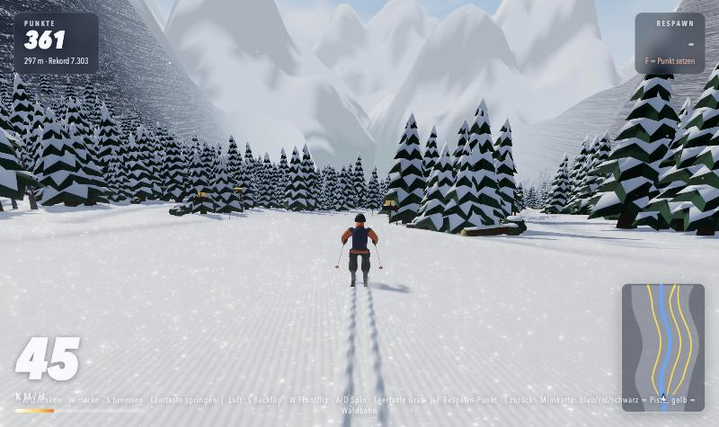
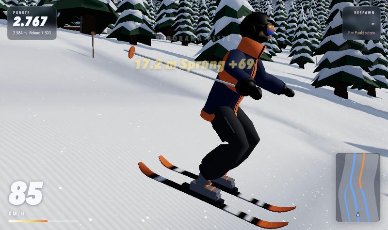

# Piste-Generator – Testbericht

Stand: 11. November 2026 (vierte Runde: Zäune am Hang, Stufen an Zonenwechseln, Abseits-Test, neue Felsen). Getestet auf einem Mac mit Apple M4 im Browser (Vite-Entwicklungsserver) und headless in Node.

## 1. Was gebaut wurde

| Baustein | Datei | Aufgabe |
|---|---|---|
| Routenplanung | `src/piste.js` (`pickType`, `makeZone`) | Zonen-Grammatik: Start, Panorama-Piste, Waldbahn, Pulverhang, Ski-Cross-Park, Big Air, Steilhang, Rinne, Klippenband, Auslauf. Keine Wiederholung hintereinander; nach zwei sanften Zonen erzwingt der Generator eine steile; nach harten Zonen folgt eine Verschnaufpause. |
| Mittellinie | `piste.js` (`hubX`) | Aus einem Kurswinkel integriert (Sweeper, Esses, enge Rinnen-Kurven), mit Rückstellkraft. Kurvenradius ≥ 42 m. |
| Spuren | `piste.js` (`props`, `linkLanes`) | **Bis zu fünf Spuren** pro Hang (A bis E): präpariert, Waldbahn, Rinne, Sprunglinie. Neue Spuren **wachsen aus einer Nachbarspur heraus**, endende laufen in sie hinein. Rinne und Auslauf führen alle Spuren wieder zusammen. |
| Höhenprofil | `piste.js` (`Hof`, `heightP`) | Gefälle je Zone, Steilstufen mit Absatz, Querneigung, Hügel. **Breite, flache Täler (bis ± 190 m)**, Talränder steigen nur sanft an. |
| Sprung-Geometrie | `src/jumps.js` | Absprung, Tisch, Landefläche und Klippen-Abbruch werden **aus der Flugbahn** berechnet (äquivalente Fallhöhe, Übergangsradius). |
| Features | `piste.js` | Kicker, Tisch, Step-up, Step-down, Spine, Big Air, Rollen, Steilkurven, Pulverkissen, Mogulfelder, Engstellen, Klippenband mit mehreren Rampen. |
| Ausstattung | `src/course.js` (`genChunk`) + `tools/blender_props.py` | 14 neue Blender-Modelle, platziert nach Zone, Abzweigung und Feature. |
| Validierung | `piste.js` + `tools/piste_validate.mjs` | Statische Prüfung beim Erzeugen und ein Bot mit der echten Spielphysik. |

## 2. Testmethode

1. **Statische Regeln:** Ein Sprung wird verworfen, wenn die berechnete Landung zu hart ist (über ca. 6,7 m/s bei Auslegungstempo). Spuren, die nicht ins Tal passen, entfallen. Kurven mit zu kleinem Radius werden entschärft.
2. **Bot-Fahrten (headless):** `node tools/piste_validate.mjs 20 3800` lässt einen Bot **20 Seeds × 3 Fahrweisen** je 3800 m fahren (aufrecht Spur A, Hocke Spur A, Hocke Spur B), mit der echten Physik (120 Hz).
3. **Sichtprüfung im Browser:** Routenkarten, Sprung-Seitenansichten mit echten Flugbahnen, Spielansichten.

## 3. Ergebnisse

### Bot-Fahrten (60 Läufe, 228 km, 781 Landungen; Stand vierte Runde)

| Kennzahl | Wert |
|---|---:|
| Läufe ohne Hängenbleiben | 60 von 60 |
| Stürze | **0** |
| Landungen mit Aufprall über 15 m/s | 22 (2,8 %) |
| Höchstes Tempo | 138 km/h |
| Ø Zeit für 3800 m | aufrecht 198 s, Hocke 159–167 s |

| Feature | Landungen | Ø Aufprall (m/s) | max. Aufprall | längste Flugzeit (s) | weitester Flug (m) |
|---|---:|---:|---:|---:|---:|
| Big Air | 37 | 10,3 | 18,9 | 4,54 | 92,4 |
| Kicker (Seitenlinie) | 95 | 6,8 | 15,2 | 3,02 | 77,5 |
| Kicker | 22 | 6,7 | 14,4 | 2,93 | 75,4 |
| Step-up | 9 | 7,4 | 11,9 | 2,07 | 48,6 |
| Tischsprung | 34 | 6,1 | 10,1 | 1,84 | 45,7 |
| Waldkicker | 4 | 8,3 | 13,3 | 1,76 | 47,7 |
| Klippe | 80 | 6,3 | 16,4 | 2,27 | 47,1 |
| Natürliches Gelände (Kanten, Kissen) | 500 | 5,8 | 22,1 | – | – |

**Wirkung der Glättung:** Ungewollte Mini-Flüge im natürlichen Gelände sanken von 3.158 (zweite Runde) auf 500 Landungen (−84 %) bei gleicher Strecke. Weiterhin **0 Stürze** und **0 Läufe mit Hängenbleiben**. Die harten Aufpralle im Gelände (bis 22,1 m/s, Absturzgrenze 23) stammen fast alle vom Ausgang der Rinne: Der Bot fliegt dort mit 100+ km/h in der engen, kurvigen Rinne aus der Spur an die Wand und landet hart. Das ist ein Fehler des Bots, kein Höhenfehler der Spur (siehe 4c).

Auslegungswert der Landeflächen: **4,2 m/s**. Das Spiel lässt erst ab **23 m/s** stürzen. Rohdaten: `docs/validation_results.json`.

Die Bot-Fahrten laufen ohne Bäume und Zäune (siehe Grenzen). Zum Vergleich: In der **ersten Runde** (schmaler Berg) gab es in 60 Läufen **einen** Sturz.

### Zonen-Mischung (12 Seeds, je 5000 m)

- Durchschnittliche Zonenlänge: **ca. 350 m** (vorher 450–650 m).
- Rund **26 %** der Strecke sind steil (≥ 33 %), rund **28 %** flach (< 22 %), der Rest mittel. Flache Anteile stecken vor allem im Ski-Cross-Park (bewusst 15–20 % Gefälle) und im Auslauf.
- Ø **2,2 bis 2,7 aktive Spuren** pro Zone.

### Routenkarten (Draufsicht, 0 bis 4000 m, ± 190 m breit, 8 Seeds)


Man sieht mehrere Pisten nebeneinander, Abzweigungen, Schleifen aus roten und schwarzen Spuren, die sich wieder treffen, gelbe Waldbahnen, orange Sprunglinien und Klippenbänder (rot gestrichelt). Der Berg ist so breit wie die graue Fläche, nicht mehr nur ein Streifen.

### Sprünge im Querschnitt (Gelände und echte Flugbahnen)


Alle sechs Beispiele ohne Sturz, Aufprall 2,6 bis 16,7 m/s (der höchste Wert ist das Big Air in Hocke, siehe Grenzen).

### Spielansichten

| | |
|---|---|
|  Abzweigung: Wegweiser rechts, Trail-Tor links |  Waldzone mit mehreren Bahnen |
|  Tiefschnee: Fahrer sinkt ein, tiefe Spur |  Klippenband mit Rampen links und rechts |
|  Hocke: Stöcke laufen am Körper vorbei |  Sturz: Schneewolke und sichtbare Figur |

Aus der ersten Runde: [Panorama](docs/img/game_panorama_cruise.jpg), [Rinne](docs/img/game_couloir.jpg), [Big Air](docs/img/game_bigair_backflip.jpg), [Grafik niedrig](docs/img/game_quality_low.jpg).

## 4. Änderungen dieser Runde und was dabei gefunden wurde

- **Stöcke durch den Körper:** In der Hocke lagen die Hände vor der Brustmitte, die Stöcke gingen nach hinten durch den Rumpf. Die Hände sitzen jetzt außen neben dem Oberkörper, die Stöcke zeigen nach hinten und leicht nach außen.
- **Sturz ohne Schnee:** Die Wolken wurden zu stark ausgedünnt, die Figur wirkte schwebend. Jetzt stieben Spritzer vom Boden bis Körperhöhe, dazu Wolken und eine Schneefahne. Der **Fahrer wird nach den Schneepartikeln gezeichnet** (Tiefentest bleibt), so verdeckt der Schnee ihn nie. Die Überschläge hüpfen niedriger.
- **Zu schmaler Berg:** Täler mit 115 bis 190 m halber Breite statt 50 bis 80 m; fünf Spuren; Talränder fast flach; der Weltrand steigt erst weit außen an. Wald wächst in Inseln und Lichtungen, nicht mehr als Wand.
- **Abzweigungen:** Neue Spuren wachsen aus einer Nachbarspur heraus (Übergangsfenster 140 m). Ein Wegweiser mit Pfeilfarbe (Schwierigkeit) steht am Beginn, Waldbahnen bekommen ein Trail-Tor.
- **Abwechslung:** neue Zone „Steilhang“, kürzere Zonen, Steilstufen mit Absatz, nach zwei sanften Zonen zwingend eine steile.
- **Tiefschnee:** Pulverfahne an den Kurven (stärker bei hoher Querbeschleunigung), tieferes Einsinken in Kurven, weiches Rauschen als Ton.
- **Fehler beim Testen:** Die Abzweigungs-Erkennung verglich zweimal dasselbe zwischengespeicherte Objekt (0 Abzweigungen gefunden), korrigiert. Die Klippenhöhe schwankte mit der Wandhöhe, wodurch am Ende des Bandes eine 2,7-m-Stufe entstand, korrigiert.

## 4b. Dritte Runde: Rückmeldung „Wälder, kleine Hügel, Tiefschnee, alles fahrbar“

- **Zäune in Wäldern und an Waldbahnen:** Holzzäune (Blender-Modell `SnowFence`) im Abstand von 4,2 m an beiden Rändern jeder Waldbahn und Lichtung, mit Kollisionskörper (`zaun`): man prallt ab und rutscht entlang, statt durchzufahren. Zäune fehlen bewusst an Abzweigungen und Einfahrten. Per Screenshot geprüft.
- **Kleine Hügel:** Rauschen, Kissen und Mogulfelder in der Höhe deutlich flacher, die Abhebe-Schwelle am Boden höher (`vn > 1.5 + 0.012·v`). Dadurch weniger ungewollte Flüge (siehe oben).
- **Landung ohne Tempo:** Hinter jedem Sprung liegt mehr Auslauf (Absprung-Reichweite + 10 m + 14 m) und der Abstand von Sprung zu Sprung wurde auf 8 bis 18 m (Sprungketten) bzw. 26 bis 44 m angepasst. Verbleibende Schwäche: In Sprungketten kommt man mit etwas weniger Tempo an.
- **Verzeihendere Kollisionen:** Zäune, weiche Hindernisse und Streifkontakte bremsen nur; ein Sturz folgt erst bei frontalem Aufprall mit mehr als 9,5 m/s Annäherung.
- **Echtes Einsinken im Tiefschnee:** Neue Pulverschicht (`src/powder.js`, 18 m × 18 m um den Fahrer, bis 30 cm dick, nur im Endlosmodus und ab Pulveranteil 0,18). Skier und Körper schneiden eine Rinne in die Schicht, daneben bleibt ein Schneewall; der Fahrer steht in der Spur, sein Körper wird nicht mehr in den Boden gezogen. Das Einsinken des Modells wurde dafür von 0,8 auf 0,12 reduziert. Eine anfangs sichtbare Patch-Kante in präpariertem Schnee wurde durch die höhere Schwelle behoben. Messung im Browser: ca. 0,4 ms pro Schritt inklusive Physik bei vollem Pulver (M4).

## 4c. Vierte Runde: Zäune am Hang, Bump an Zonenwechseln, Abseits der Piste, Felsen

- **Zäune:** Jedes Zaunfeld folgt jetzt dem Hang (Pfosten senkrecht, Bahn und Oberkante laufen parallel zum Boden; im Code eine Scherung der Instanzmatrix, `src/world.js`, Steigung aus der Geländehöhe an den Feldenden, `src/course.js`). Vorher standen sie waagerecht. Im Browser geprüft.
- **Bump an Zonenwechseln (Ursache gefunden):** `tools/terrain_scan.mjs` misst Gefälleänderungen entlang aller Spuren alle 0,5 m. Zwei harte Ursachen: (1) Die Waldbahn-Rinne (30 cm tief) schaltete beim Wechsel der Spurart schlagartig ein oder aus. (2) Die Querneigung wählte hart die „stärkste Spur“, die beim Spurwechsel sprang. Beides ist jetzt stetig (gewichteter Mittelwert, stetiger Waldbahn-Anteil). **Auffällige Knicke über 6 Seeds: 133 → 9** (Schwelle: Gefälleänderung über 0,16 auf 0,5 m).
- **Abseits der Piste:** `node tools/piste_validate.mjs 12 3800 off` fährt feste Linien abseits der Spuren und einen Quer-Slalom über das ganze Tal, ohne Bäume: **0 Stürze**. Dabei zeigte sich, dass man in tiefem Pulver auf sanften Hängen stehen blieb. Reibung im Pulver deshalb gesenkt (Gleitreibung 0,10 → 0,072, Zusatzbremse 0,5 + 0,04·v → 0,26 + 0,03·v), und der Boden hält Kanten besser fest (Abhebe-Schwelle steigt mit Pulver und Gelände neben der Piste).
- **Felsen:** Sechs neue Blender-Felsen (`tools/blender_rocks.py`): kantige Granitblöcke mit Schnittflächen, Schichtung, Flechten, Schnee nur auf flachen Flächen und Verschattung am Fuß; dazu hohe Platte, runder Findling und Blockgruppe. Je ca. 490 bis 730 Dreiecke (auf 38 % reduziert). Messung im Browser (Seed 15, Klippenzone, Chrome im Claude-Fenster): Felsen kosten zusammen etwa 0,5 Mio. von rund 7,1 Mio. Dreiecken pro Bild (inklusive Schattenpass). Die Felswände der Berge selbst nutzen weiter den Schnee-Shader mit Schichtung; dort habe ich nichts geändert.

## 4d. Fünfte Runde: Anlauf, Felsen-Kollision, Netzzaun, Berge

- **Anlauf vor Sprüngen:** 90 m vor jedem Absprung ist das Gelände glatt: kein Geländerauschen, keine Rollen, Kissen, Moguls oder Steilkurven, die Seitenform schwenkt nicht mit der Mittellinie mit. Gemessen: mittlere Abweichung von der Geraden über 80 m Anlauf von 0,25 m auf 0,09 m (46 Sprünge, 6 Seeds). Der Rest ist das sanfte Gefälle des Berges selbst; bei Sprungketten kann die Landung des Vorgängers im Anlauf liegen.
- **Felsen:** Sturz schon ab 2,2 m/s Aufprall (Bäume 5,5, sonst 7). Felsen am Klippenband haben jetzt auch Kollisionskörper, Radius 1,3 × Größe.
- **Zaun:** Orangefarbenes Fangnetz an dünnen Stangen statt Holzbrettern; jedes Feld leicht versetzt, schief, in Größe und Helligkeit unterschiedlich.
- **Zaun, Nachbesserung:** Jedes Feld wird jetzt exakt von Endpunkt zu Endpunkt gesetzt (Länge, Richtung, Hangneigung aus den Enden). Gemessen über 2.329 Felder: Median-Abstand der Enden 0,05 m (leichte Überlappung statt Lücke). Kollision: drei kleine Körper pro Feld statt eines 2-m-Kreises; kein Abstoßen mehr. Sturz, wenn man mit mehr als 2,2 m/s quer zur Zaunlinie hineinfährt; flaches Entlangstreifen bleibt ohne Sturz (headless getestet).
- **Strohballen entfernt**, an Steilkurven steht stattdessen ein kurzes Netz. **Waldbahn-Tor neu:** Rundholz-Pfosten, Querbalken mit Schnee, Holzschild mit Tannen-Symbol (vorher Schild mit Strich-Platzhaltern).
- **Berge im Hintergrund:** feinere Gitter, Grate, geschichteter Fels mit Schnee in Rinnen statt grauer Flächen. Nur per Screenshot beurteilt.

## 4e. Sechste Runde: Buckel, Erkennbarkeit, Abzweigungen, Engstellen

- **Buckel:** Wellenbahnen (Roller) jetzt 17 bis 21 m lang und höchstens 0,7 m hoch (vorher 9 bis 12 m und bis 1,3 m), Buckelfelder halb so hoch und gestreckter. Bot-Test: Landungen im natürlichen Gelände 500 → 359, 0 Stürze, 0 Hängenbleiben.
- **Pisten erkennen:** Präparierte Fläche etwas kühler und matter, am Rand ein weicher dunklerer Saum; Markierungsstangen alle 22 m statt 34 m.
- **Zufahrt zu Abzweigungen:** Neue Spuren sind nach einem Drittel des Übergangs voll breit (liegen dort noch auf der Elternpiste) und ziehen dann seitlich weg; vorher wuchsen sie als schmaler Streifen heraus. Endende Spuren bleiben bis kurz vor dem Zusammenfluss breit. An jeder Einfahrt stehen acht Paar farbige Leitstangen.
- **Engstellen:** Die Felsnasen in Rinnen bestehen jetzt aus zwei Reihen Felsbrocken auf einem flachen Sockel (vorher ein glatter Hügel mit zufälligen Steinen). Alle Felsen sitzen auf dem tiefsten Bodenpunkt unter ihrer Grundfläche und schweben nirgends. Im Browser angesehen.

## 4f. Mehr Abwechslung (Berg-Charakter und Zonen-Variationen)

- **Berg-Charakter pro Startwert:** eigene Gewichte für Zonentypen sowie Grundzüge (Talbreite, Steilheit, Wald, Pulver, Kurvigkeit, Häufigkeit von Geländeformen). Jeder Berg fühlt sich anders an.
- **Jede Zone wird abgewandelt:** Länge ×0,75–1,3, Kurvenstil (gerade, enge S-Kurven, weite Bögen), Spuren (Breite, Lage, zusätzliche oder wegfallende Spuren, Piste ↔ Waldbahn), dazu 0–2 Geländeformen: lange Wellen, Mulde (natürliche Halfpipe), Rücken in der Mitte, Kuppen, Baum-Inseln, Felsinseln, weit/eng. Alle Formen sind krümmungsbegrenzt und laufen an Zonengrenzen weich aus. Der Name der Zone zeigt die Abwandlung („Pulverhang – eng, mit Rücken“).
- **Sprünge geschützt:** Über Anlauf, Sprung und Landung gibt es keine Zusatzformen; Steilstufen, die in einen Sprungbereich fallen würden, entfallen vor dem Sprung-Entwurf. Mittlere Abweichung des Anlaufs von der Geraden: 0,076 m auf 80 m (78 Sprünge, 6 Seeds); es werden mehr Sprünge gebaut, weil weniger verworfen werden.
- **Rinne:** Kurvenradius jetzt ≥ ca. 130 m (vorher bis 76 m), weil man bei Höchsttempo sonst an die Wand getragen wurde.
- **Bot-Test danach:** 60 Läufe, 228 km, **0 Stürze**, 0 Hängenbleiben, 653 Landungen, 13 über 15 m/s (vorher 22–25), höchster Aufprall 21,2 m/s. Big Air höchstens 13,3 m/s (vorher 18,9).
- Die rot gestrichelte Linie auf der Minikarte ist ein **Klippenband**, keine Nahtstelle zwischen Abschnitten.

## 4g. Dritte Welt: Freestyle-Berg

- **Eigener Generator-Stil** (`pisteInit(seed, 'freestyle')`): Zonen „Sprunglinie“ (bis zu sechs große Tische, Kicker XL und Step-downs auf der Hauptspur, jeweils 110 bis 160 m Abstand zum Tempo-Aufbauen, Kicker auf den Seitenspuren), „Mega Air“ (ein Riesensprung nach etwa 60 % der Zone, Landung in steilen Hang, mit Rückfallgrößen bis Big Air), „Slopestyle“ (Tisch, Spine, Step-up, großer Tisch, Step-down), dazu Big Air, gelegentlich Klippen und kurze Ausläufe. Gleichmäßiges Gefälle, ruhige Kurven, keine Wellen oder Kuppen.
- **Große Sprünge auf Hocke ausgelegt** (Auslegungstempo näher an der Hocke), damit man bei Vollgas nicht über die Landung hinausfliegt. Step-up XL wurde nach dem Bot-Test entfernt (bis 24 m/s Aufprall).
- **Bot-Test** (`node tools/piste_validate.mjs 20 4000 freestyle`): 60 Läufe, 240 km, **0 Stürze**, 942 Landungen, 16 über 15 m/s, höchster Aufprall 20,4 m/s; Ergebnis in `docs/validation_freestyle.json`.
- **Grabs:** Leertaste Safety Grab, Pfeil links Mute Grab (linke Hand), Pfeil rechts Tail Grab (rechte Hand ans Skiende); mehrere Grabs in einem Sprung zählen einzeln. Am Handy seitlich wischen und halten.
- **Landung im Stand:** Wer langsamer als 3 m/s ist, landet quer ohne Sturz (die Drehung wird zur neuen Fahrtrichtung); bis 8 m/s wird die Grenze schrittweise strenger, darüber gilt wie bisher: quer = Sturz.

## 4h. Rails, Boxen, Gaps und Sprünge passend zum Tempo

- **Tempo-Modell** (`speedAfter` in `src/piste.js`, gleiche Reibung und Luftwiderstand wie die Spielphysik): In Sprunglinien wird für jeden Sprung berechnet, wie schnell man nach dem tatsächlichen Anlauf seit der letzten Landung ist (Landung kostet ca. 15 % Tempo). Der Sprung wird genau auf dieses Tempo ausgelegt; kurzer Anlauf ergibt einen kürzeren Sprung.
- **Gaps:** Statt eines Tisches liegt ein 2,2 bis 3 m tiefer Graben zwischen Absprung und Landung (rote Stangen an beiden Kanten). Ein Gap wird nur gebaut, wenn auch das untere Ende des erwarteten Tempobereichs sicher hinter dem Graben landet; sonst wird es ein normaler Tisch. Wer viel zu langsam ist, fällt hinein.
- **Rails und Boxen:** eigene Elemente mit Schneerampe zum Auffahren; man kann auch von oben aufspringen. Auf dem Element rutscht man mit eigener Physik (Hangabtrieb, geringe Reibung). Die Balance kippt von selbst weg und wird mit Lenken gehalten (Anzeige unten), auf Boxen gutmütiger. Sprung = abspringen; kippt die Balance, rutscht man seitlich ab (kein Sturz). Seitlich gegen ein Element fahren drückt einen weg. Rail = Boardslide (quer), Box = 50-50 (gerade); Punkte nach Länge, zählen für den Combo-Multiplikator.
- **Neue Zone „Rail-Park“** (Boxen, Rails, kleine Gaps im Wechsel, Seitenspuren mit Boxen/Rails); Sprunglinien haben Rails und Boxen auf den Seitenspuren, Slopestyle beginnt mit Box und Rail, im Freeride-Park gibt es echte Boxen/Rails statt Deko.
- **Bot-Test Freestyle** (60 Läufe, 240 km): **0 Stürze**, höchster Aufprall 16,5 m/s (vorher 20,4 – das Tempo-Modell passt die Sprünge besser an), 8 Landungen über 15 m/s, 64 Gap-Landungen, 89 Rail-/Box-Slides, alle sauber (der Bot hält die Balance mit Gegenlenken). Freeride unverändert 0 Stürze.

## 4i. Heli-Skiing (vierte Welt) und Rückwärts landen

- **Heli-Berg** (`pisteInit(seed, 'heli')`): Start auf einem schmalen Gipfel, danach Gletscher (weit, lange Wellen, Séracs aus Eisbrocken), steile Pulverflanken (Gefälle 0,50 bis 0,62, Pillow-Linien), Felsgärten (viele große Felsen), Riesenklippen (18 bis 30 m Abbruch mit Geröllhang zum Landen), Rinnen und Pulverhänge. Keine präparierten Pisten, keine Pistenausstattung, über der Baumgrenze kein Wald; weiter unten beginnt langsam der Wald.
- **Absprung:** Während des Countdowns schwebt ein Helikopter (Blender, `tools/blender_heli.py`) über dem Gipfel, der Fahrer steht auf der Kufe; bei „Spring!“ fällt er gut 4 m in den Tiefschnee, der Helikopter dreht ab und fliegt davon. Rotorgeräusch abhängig von der Entfernung.
- **Tiefschnee auf Niedrig:** Die Pulverschicht mit Spurrinne läuft jetzt auch auf „Niedrig“ (gröberes Raster), die Pulverfahne bleibt kräftig, der Schnee bekommt eine günstige Oberflächenstruktur.
- **Bot-Test Heli** (`node tools/piste_validate.mjs 20 4000 heli`): 60 Läufe, 240 km, **0 Stürze**, höchster Aufprall 15,8 m/s.
- **Rückwärts landen (Switch):** Drehungen werden auf halbe Umdrehungen gewertet. Eine 180 landet rückwärts (sauber, mit Punkten), eine weitere 180 wieder vorwärts. Rückwärts dreht der Fahrer Oberkörper und Kopf über die Schulter hangabwärts; die Ego-Sicht schaut ebenfalls nach vorn. Tricks aus dem Rückwärtsfahren heißen „Switch …“ und zählen 25 % mehr.
- **Balance-Leiste entfernt:** Die Balance auf Rails sieht man nur noch an der Körperneigung des Fahrers.

## 4j. Heli-Berg spannender: Drops, Spines, Eisbruch, Eishöhlen, Lawinen

Referenzen (Recherche): Alaska-Heli-Gebiete werden mit offenen Gletschern, steilen Rinnen, Türmen und den typischen **Spines** beschrieben (Pure Powder, Tordrillo Mountain Lodge); in Haines (Alaska) gibt es befahrbare **Eishöhlen**; Heli-Ski-Betreiber fliegen meist den **AS350 B3** mit großen Fenstern und **Skikorb außen** (Stellar Heliskiing, Heliksir).

- **Klippen-Drops:** Bänder mit 2 bis 3 Drops nebeneinander in verschiedenen Höhen (7 bis 11, 13 bis 19 und 20 bis 30 m), jeweils mit Absatz davor (Tempo kontrollierbar), Wand und Geröllhang zum Landen (aus der Flugbahn berechnet); daneben sanfte Umgehungen. Felsen rahmen die Kanten. Eigene Zone „Dropzone“ mit zwei Bändern, Pulverflanken haben oft ein Band.
- **Spines** (Zone „Spines“): scharfe Grate in Falllinie mit runden Rinnen dazwischen, Gefälle 0,55 bis 0,66.
- **Eisbruch:** steile Gletscherstufe mit Séracs und einer **Eishöhle**; auch auf Gletschern gibt es oft eine Höhle: ein 55 bis 100 m langer Tunnel aus Eis (innen tiefblau bis türkis, leicht leuchtend, außen dicke Eisschale mit Schneekappe), Wände mit Kollision.
- **Lawinen:** Auf steilen Pulverhängen (über ca. 29°) steigt das Risiko mit Steilheit und Tempo; harte Landungen aus über 1,4 s Flug können ein Brett lösen. Das Brett reißt oberhalb ab, die Front rollt hinab (auf steilem Gelände bis über 100 km/h) als riesige, quellende Staubwolke; Abrissknall, Grollen, Kamerawackeln und kurz eine Seitenkamera auf die Lawine. Erfasst = Sturz; entkommen = +1500 Punkte. Danach 22 s Ruhe.
- **Helikopter neu modelliert** (AS350-Stil): Rumpf mit großer Glaskanzel, Seitenfenster, Schiebetür, Triebwerkshaube, Heckausleger mit Höhenleitwerk und Endscheiben, gepfeiltes Seitenleitwerk, Kufen mit hochgebogenen Spitzen, Skikorb mit Skiern, Dreiblatt-Rotor mit gelben Spitzen; Lackierung mit scharfen Kanten (Farbe pro Fläche).
- **Bot-Test Heli** (60 Läufe, 300 km): **0 Stürze**, 56 Flüge über 2 s, höchster Aufprall 16,4 m/s. Freeride und Freestyle weiterhin 0 Stürze. (Der Bot löst keine Lawinen aus, sie sind nur im Spiel aktiv.)

## 5. Bekannte Grenzen (bitte ernst nehmen)

- **Kein Mensch hat die Strecken gespielt.** Der Bot fährt Spur und Tempo ideal. Wie sich die Abzweigungen, der Pulverschnee und die Rinne bei 100 km/h mit Tastatur anfühlen, ist nicht getestet.
- **Bäume und Felsen fehlen im Bot-Test.** Dort gibt es keine Kollisionen mit Bäumen, Zäunen, Kanonen oder Hütten. Wie gut Spuren davon freigehalten werden, habe ich nur optisch geprüft.
- **Big Air bei Höchsttempo:** In Hocke (ca. 25 m/s) landet es hart (bis 18,9 m/s Aufprall, Absturzgrenze 23).
- **Dekoration ist nur Dekoration:** Rails, Boxen und umgestürzte Bäume sind keine befahrbaren Features. Kollisionen haben nur Hütten, Kanonen, Wegweiser, Totholz-Bäume und Bäume; Strohballen federn ab.
- **Tiefschnee-Optik nur Screenshots:** Die Rinne und der Schneewall sind per Screenshot beurteilt, nicht im Fahrgefühl. Auf „Niedrig“ ist die Pulverschicht abgeschaltet (dort bleibt nur die flache Spur im Schnee); Leistung auf schwachen Geräten nicht gemessen.
- **Freeride „überall fahrbar“** heißt: Gelände ist glatter und verzeiht mehr, aber Felsbänder, Klippen und dichter Wald bleiben bewusst Hindernisse.
- **Rinne bei hohem Tempo:** Die enge, kurvige Rinne (Hub schwenkt bis 0,44 m pro Meter) wirft einen Bot mit 100+ km/h aus der Spur; auch ein Mensch fliegt dort bei hohem Tempo an die Wand. Das ist ein Hindernis, kein Bump.
- **Rest-Knicke:** 9 kleine Knicke (Gefälleänderung 0,17 bis 0,27 auf 0,5 m) bleiben, vor allem an Zonenenden; sie sind gering, aber nicht null.
- **Felsen nur von Nahem angesehen:** Ein Screenshot im Spiel, kein Vergleich auf schwachen Geräten.
- **Chunk-Aufbau:** Ein 100-m-Stück erzeugt Bäume, Felsen, Zäune und Dekoration in einem Schritt; gemessen ca. 117 ms, aber auf einem stark ausgelasteten Rechner (Last ~90). Ob das auf schwachen Geräten zu einem Ruckler führt, ist nicht geprüft.
- **Rails nur gerade:** keine Knick-Rails (Kinks), keine Wallrides oder Quarterpipes. Auf Rails gibt es keine eigenen Tricks (z. B. 270 auf die Rail); Drehungen davor und danach zählen normal.
- **Lawinen** sind ein vereinfachtes Modell (eine Front über eine Breite, keine echte Schneedecke); nur im Heli-Berg.
- **Eishöhlen** sind ein eigenes Netz über dem Gelände; mit der Kamera kann man bei engen Kurven die Wand streifen.
- **Hip Jumps** und eine echte Halfpipe fehlen (siehe `PISTE_REFERENCE_RESEARCH.md`).
- **Leistung auf schwachen Geräten ist nicht gemessen.** Auf dem M4 kostet ein Gelände-Stück (jetzt ca. 12.000 Punkte plus Bäume und Dekoration) rund 4 ms; die Stufen „Mittel“ und „Niedrig“ habe ich nur optisch geprüft. Die Dekoration (ca. 70 Teile pro 100 m) und bis zu 720 Bäume pro Stück laufen über denselben Regler wie die Bäume.
- Die Felswand-Textur wirkt aus der Nähe teilweise streifig.
- **Die Quellen zu Skispielen sind dünn** (siehe `PISTE_REFERENCE_RESEARCH.md`, Abschnitt 2b).

## 6. Nachprüfen

```bash
npm run dev                                # Spiel auf http://localhost:5183
node tools/piste_validate.mjs 20 3800      # Bot-Läufe, schreibt docs/validation_results.json
node tools/savepng.mjs                     # (optional) Empfänger für Bilder der Prüfseiten
# Prüfseiten im Browser: /tools/layouts.html und /tools/jumpview.html
```

Im Spiel lassen sich Seeds für Tests festlegen: `window.__game.game.forceSeed = 15; window.__game.setKind('endless', 15)`.
Blender-Modelle neu erzeugen: `tools/blender_build.py`, danach `blender_skier.py` und `blender_props.py` ausführen, dann `export(...)`.

## Heli-Berg neu (2026-11-16)

Der Heli-Modus ist kein Endlos-Generator mehr, sondern ein endlicher Berg vom Gipfel bis ins Tal (`src/heliberg.js`), jedes Mal aus einem Grund-Bauplan zufällig abgewandelt.

### Vorbilder und übernommene Prinzipien

| Vorbild | Übernommenes Prinzip |
|---|---|
| Haines, Alaska (Freeride World Tour, Haines Pro) | Gipfelflanke mit anhaltend rund 45 Grad, Spines und Felsbändern; Rinnen zwischen den Bändern als Durchschlupf |
| Chugach | Spines als scharfe Grate in Falllinie, dazwischen Rinnen |
| Tordrillo | Gletscherstufe im mittleren Berg (Eisbruch mit Séracs) |
| British Columbia (Heli-Skiing) | unten Bergwald mit Lichtungen und Pillow-Feld |
| Bec des Rosses (Verbier) | schmaler Gipfelgrat als Startplatz, links und rechts fällt es ab, Linie sucht man selbst |

### Aufbau

- Gipfel: Grat mit 43 bis 49 Grad Gefälle, Breite wächst nach unten; die Flanken links und rechts sind Absturzgelände (wer sie bis zum Rand abrutscht, stürzt).
- Gipfelflanke: zwei bis drei Felsbänder mit Klippen von 10 bis 42 m, Spines auf einer Seite.
- Mitte: Kessel, Gletscherstufen, Eisbruch, Pillow-Feld, einzelne Felsköpfe.
- Unten: Baumgrenze mit unruhigem Rand, Bergwald mit Lichtungen, Talboden mit Ziel und Hütten.
- Felswände: eigene Meshes vor jeder Klippenkante (`World.buildWalls`), geschichtetes Gestein, Pfeiler, Bänder mit Schnee, Wechte an der Oberkante.
- Fernsicht: grobes Mesh des ganzen Bergs und Tals; Nachbargipfel stehen fest um den Berg.

### Bot-Test `node tools/heli_validate.mjs 20`

| Prüfung | Ergebnis |
|---|---|
| Hauptlinie Gipfel bis Tal, 20 Berge, je drei Tempi | 60 von 60 ohne Sturz, Zeiten 97 bis 112 s |
| Klippensprünge (jede Klippe, vier Tempi, zwei Stellen) | 2264 Sprünge, 0 Stürze, höchster Aufprall 12,4 m/s (Sturzgrenze 23) |
| Freie Linien (seitlich versetzt, pendelnd), 80 Fahrten | 78 enden an Bäumen oder Felsen, weil der Bot nicht ausweicht; 2 bleiben im Flachen stecken |
| Andere Welten (`piste_validate.mjs` Freeride, Freestyle, abseits) | weiterhin 0 Stürze |

### Nicht geprüft

- Kein Mensch hat den neuen Berg gespielt.
- Lawinen-Auslösung im echten Spiel nur per Testbefehl ausgelöst und im Bild angesehen, nicht beim Fahren.
- Leistung auf schwachen Handys nicht gemessen (Fernsicht-Mesh und Felswände kommen dazu).

## Heli-Gebirge (2026-11-16, zweite Fassung)

Die erste Fassung war ein einzelner Hang mit vorgegebener Linie. Jetzt erzeugt `src/heliberg.js` ein ganzes Gebirge, `src/heliworld.js` stellt es dar.

### Was echte Berge ausmacht (angesehen: Matterhorn, Lauterbrunnental, Chugach) und wie es umgesetzt ist

| Beobachtung | Umsetzung |
|---|---|
| Horn-Gipfel: Grate laufen nach allen Seiten, dazwischen konkave Flanken | Kegel mit Graten je Winkel, Grate biegen und haben Schultern |
| Flanken sind von Rippen und Rinnen in Falllinie durchzogen | gestrecktes Grat-Rauschen in Polarkoordinaten um den Gipfel |
| Wasser formt verzweigte Rinnen und Schwemmkegel | Tropfen-Erosion (160 000 Tropfen), Hangrutschung bis rund 48 Grad |
| Ketten hängen zusammen, Täler dazwischen sind V-förmig | Ridged-Multifractal-Rauschen mit Verzerrung für die Umgebung |
| Haupttal als Trog: flacher Boden, Fluss, Dörfer, Wald an den Hangfüßen | U-Trog, Fluss als Band (teils zugefroren), fünf Dörfer, Waldgürtel |
| Wald endet unregelmäßig, Lawinenstriche bleiben frei | Baumgrenze mit Rauschen, keine Bäume in Mulden und auf Steilhängen |
| Fels zeigt sich in Rippen, Schnee hält in Rinnen | Fels-Maske im Shader entlang der Falllinie gestreift |
| Ferne Berge werden blasser und bläulich | exponentieller Dunst statt fester Sichtgrenze |
| Grate werfen Schatten auf die Flanken | Gelände-Schatten vorab berechnet (Strahlen zur Sonne), tiefere, seitliche Sonne |

### Spielbarkeit

- Senken werden mit Mindestgefälle aufgefüllt (Priority-Flood), im Talboden nur minimal; so bleibt man nicht stecken, ohne dass das Tal zur Rampe wird.
- Der Fluss trägt den Schutt ab: Ablagerungen der Erosion im Talboden werden zurückgenommen.
- Klippen werden quer zur örtlichen Falllinie gesetzt, die Bank oberhalb nach dem örtlichen Gefälle ausgelegt und jede Landung mit der Flugbahn geprüft.
- Endtempo im Tiefschnee rund 100 bis 120 km/h, Lawinen nur auf Hängen über etwa 31 Grad, seltener als vorher.
- Lawine folgt der örtlichen Falllinie (eigener Rahmen je Abriss).

### Bot-Test `node tools/heli_validate.mjs 8 ohne` (ohne Bäume und Felsen)

| Prüfung | Ergebnis |
|---|---|
| Fahrten vom Gipfel ins Tal (8 Berge, je 5 Linien entlang der Falllinie) | 40 von 40 im Tal, 0 Geländestürze, 0 steckengeblieben, 4 bis 7 Minuten |
| Klippensprünge (368 Klippen, je 4 Tempi an 2 Stellen) | 2944 Sprünge, 0 Stürze, höchster Aufprall 15,3 m/s (Grenze 23) |
| Erzeugungszeit je Berg | rund 1,4 bis 1,6 s |
| Mit Bäumen und Felsen (`node tools/heli_validate.mjs 4`) | alle 20 Fahrten enden an einem Baum oder Fels, der Bot weicht nicht aus |
| Andere Welten | weiterhin 0 Stürze |

### Nicht geprüft

- Kein Mensch hat das Gebirge gespielt; ob der Wald mit rund 6 bis 7 m Baumabstand angenehm fahrbar ist, ist offen.
- Bildrate nur auf diesem Rechner gemessen (60 Bilder/s), nicht auf Handys.

## Heli-Gebirge, dritte Fassung (2026-11-16, nachts)

Rückmeldung nach dem ersten Spieltest: Tiefschnee zu langsam, durch Felsen durchgeglitten, Tal erst spät sichtbar, Berg zu gleichförmig („Rillenpisten“), Hängen beim Moduswechsel, Rückwärts-Pizza falsch, Handy-Steuerung, Wunsch nach Snowboard.

| Punkt | Änderung |
|---|---|
| Tiefschnee | Pulver bremst im Heli-Modus kaum noch (wie leichter Powder); Abfahrt rund ein Drittel schneller |
| Felsen | Felsen kollidieren als Kreiskette über ihre ganze Länge und bis zu ihrer Oberkante; Felswände der Klippen haben Kollisionen am Wandfuß; jede Kachel entfernt nur ihre eigenen Kollisionen (vorher konnten Kollisionen beim Entladen der Nachbarkachel verschwinden) |
| Sichtbarkeit | Horizont-Ring bis rund 35 km um das Gebirge; Kacheln bauen sich schrittweise auf, bis dahin zeigt die Fernsicht |
| Abwechslung | Grundrillen deutlich schwächer, Erosion sanfter; neu: 9 Couloirs mit Felswänden, Klippenbänder (bis 80 Klippen), 38 Windlippen mit geprüfter Landung, Pillow-Felder, Spines-Zonen, Felsinseln |
| Hängen | Gebirge und Fernsicht entstehen im Web Worker, der nächste Berg wird vorab erzeugt; Menü bleibt bedienbar |
| Rückwärts bremsen | Pflug gespiegelt: rückwärts Enden zusammen, der Keil öffnet sich in Fahrtrichtung |
| Handy | keine automatische Nulllage mehr (geradeaus = Handy waagrecht); weniger Knöpfe mit eigenen Symbolen; Respawn-Punkt in einem Knopf (tippen zurück, halten setzen), im Heli-Modus ausgeblendet; Lenkung Neigen/Daumen unter Einstellungen |
| Snowboard | wählbar im Startmenü (Taste B): seitliche Haltung, Kurven über die Kante, Bremsen durch Querstellen, eine breite Spur, Tricks Indy, Melon, Tail Grab, Frontside und Backside, Fakie |

### Bot-Test `node tools/heli_validate.mjs 6 ohne`

| Prüfung | Ergebnis |
|---|---|
| Fahrten Gipfel bis Tal (6 Berge, je 5 Linien) | 30 von 30 im Tal, 0 Geländestürze, 0 steckengeblieben, 3 bis 6 Minuten |
| Klippensprünge | 3840, 0 Stürze, höchster Aufprall 15,6 m/s |
| Andere Welten | weiterhin 0 Stürze |

### Nicht geprüft

- Moduswechsel-Flüssigkeit und Handy-Knöpfe nur bei ausgeblendetem Browserfenster geprüft (Animationen liefen dort nicht); im sichtbaren Fenster nicht gemessen.
- Snowboard nur im Standbild angesehen, Tricks nicht von Hand gespielt; Bot-Test fährt nur Ski.
- Ob der Zustand „Tal am Anfang nicht sichtbar“ damit behoben ist, ist nicht sicher belegt: ich konnte den Fehler nicht nachstellen.

## Fernsicht repariert: Tal war durchsichtig (2026-11-17)

- Ursache: Die Dreiecke der Fernsicht waren falsch herum gewickelt. Von oben zeigten sie ihre Rückseite und wurden nicht gezeichnet; vom Tal aus sah man die abgewandten Hänge von innen. Darum war der Blick hinunter ins Tal leer, nur Bäume, Fluss und Straße schwebten. Gefunden, indem die Fernsicht testweise ausgeblendet wurde: das Bild blieb gleich.
- Waldgrenze rund 1100 bis 1300 m über dem Talboden (vorher 900, Wald erst ab 600). Wald steht auch an steilen Hängen, frei bleiben nur große Lawinenstriche: unterhalb der Waldgrenze 65 Prozent bewaldet statt 32.
- Talboden: unregelmäßige Flur mit einzelnen Hecken und Zäunen, geräumte Straße, 170 Heustadel, größere Dörfer, Ufergehölz und Feldgehölze, rund 75 000 Fichten in der Ferne.
- Fernsicht: Felsköpfe auch in mittelsteilen Flanken, Mulden-Schattierung, Windstrukturen; Waldboden im Nahbereich dunkler, damit der Übergang zur Fernsicht nicht als heller Kreis auffällt.
- Bot-Test ohne Hindernisse weiterhin alle Fahrten im Tal, Klippensprünge ohne Sturz.

## Großes Update (2026-11-17, abends): Snowboard, Renn-Disziplinen, glatter Freeride, Hütten, Heli-Wertung, Shop

Stand Cache `gipfelsturm-v26`, jeder Block einzeln gebaut, gepusht und mit grüner GitHub Action online.

### Snowboard im Pulver (v21)
- Fehler: Geradeaus schwebte das Brett über einer ausgeschnittenen Rinne (die breite Körperspur schnitt den ganzen Pulver weg), in der Variante davor lag es 5 bis 10 cm unter der Pulverschicht.
- Jetzt: Die Spur schneidet beim Snowboard nur so tief, wie die Kante eingreift; die Brett-Höhe folgt genau der übrig gebliebenen Schicht (gleiche Formel wie `powder.js` und der Schnee-Shader). Geradeaus liegt der Belag gut 1 cm im Pulver, auf der Kante gräbt sich das Brett in die Rinne. Auf präpariertem Schnee liegt das Brett obenauf (vorher 2 cm darunter).
- Geprüft per Standbild in Freeride (gerade und Kurve) und Heli.

### Rennen: vier Disziplinen (v22)
| Disziplin | Start | Länge | Höhenmeter | Tore | Torbreite | Abstand |
|---|---|---|---|---|---|---|
| Slalom | 1960 m | 440 m | 94 | 35 (Kippstangen, Vertikalen) | 5 m | 10,5 bis 12,5 m |
| Riesentorlauf | 1480 m | 920 m | 284 | 26 | 6,4 m | 28 bis 34 m |
| Super-G | 700 m | 1700 m | 491 | 29, 2 Sprünge | 8 m | 48 bis 62 m |
| Abfahrt | 0 m | 2400 m | 706 | 22, 3 Sprünge | 11 m | 90 bis 125 m |

- Bot-Test `node tools/race_validate.mjs` (neu): je Disziplin drei Fahrstile. Vorsichtig und mittel: alle Tore, 0 Stürze. Schnell: im Slalom werden bei 47 km/h Tore verpasst (gewollt: Tempo dosieren), sonst alle Tore. Riesentorlauf und Super-G waren zuerst zu eng gesteckt (Kurvenradius verlangte über 2 g bei 1,5 g Kantengriff) und wurden entsprechend ausgelegt.
- Eigene Bestzeit je Disziplin, Auswahl im Menü (Knöpfe, Pfeil hoch/runter, Tasten 1 bis 4).

### Freeride glatt (v23)
- Neuer Flächenscan `node tools/terrain_scan2.mjs [seeds] [m] [stil]`: Krümmung in alle Richtungen im ganzen Tal, eingeteilt in Kreuzung, Pistenrand, Spur, frei.
- Gefunden und behoben: (1) Features wurden nur aus der eigenen Zone gerechnet und an Zonengrenzen abgeschnitten (Stufen bis 0,75 m); (2) überlappende Sprung-Anläufe sprangen zwischen zwei Bezugslinien (0,85 m Stufe); (3) Zonen kürzer als 160 m wurden zweimal überblendet (Spuren sprangen 14 m); (4) Querneigung wurde am Pistenrand auf 3,7 m ausgeglichen (jetzt 14 m), Rauigkeit auf 8 m; (5) im Anlauf wurden Koordinaten statt Höhenwerte gemischt (Böschungen).
- Ergebnis Flächenscan Freeride 6 Berge x 3 km: **425 auffällige Stellen vorher, 0 danach** (Kreuzung 27 auf 0, Pistenrand 249 auf 0); mit den neuen Sprüngen 4 Stellen an den Flanken großer Sprungtische (gewollt). Spur-Scan `terrain_scan.mjs`: 29 Knicke auf 1.
- Keine Felsbrocken, Büsche, Totholz und Kanonen direkt an der Strecke (Abstand 10 bis 18 m), Freeride ohne Buckelpisten und Felsengstellen. Sprünge in vier Größen, rund 15 je 4 km (vorher 9, fast nur kleine), Höhen 1,6 bis 7,1 m.
- Bergdörfer aus Blender (`tools/blender_village.py`: Bauernhaus mit Balkon, Holzhaus, Kapelle mit Zwiebelturm, Heustadel), etwa eines je 2,4 km, mindestens 26 m neben den Spuren, jedes Haus auf einer ebenen Terrasse.

### Freestyle (v24)
- Hüttendach als Schanze: bergseitige Dachhälfte unter dem Schnee, der First ist die Kante (Abflugwinkel = Dachneigung 20,6 Grad), dahinter ein Step-down-Tisch. Nur wo das Anlauftempo passt (Rail-Park, Slopestyle).
- Hüttensprung: Hütte in einer 10 m langen Lücke eines großen Tisches; die langsamste Flugbahn bleibt mindestens 0,9 m über dem First.
- Im Spiel mit Kollision gefahren: über das Dach 20 bis 27 m weit, über die Hütte 21 bis 23 m, kein Sturz.
- Rails und Boxen 2,1-mal so lang (bis 30 m), eigenes Modell (Rohr auf Stützen, Box mit Seitenwänden), ebenes Schneebett darunter. 30-m-Rail und 25-m-Box im Spiel ganz durchgefahren.

### Heli-Skiing (v25)
- Absprungpunkte wählbar: Gipfel, Westgrat, Ostgrat, Couloir, über dem höchsten Klippenband; Schwierigkeit 1 bis 5; jeder Punkt wird mit einer fein gemittelten Falllinie bis ins Tal geprüft (Grate sind instabil, ein Punkt führte zuerst auf die Rückseite).
- Wertung wie bei der Freeride World Tour: Linie, Flüssigkeit, Kontrolle, Sprünge, Gesamt 0 bis 100; Flow-Kette (saubere Drops, Sprünge, Tricks, Couloir), die durch Anhalten oder langes Bremsen reißt; Hinweise auf Klippen, Couloirs und Windlippen voraus.
- Bot-Test `node tools/heli_validate.mjs 6 ohne`: **72 von 72 Fahrten im Tal** (30 vom Gipfel, 42 von den neuen Absprungpunkten), 0 Geländestürze, 0 steckengeblieben, 3840 Klippensprünge ohne Sturz, höchster Aufprall 15,5 m/s.

### Shop (v26)
- Punkte aus Läufen (Rennen nach Toren und Bestzeit, Freeride und Freestyle ein Zehntel der gesicherten Punkte, Heli nach Wertung), Startguthaben 300.
- 8 Ski (Taillierung, Rocker, Vorspannung, Stahlkanten, Belag, Bindung mit Stopper, Grafik), 6 Snowboards (Twin, Directional, Swallowtail, mit Bindungen), 7 Outfits, davon 4 mit Kopfteil (Weihnachtsmann mit Mütze und Bart, Schneemann, Retro, Gipfelkönig).
- Kauf, Anlegen und Abbuchen per Klick getestet; Ski, Brett und Kopfteile im Standbild angesehen.
- Nebenbei behoben: Das Liftseil der Rennpiste hing bei 2300 m bis 7,8 m im Schnee.

### Andere Welten
- `piste_validate.mjs` Freeride, Freestyle und abseits: jeweils 0 Stürze. Abseits bleiben wie vorher 12 freie Linien bei ±85 m stecken (vor und nach diesem Update gleich).

### Nicht geprüft
- Kein Mensch hat die neuen Teile gespielt (Slalom-Gefühl, Hüttendach, lange Rails mit Tastatur, Heli-Wertung über eine ganze Abfahrt).
- Der Browser in der App war ausgeblendet: Bilder per Canvas-Export, Animationen und Moduswechsel per Testaufruf statt per Klick geprüft. Shop-Fenster nur als Inhalt geprüft, nicht im Bild.
- Leistung auf Handys mit den Dörfern (Bauernhaus rund 12.700 Punkte) und der größeren Modelldatei (2,1 MB statt 1,2 MB) nicht gemessen.
- Die Heli-Wertung ist selbst gewichtet und nicht mit echten Contest-Noten abgeglichen.

## Rückmeldung nach dem Spieltest (2026-11-17, v27)

| Punkt | Befund | Änderung | Prüfung |
|---|---|---|---|
| „Dinger am Berg, man stürzt darauf“ (Heli) | Das sind die Klippen-Bänke (erhöhte Bank mit Felswand davor). An ihren **Seiten** standen unsichtbare Fels-Kreise; wer die steile Seite hinauffuhr, stürzte. Dazu Felsblöcke genau in der Umfahrung | Kreise nur noch an der Stirnseite (ohne Ecken, nur wo die Wand mindestens 4 m hoch ist), keine Blöcke neben dem Wandfuß | Seitliche Anfahrten (1920 Fahrten, 3 Berge, mit Hindernissen): Stürze 1446 auf 287, davon 109 Bäume, der Rest frontal gegen den Wandfuß. `heli_validate.mjs 4 ohne`: 46 von 46 im Tal |
| Freeride zu viele Sprünge | | Keine gebauten Sprünge mehr in Piste, Waldbahn, Pulverhang, Steilhang, Auslauf; kein Ski-Cross-Park im Freeride; Big Air bleibt selten (etwa einer je 6 km) | Zählung 8 Berge x 4 km: 5 Big Airs |
| Freestyle abwechslungsreicher | | Sprunglinie mischt Kicker, Tisch, Großer Tisch, Riesen-Tisch, Kicker XL, Step-up, Step-down, Step-down XL, nie zweimal dieselbe Art hintereinander | `piste_validate.mjs freestyle`: 0 Stürze |
| Hütten nicht in Sprüngen, sondern eigene Hindernisse | | Hütten aus den Park-Sprüngen entfernt. Neu: Holzhackerhütten abseits der Pisten im Freeride (eine je etwa 1,4 km, nur auf Hängen ab 30 Prozent), bergseitig eingeschneit bis zur Traufe; das Dach ist eine eigene Fahrfläche der Physik (`course.js` addDeck), der First die Absprungkante. Neues Blender-Modell `WoodHut` (Blockhütte, Trockenmauer, Holzstoß, Hackstock mit Axt) | Node-Test 22 Hütten x 7 Tempi x 3 Linien: 0 Stürze an der Hütte, höchster Aufprall 16 m/s; Stürze nur jenseits des 75 m freien Auslaufs (Wald, der Testfahrer lenkt nicht) |
| Gekaufte Outfits wählen, cool aussehen | Das Fenster „Outfit“ kannte nur Farben | Gekaufte Outfits dort als Knöpfe; jedes Outfit mit Ausrüstung (Weihnachtsmann: Gürtel mit Goldschnalle und Knöpfe; Rennanzug: Startnummer vorn und hinten; Bergführer: Rucksack mit Schaufel; Schneemann: Schal, Kohleknöpfe; Gipfelkönig: Medaille; Retro: Bauchtasche) | Kauf, Auswahl im Fenster und Anlegen per Klick getestet, Standbilder vorn und hinten |
| Snowboard lehnt unrealistisch zur Seite | Der ganze Körper kippte starr mit dem Brett | Brett geht weiter auf die Kante als der Körper (Körper etwa 55 Prozent), Knie und Hüfte beugen sich in der Kurve (Angulation) | Standbilder Fersen- und Zehenkante auf der Rennpiste |

### Nicht geprüft
- Kein Mensch hat die Holzhackerhütten, die neue Snowboard-Haltung und die geänderten Klippen gespielt.
- Die Holzhackerhütten-Physik (Dach als Fahrfläche) nur mit geradem Testfahrer; schräges Anfahren der Dachkante von der Seite nicht systematisch geprüft.
- Modelldatei jetzt 2,26 MB.

## Zweite Rückmeldung nach dem Spieltest (v28, 2026-11-18)

| Rückmeldung | Ursache | Änderung | Prüfung |
|---|---|---|---|
| Freeride: wieder dicke Hügel mitten in der Piste | Steilstufen (`addPitches`) bildeten Kuppen; vorher lagen sie unter den 150 m langen Sprung-Anläufen, die das Gelände glätteten. Dazu Zonen-Wellen bis 2 m, der Mittelrücken und Pulverkissen auf den Spuren, Steilkurven bis 2,3 m | Steilstufen mit Übergang 40 m und kleinerem Gefälle-Sprung, Wellen auf den Spuren um 60 % flacher, Rücken und Kuppen auf den Spuren fast weg (weiche Vereinigung aller Spurmasken, kein Knick an Kreuzungen), Kissen nur neben den Spuren, Steilkurven 1,0 bis 1,5 m, Roller 0,35 bis 0,55 m | Hügel über 1,2 m (20-m-Sehne, 8 Berge): 132 auf 51, Rest Klippen und Big Air. `terrain_scan2`: 4 auffällige Stellen, alle über 120 m neben der Piste (vorher 2) |
| Zu viele Pistenstangen | alle 22 m ein Paar je Spur, 8 Paare an jeder Abzweigung | alle 50 m, an Abzweigungen 3 Paare | Standbild |
| Dörfer und Hütten zu selten | Dorf-Wahrscheinlichkeit 0,42 mit 3 Zonen Abstand, Hütten 0,55 | 0,75 und 2 Zonen Abstand, Hütten 0,85 (zwei mit 45 %), etwas weitere Gefälle | Dörfer 0,36 auf 0,75 pro km (Abstand im Mittel 855 m), Hütten 0,81 auf 1,39 pro km |
| Heli: Boden zu uneben | feines Rauschen 0,9 m auf 19 m und 0,3 m auf 6,5 m | 0,45 m auf 24 m und 0,08 m auf 7 m | `heli_validate.mjs 6 ohne`: 75 von 76 im Tal, 0 Geländestürze; eine langsame Bot-Linie bleibt in einer engen Rinne stecken (der Bot lenkt dort in die Wand, die Rinne fällt weiter ab) |
| Lenkung am Fahrer schlecht sichtbar | Neigung nur aus der Querbeschleunigung, die im Pulver klein ist | Antizipation: Neigung folgt schon der Lenkeingabe (Heli stärker), Einfedern beim Kurvenwechsel, Oberkörper dreht mit | Standbild: Neigung 0,92 bei voller Lenkung |
| Coole Spezialtricks mit eigener Kamera | neu | Tasten 1 bis 5: Cork 720 (Kreisfahrt), Rodeo 540 (Profil), Superman bzw. Method Air (Heldenkamera von vorne), Iron Cross bzw. Stalefish (Froschperspektive), Bullet Time Doppel-Backflip (ganze Kreisfahrt); Zeitlupe 0,4 bis 0,6; Start nur bei genug Flugzeit; Handy: Stern-Knopf in der Luft | alle fünf mit Ski und zwei mit Snowboard sauber gelandet, Kamerabilder geprüft |

Weitere Bots: `piste_validate.mjs` Freeride 30 von 30 ohne Sturz; Freestyle, abseits und `race_validate.mjs` mit genau denselben Ergebnissen wie v27 (ein bekannter Freestyle-Sturz bei Seed 57, 20 freie Linien bei ±85 m stecken, ein knappes Tor im Super-G Stil 2).

## Wunschliste nach dem Spieltest (v29, 2026-11-18)

### Bodentricks (neu)

| Taste | Trick | Wertung |
|---|---|---|
| Q / E halten | Butter-Drehung links oder rechts auf dem Schnee (180, 360, 540 ...), beim Loslassen dreht der Fahrer zur nächsten halben Drehung aus; ungerade halbe Drehungen fahren rückwärts weiter | 170 x Drehungen^1,35, Nose-Butter +25 %, aus der Rückwärtsfahrt +20 % |
| X halten | Tail-Press (Manual auf den Skienden), Snowboard: Tail Press | ab 0,6 s, 60 + 150 je Sekunde |
| G halten | Nose-Press, mit Q/E: Nose-Butter | wie Tail-Press, +20 % |
| Leertaste aus dem Press | Ollie (Enden) oder Nollie (Spitzen), springt 1,3 m/s höher | +140, zählt mit Lufttricks als Kombination |

- Darstellung: der ganze Körper kippt um das Ski-Ende bzw. die Spitze (Kontaktpunkt bleibt auf dem Schnee), auch mitten in der Drehung; Snowboard ebenso.
- Physik: im Press greift die Kante 22 % weniger, quer stehende Ski bremsen in der Drehung (Freestyle-Ski weniger).
- Wertung über dasselbe Risiko-Konto wie die Lufttricks (`addPending`, Kombi-Multiplikator), im Heli-Modus in die Trick-Wertung und Flow-Kette.
- Handy: neuer Dreh-Knopf am Boden an der Stelle des Stern-Knopfs (Richtung nach der Lenkung), hoch wischen und halten = Nose-Press, runter = Tail-Press.
- Im Spiel geprüft (Canvas-Export, Browser ausgeblendet): Butter 360, Butter 180 (danach rückwärts), Tail- und Nose-Manual, Ollie aus dem Press mit 1,1 s Luft, Snowboard Nose-Butter Frontside 180 und Tail Press, Dreh-Knopf in der Handy-Ansicht.

### Ski- und Brett-Eigenschaften (neu)

Jedes Teil hat fünf Werte von 1 bis 10 (Tempo, Wendigkeit, Pulver, Tricks, Kantengriff), im Shop als Balken mit Vergleich zum angelegten Teil (+/−). Wert 5 ist neutral: der Allround-Ski und das Classic-Brett fahren genau wie vorher, deshalb sind alle Bots unverändert.

Messung `node tools/gear_stats.mjs` (echte Spielphysik):

| Teil | Werte T/W/P/Tr/K | Endtempo Hocke | Kurvenradius bei 54 km/h | Pulver-Bremswirkung Freeride | Tempoverlust Butter 1 s |
|---|---|---|---|---|---|
| Allround / Classic | 5/5/5/5/5 | 123 km/h | 16,3 m | 2,87 m/s² | 2,2 km/h |
| Slalom-Racer | 5/9/2/3/8 | 123 km/h | 12,9 m | 3,33 m/s² | 2,5 km/h |
| Riesentorlauf GS | 8/4/3/2/8 | 127 km/h | 15,3 m | 2,97 m/s² | 2,7 km/h |
| Powder 118 | 5/5/10/6/3 | 123 km/h | 17,7 m | 2,52 m/s² | 2,1 km/h |
| Park Twin (Ski und Brett) | 4/7/4/10/4 | 121 km/h | 15,5 m | 3,05 m/s² | 1,7 km/h |
| Gipfel Gold | 8/7/7/8/7 | 127 km/h | 13,8 m | 2,53 m/s² | 1,9 km/h |

Freestyle-Teile (Tricks 10): Luft-Drehungen 18 % schneller, Butter-Drehungen 42 % schneller, alle Trickpunkte (Luft, Rails, Boden) x 1,3. Im Spiel: mit dem Park Twin dreht der Butter 360 in 0,9 s statt 1,2 s.

### Heli-Berg

| Wunsch | Ursache | Änderung | Messung |
|---|---|---|---|
| An den riesigen Sprüngen am Rand durchglitchen | Die Seiten der Klippen-Bänke waren senkrechte Schneewände ohne Fels (Felswand nur bis 76 m hinter der Kante). Die Physik ließ den Fahrer an jeder Wand hinauffahren (Geschwindigkeit in die Wand wurde nach oben umgelenkt), mitten durch den Fels | Physik: steiler als 60 Grad ist eine Wand; hineinfahren heißt abprallen und an ihr entlanggleiten (Ski drehen mit), an einer Wand gewinnt man keine Höhe; frontal über 43 km/h gegen eine hohe Wand Sturz. Felswand an den Bank-Seiten so weit bergauf, wie die Bank über 2 m hoch ist. Windlippen mit flacheren Seiten | `node tools/heli_edges.mjs 3` (12.300 seitliche und schräge Anfahrten an Bänke und Windlippen): Wandfahrten 5100 (bis 16 m hoch) auf 0 |
| Gelände zu uneben | Erosionsrillen und feine Rippen: quer zur Falllinie im Mittel 1,7 m Buckel auf 20 m | Vier Glättungsdurchgänge nach der Erosion (Wellen unter etwa 40 m), feine Rippen und Rauschen kleiner; Couloirs, Klippen und Geländeformen bleiben. Interpolation schwingt nicht mehr über die Eckwerte (Mulden im Rinnenboden) | `node tools/heli_rough.mjs 4`: Buckel quer Median 1,72 auf 0,35 m, Falllinie 0,70 auf 0,11 m; über 1 m quer 77 % auf 10 % |
| Ganz unten im Tal alles weiß | Talboden und unterste 70 m waldfrei | Talboden mit Waldflecken und Wiesen, Fluss, Straße und Dörfer frei; geht zum Hang in den Bergwald über | Talboden 0 % auf rund 44 % bewaldet |
| Nicht überall Bäume | unten geschlossener Wald | Almen (einige hundert Meter) und Lichtungen, auch in der Fernsicht | rund 15 % der Waldzone offen |
| Lenkung greift bei Tempo am Querhang nicht | Der ganze Kantengriff ging auf den Querhang-Abtrieb, dazu hob man auf dem welligen Hang dauernd ab (20 bis 26 % der Zeit in der Luft, keine Lenkung) | Kante hält im Heli zusätzlich den Querhang-Abtrieb, mehr Griff im Heli-Pulver; dazu das glattere Gelände | `node tools/heli_steer.mjs 3` (120 Steilhänge 29 bis 44 Grad, 2 s voll gegen den Hang): bei 101 km/h quer Drehung im Mittel 16 bis 21 auf 47 bis 49 Grad, schlechteste 10 % von −3 bis 4 auf 40 Grad; Luftanteil 26 % auf 4 % |

- Absprungpunkte: auf einem Grat wird auch 30 m links und rechts geprüft, ob die Falllinie ins Tal führt (ein Bot rollte vom Westgrat auf die Rückseite); mehr Kandidaten, weiterhin 5 Punkte je Berg.
- Nach dem Einschneiden der Couloirs volles Mindestgefälle (vorher 0,9-fach): im Rinnen-Auslauf rollte man im Pulver aus.

### Lawinen-Kamera

- Statt seitlich zu schwenken geht die Kamera weit zurück und hoch und schaut voraus den Hang hinab (Blickrichtung bleibt die Fahrtrichtung), mindestens 3,4 s und solange die Lawine nah ist, weich ein- und ausgeblendet.
- In dieser Zeit lassen Felsen und Felswände nicht stürzen: man gleitet seitlich am Felsen vorbei (Test: frontal mit 72 km/h auf einen Felsen, vorher Sturz, jetzt vorbei mit rund drei Vierteln des Tempos). Bäume werfen weiterhin ab.
- Standbild: Fahrer, Schollen und der Hang bis ins Tal im Bild.

### Bots vorher und nachher

| Prüfung | v28 | v29 |
|---|---|---|
| `piste_validate.mjs 10 3200` (Freeride, Freestyle, abseits) | 0 Stürze; Freestyle 1 Sturz Seed 57; abseits 20 Linien bei ±85 m stecken | genau gleich (Ausgaben identisch) |
| `race_validate.mjs` | 1 knappes Tor Super-G Stil 2, Slalom schnell verpasst 4 Tore | genau gleich |
| `terrain_scan2.mjs` | 4 Stellen, alle über 120 m neben der Piste | genau gleich |
| `heli_validate.mjs 6 ohne` | 75 von 76 im Tal, 1 Linie steckt in einer Rinne | 75 von 78 im Tal, 0 Geländestürze, 3840 Klippensprünge ohne Sturz (höchster Aufprall 13,3 m/s); 1 Linie (Dauer-Lenkung nach rechts) steckt, 2 Bot-Fahrten prallen mit rund 100 km/h frontal gegen eine Felswand und stürzen (vorher wären sie an der Wand hinaufgeglitten; der Bot weicht nicht aus) |

### Nicht geprüft

- Kein Mensch hat die Bodentricks, die Ski-Werte, die neue Heli-Lenkung und die Wände gespielt. Ob Q/E/X/G gut erreichbar sind und sich der Butter gut anfühlt, ist offen.
- Handy-Knopf und Wischen für den Press nur in der Handy-Ansicht des Browsers geprüft, nicht auf einem echten Telefon.
- Die Heli-Wand-Regel kann an engen Couloir-Wänden bei Vollgas frontal stürzen lassen; ob das fair wirkt, muss ein Spieltest zeigen.
- In `heli_edges.mjs` gerät der Fahrer in 3 von 12.300 Fahrten kurz mehr als 0,3 m unter die Oberfläche (nicht weiter untersucht).

## Rückmeldung zu den Bodentricks (v30, 2026-11-18)

| Rückmeldung | Änderung | Prüfung |
|---|---|---|
| „Was ist das auf dem Rücken?“ | Der Rucksack des Outfits „Bergführer“ war eine dicke schwarze Kiste mit Abstand zum Rücken. Neu: flacher, abgerundeter Lawinen-Rucksack direkt am Rücken, orangener Deckel, Schaufelblatt außen, Träger über die Schultern | Standbilder von der Seite, von hinten und von vorn |
| Neue Tricks sehen schlecht aus, man schwebt, zu leicht | Butter-Drehungen, Nose-Press und Tail-Press entfernt. Statt den ganzen Körper starr um das Ski-Ende zu kippen, eigene Haltung: Ski drehen um ihr Ende (Spitzen hoch), Gesäß zurück und tief, Oberkörper aufrecht, Arme nach vorn | Standbild seitlich am Heli-Steilhang |
| Nur Zurücklehnen, nur im Tiefschnee, schwer, mit Q und E balancieren | Tiefschnee-Manual: Q startet ihn (nur im Pulver und ab rund 30 km/h, sonst Hinweis), danach Q zurück, E (oder W) nach vorn. Die Balance kippt von selbst weg, schneller bei Tempo und auf welligem Boden; Freestyle-Teile sind ruhiger. Zu weit hinten heißt Sturz („Nach hinten gekippt!“), nach vorne tauchen die Spitzen ein und der Manual wird gewertet (ab 1 s, 90 + 210 · s^1,25). Leertaste aus dem Manual: Ollie. Balken mit Marke und Sekunden unter dem Fahrer. Handy: Zurücklehnen-Knopf, Hocke-Knopf lehnt nach vorn | Simulierter Spieler im Heli-Pulver bei 104 bis 128 km/h: ohne Ausgleich Sturz nach 0,5 s; mit 0,12 s Reaktionszeit 2 bis 5 s gehalten, mit 0,25 s rund 1 s oder Sturz. Auf der Piste kommt der Hinweis „nur im Tiefschnee“ |
| Kurz weiß nach einem Trick | nicht nachgestellt: Bildhelligkeit Bild für Bild nach Backflips, allen fünf Spezialtricks, in der Ego-Sicht und mit Lawine gemessen, kein Aufblitzen | offen, braucht Angabe, wann genau |

Bots: Freeride, Freestyle und Rennen unverändert (Ausgaben identisch), Heli-Lenkung unverändert.
