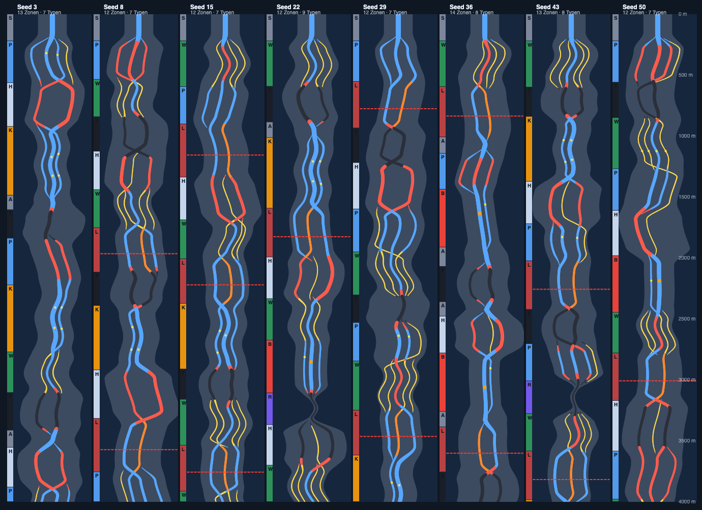
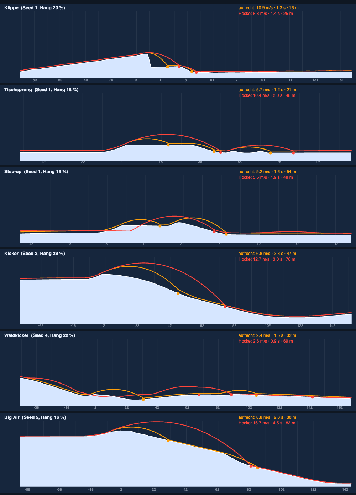
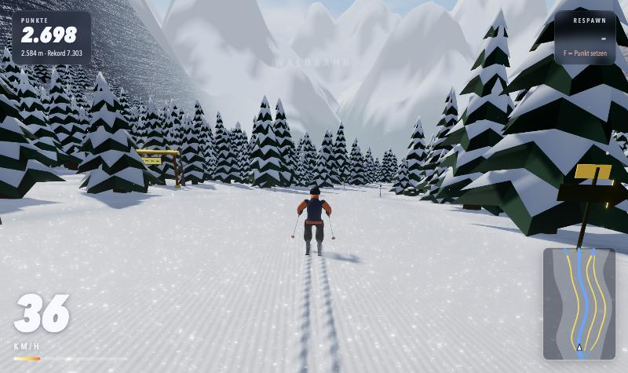
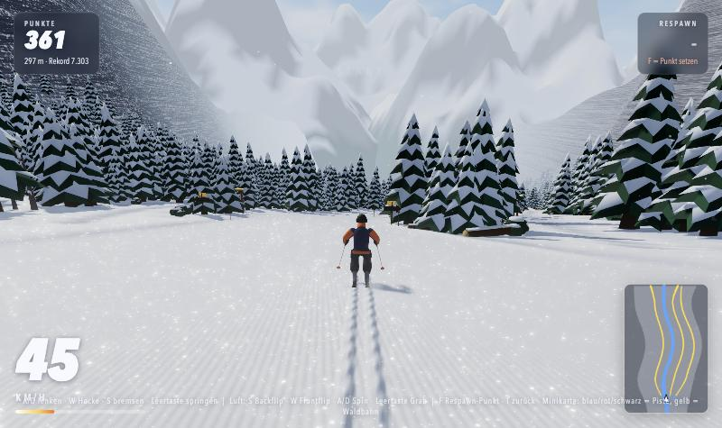
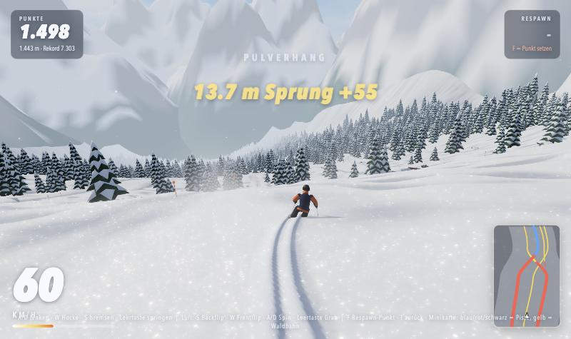
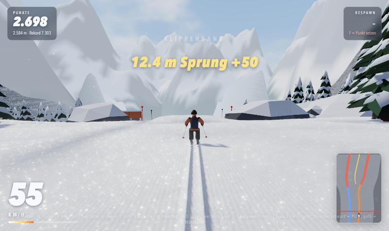
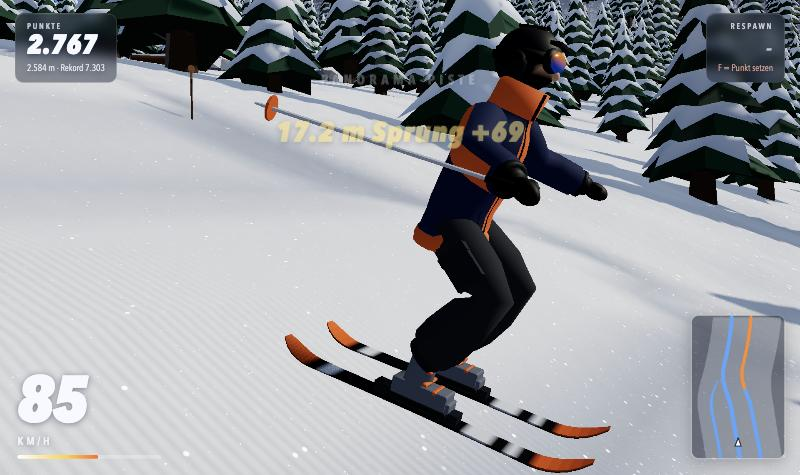
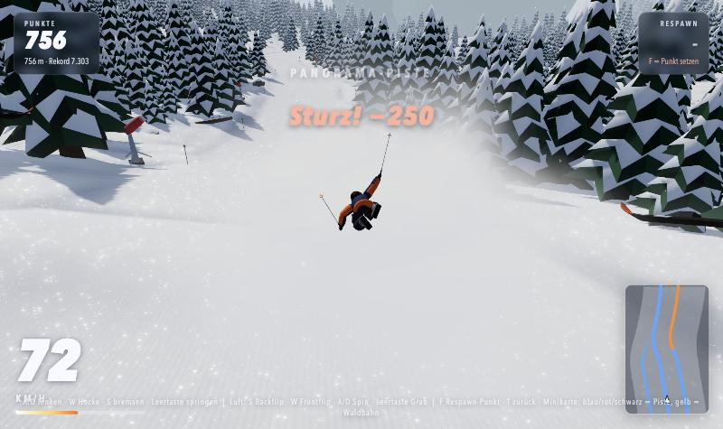

# Piste-Generator – Testbericht

Stand: 11. November 2026 (vierte Runde: Zäune am Hang, Stufen an Zonenwechseln, Abseits-Test, neue Felsen). Getestet auf einem Mac mit Apple M4 im Browser (Vite-Entwicklungsserver) und headless in Node.

## 1. Was gebaut wurde

| Baustein | Datei | Aufgabe |
|---|---|---|
| Routenplanung | `src/piste.js` (`pickType`, `makeZone`) | Zonen-Grammatik: Start, Panorama-Piste, Waldbahn, Pulverhang, Ski-Cross-Park, Big Air, Steilhang, Rinne, Klippenband, Auslauf. Keine Wiederholung hintereinander; nach zwei sanften Zonen erzwingt der Generator eine steile; nach harten Zonen folgt eine Verschnaufpause. |
| Mittellinie | `piste.js` (`hubX`) | Aus einem Kurswinkel integriert (Sweeper, Esses, enge Rinnen-Kurven), mit Rückstellkraft. Kurvenradius ≥ 42 m. |
| Spuren | `piste.js` (`props`, `linkLanes`) | **Bis zu fünf Spuren** pro Hang (A bis E): präpariert, Waldbahn, Rinne, Sprunglinie. Neue Spuren **wachsen aus einer Nachbarspur heraus**, endende laufen in sie hinein. Rinne und Auslauf führen alle Spuren wieder zusammen. |
| Höhenprofil | `piste.js` (`Hof`, `heightP`) | Gefälle je Zone, Steilstufen mit Absatz, Querneigung, Hügel. **Breite, flache Täler (bis ± 190 m)**, Talränder steigen nur sanft an. |
| Sprung-Geometrie | `src/jumps.js` | Absprung, Tisch, Landefläche und Klippen-Abbruch werden **aus der Flugbahn** berechnet (äquivalente Fallhöhe, Übergangsradius). |
| Features | `piste.js` | Kicker, Tisch, Step-up, Step-down, Spine, Big Air, Rollen, Steilkurven, Pulverkissen, Mogulfelder, Engstellen, Klippenband mit mehreren Rampen. |
| Ausstattung | `src/course.js` (`genChunk`) + `tools/blender_props.py` | 14 neue Blender-Modelle, platziert nach Zone, Abzweigung und Feature. |
| Validierung | `piste.js` + `tools/piste_validate.mjs` | Statische Prüfung beim Erzeugen und ein Bot mit der echten Spielphysik. |

## 2. Testmethode

1. **Statische Regeln:** Ein Sprung wird verworfen, wenn die berechnete Landung zu hart ist (über ca. 6,7 m/s bei Auslegungstempo). Spuren, die nicht ins Tal passen, entfallen. Kurven mit zu kleinem Radius werden entschärft.
2. **Bot-Fahrten (headless):** `node tools/piste_validate.mjs 20 3800` lässt einen Bot **20 Seeds × 3 Fahrweisen** je 3800 m fahren (aufrecht Spur A, Hocke Spur A, Hocke Spur B), mit der echten Physik (120 Hz).
3. **Sichtprüfung im Browser:** Routenkarten, Sprung-Seitenansichten mit echten Flugbahnen, Spielansichten.

## 3. Ergebnisse

### Bot-Fahrten (60 Läufe, 228 km, 781 Landungen; Stand vierte Runde)

| Kennzahl | Wert |
|---|---:|
| Läufe ohne Hängenbleiben | 60 von 60 |
| Stürze | **0** |
| Landungen mit Aufprall über 15 m/s | 22 (2,8 %) |
| Höchstes Tempo | 138 km/h |
| Ø Zeit für 3800 m | aufrecht 198 s, Hocke 159–167 s |

| Feature | Landungen | Ø Aufprall (m/s) | max. Aufprall | längste Flugzeit (s) | weitester Flug (m) |
|---|---:|---:|---:|---:|---:|
| Big Air | 37 | 10,3 | 18,9 | 4,54 | 92,4 |
| Kicker (Seitenlinie) | 95 | 6,8 | 15,2 | 3,02 | 77,5 |
| Kicker | 22 | 6,7 | 14,4 | 2,93 | 75,4 |
| Step-up | 9 | 7,4 | 11,9 | 2,07 | 48,6 |
| Tischsprung | 34 | 6,1 | 10,1 | 1,84 | 45,7 |
| Waldkicker | 4 | 8,3 | 13,3 | 1,76 | 47,7 |
| Klippe | 80 | 6,3 | 16,4 | 2,27 | 47,1 |
| Natürliches Gelände (Kanten, Kissen) | 500 | 5,8 | 22,1 | – | – |

**Wirkung der Glättung:** Ungewollte Mini-Flüge im natürlichen Gelände sanken von 3.158 (zweite Runde) auf 500 Landungen (−84 %) bei gleicher Strecke. Weiterhin **0 Stürze** und **0 Läufe mit Hängenbleiben**. Die harten Aufpralle im Gelände (bis 22,1 m/s, Absturzgrenze 23) stammen fast alle vom Ausgang der Rinne: Der Bot fliegt dort mit 100+ km/h in der engen, kurvigen Rinne aus der Spur an die Wand und landet hart. Das ist ein Fehler des Bots, kein Höhenfehler der Spur (siehe 4c).

Auslegungswert der Landeflächen: **4,2 m/s**. Das Spiel lässt erst ab **23 m/s** stürzen. Rohdaten: `docs/validation_results.json`.

Die Bot-Fahrten laufen ohne Bäume und Zäune (siehe Grenzen). Zum Vergleich: In der **ersten Runde** (schmaler Berg) gab es in 60 Läufen **einen** Sturz.

### Zonen-Mischung (12 Seeds, je 5000 m)

- Durchschnittliche Zonenlänge: **ca. 350 m** (vorher 450–650 m).
- Rund **26 %** der Strecke sind steil (≥ 33 %), rund **28 %** flach (< 22 %), der Rest mittel. Flache Anteile stecken vor allem im Ski-Cross-Park (bewusst 15–20 % Gefälle) und im Auslauf.
- Ø **2,2 bis 2,7 aktive Spuren** pro Zone.

### Routenkarten (Draufsicht, 0 bis 4000 m, ± 190 m breit, 8 Seeds)



Man sieht mehrere Pisten nebeneinander, Abzweigungen, Schleifen aus roten und schwarzen Spuren, die sich wieder treffen, gelbe Waldbahnen, orange Sprunglinien und Klippenbänder (rot gestrichelt). Der Berg ist so breit wie die graue Fläche, nicht mehr nur ein Streifen.

### Sprünge im Querschnitt (Gelände und echte Flugbahnen)



Alle sechs Beispiele ohne Sturz, Aufprall 2,6 bis 16,7 m/s (der höchste Wert ist das Big Air in Hocke, siehe Grenzen).

### Spielansichten

| | |
|---|---|
|  Abzweigung: Wegweiser rechts, Trail-Tor links |  Waldzone mit mehreren Bahnen |
|  Tiefschnee: Fahrer sinkt ein, tiefe Spur |  Klippenband mit Rampen links und rechts |
|  Hocke: Stöcke laufen am Körper vorbei |  Sturz: Schneewolke und sichtbare Figur |

Aus der ersten Runde: [Panorama](docs/img/game_panorama_cruise.jpg), [Rinne](docs/img/game_couloir.jpg), [Big Air](docs/img/game_bigair_backflip.jpg), [Grafik niedrig](docs/img/game_quality_low.jpg).

## 4. Änderungen dieser Runde und was dabei gefunden wurde

- **Stöcke durch den Körper:** In der Hocke lagen die Hände vor der Brustmitte, die Stöcke gingen nach hinten durch den Rumpf. Die Hände sitzen jetzt außen neben dem Oberkörper, die Stöcke zeigen nach hinten und leicht nach außen.
- **Sturz ohne Schnee:** Die Wolken wurden zu stark ausgedünnt, die Figur wirkte schwebend. Jetzt stieben Spritzer vom Boden bis Körperhöhe, dazu Wolken und eine Schneefahne. Der **Fahrer wird nach den Schneepartikeln gezeichnet** (Tiefentest bleibt), so verdeckt der Schnee ihn nie. Die Überschläge hüpfen niedriger.
- **Zu schmaler Berg:** Täler mit 115 bis 190 m halber Breite statt 50 bis 80 m; fünf Spuren; Talränder fast flach; der Weltrand steigt erst weit außen an. Wald wächst in Inseln und Lichtungen, nicht mehr als Wand.
- **Abzweigungen:** Neue Spuren wachsen aus einer Nachbarspur heraus (Übergangsfenster 140 m). Ein Wegweiser mit Pfeilfarbe (Schwierigkeit) steht am Beginn, Waldbahnen bekommen ein Trail-Tor.
- **Abwechslung:** neue Zone „Steilhang“, kürzere Zonen, Steilstufen mit Absatz, nach zwei sanften Zonen zwingend eine steile.
- **Tiefschnee:** Pulverfahne an den Kurven (stärker bei hoher Querbeschleunigung), tieferes Einsinken in Kurven, weiches Rauschen als Ton.
- **Fehler beim Testen:** Die Abzweigungs-Erkennung verglich zweimal dasselbe zwischengespeicherte Objekt (0 Abzweigungen gefunden), korrigiert. Die Klippenhöhe schwankte mit der Wandhöhe, wodurch am Ende des Bandes eine 2,7-m-Stufe entstand, korrigiert.

## 4b. Dritte Runde: Rückmeldung „Wälder, kleine Hügel, Tiefschnee, alles fahrbar“

- **Zäune in Wäldern und an Waldbahnen:** Holzzäune (Blender-Modell `SnowFence`) im Abstand von 4,2 m an beiden Rändern jeder Waldbahn und Lichtung, mit Kollisionskörper (`zaun`): man prallt ab und rutscht entlang, statt durchzufahren. Zäune fehlen bewusst an Abzweigungen und Einfahrten. Per Screenshot geprüft.
- **Kleine Hügel:** Rauschen, Kissen und Mogulfelder in der Höhe deutlich flacher, die Abhebe-Schwelle am Boden höher (`vn > 1.5 + 0.012·v`). Dadurch weniger ungewollte Flüge (siehe oben).
- **Landung ohne Tempo:** Hinter jedem Sprung liegt mehr Auslauf (Absprung-Reichweite + 10 m + 14 m) und der Abstand von Sprung zu Sprung wurde auf 8 bis 18 m (Sprungketten) bzw. 26 bis 44 m angepasst. Verbleibende Schwäche: In Sprungketten kommt man mit etwas weniger Tempo an.
- **Verzeihendere Kollisionen:** Zäune, weiche Hindernisse und Streifkontakte bremsen nur; ein Sturz folgt erst bei frontalem Aufprall mit mehr als 9,5 m/s Annäherung.
- **Echtes Einsinken im Tiefschnee:** Neue Pulverschicht (`src/powder.js`, 18 m × 18 m um den Fahrer, bis 30 cm dick, nur im Endlosmodus und ab Pulveranteil 0,18). Skier und Körper schneiden eine Rinne in die Schicht, daneben bleibt ein Schneewall; der Fahrer steht in der Spur, sein Körper wird nicht mehr in den Boden gezogen. Das Einsinken des Modells wurde dafür von 0,8 auf 0,12 reduziert. Eine anfangs sichtbare Patch-Kante in präpariertem Schnee wurde durch die höhere Schwelle behoben. Messung im Browser: ca. 0,4 ms pro Schritt inklusive Physik bei vollem Pulver (M4).

## 4c. Vierte Runde: Zäune am Hang, Bump an Zonenwechseln, Abseits der Piste, Felsen

- **Zäune:** Jedes Zaunfeld folgt jetzt dem Hang (Pfosten senkrecht, Bahn und Oberkante laufen parallel zum Boden; im Code eine Scherung der Instanzmatrix, `src/world.js`, Steigung aus der Geländehöhe an den Feldenden, `src/course.js`). Vorher standen sie waagerecht. Im Browser geprüft.
- **Bump an Zonenwechseln (Ursache gefunden):** `tools/terrain_scan.mjs` misst Gefälleänderungen entlang aller Spuren alle 0,5 m. Zwei harte Ursachen: (1) Die Waldbahn-Rinne (30 cm tief) schaltete beim Wechsel der Spurart schlagartig ein oder aus. (2) Die Querneigung wählte hart die „stärkste Spur“, die beim Spurwechsel sprang. Beides ist jetzt stetig (gewichteter Mittelwert, stetiger Waldbahn-Anteil). **Auffällige Knicke über 6 Seeds: 133 → 9** (Schwelle: Gefälleänderung über 0,16 auf 0,5 m).
- **Abseits der Piste:** `node tools/piste_validate.mjs 12 3800 off` fährt feste Linien abseits der Spuren und einen Quer-Slalom über das ganze Tal, ohne Bäume: **0 Stürze**. Dabei zeigte sich, dass man in tiefem Pulver auf sanften Hängen stehen blieb. Reibung im Pulver deshalb gesenkt (Gleitreibung 0,10 → 0,072, Zusatzbremse 0,5 + 0,04·v → 0,26 + 0,03·v), und der Boden hält Kanten besser fest (Abhebe-Schwelle steigt mit Pulver und Gelände neben der Piste).
- **Felsen:** Sechs neue Blender-Felsen (`tools/blender_rocks.py`): kantige Granitblöcke mit Schnittflächen, Schichtung, Flechten, Schnee nur auf flachen Flächen und Verschattung am Fuß; dazu hohe Platte, runder Findling und Blockgruppe. Je ca. 490 bis 730 Dreiecke (auf 38 % reduziert). Messung im Browser (Seed 15, Klippenzone, Chrome im Claude-Fenster): Felsen kosten zusammen etwa 0,5 Mio. von rund 7,1 Mio. Dreiecken pro Bild (inklusive Schattenpass). Die Felswände der Berge selbst nutzen weiter den Schnee-Shader mit Schichtung; dort habe ich nichts geändert.

## 4d. Fünfte Runde: Anlauf, Felsen-Kollision, Netzzaun, Berge

- **Anlauf vor Sprüngen:** 90 m vor jedem Absprung ist das Gelände glatt: kein Geländerauschen, keine Rollen, Kissen, Moguls oder Steilkurven, die Seitenform schwenkt nicht mit der Mittellinie mit. Gemessen: mittlere Abweichung von der Geraden über 80 m Anlauf von 0,25 m auf 0,09 m (46 Sprünge, 6 Seeds). Der Rest ist das sanfte Gefälle des Berges selbst; bei Sprungketten kann die Landung des Vorgängers im Anlauf liegen.
- **Felsen:** Sturz schon ab 2,2 m/s Aufprall (Bäume 5,5, sonst 7). Felsen am Klippenband haben jetzt auch Kollisionskörper, Radius 1,3 × Größe.
- **Zaun:** Orangefarbenes Fangnetz an dünnen Stangen statt Holzbrettern; jedes Feld leicht versetzt, schief, in Größe und Helligkeit unterschiedlich.
- **Zaun, Nachbesserung:** Jedes Feld wird jetzt exakt von Endpunkt zu Endpunkt gesetzt (Länge, Richtung, Hangneigung aus den Enden). Gemessen über 2.329 Felder: Median-Abstand der Enden 0,05 m (leichte Überlappung statt Lücke). Kollision: drei kleine Körper pro Feld statt eines 2-m-Kreises; kein Abstoßen mehr. Sturz, wenn man mit mehr als 2,2 m/s quer zur Zaunlinie hineinfährt; flaches Entlangstreifen bleibt ohne Sturz (headless getestet).
- **Strohballen entfernt**, an Steilkurven steht stattdessen ein kurzes Netz. **Waldbahn-Tor neu:** Rundholz-Pfosten, Querbalken mit Schnee, Holzschild mit Tannen-Symbol (vorher Schild mit Strich-Platzhaltern).
- **Berge im Hintergrund:** feinere Gitter, Grate, geschichteter Fels mit Schnee in Rinnen statt grauer Flächen. Nur per Screenshot beurteilt.

## 4e. Sechste Runde: Buckel, Erkennbarkeit, Abzweigungen, Engstellen

- **Buckel:** Wellenbahnen (Roller) jetzt 17 bis 21 m lang und höchstens 0,7 m hoch (vorher 9 bis 12 m und bis 1,3 m), Buckelfelder halb so hoch und gestreckter. Bot-Test: Landungen im natürlichen Gelände 500 → 359, 0 Stürze, 0 Hängenbleiben.
- **Pisten erkennen:** Präparierte Fläche etwas kühler und matter, am Rand ein weicher dunklerer Saum; Markierungsstangen alle 22 m statt 34 m.
- **Zufahrt zu Abzweigungen:** Neue Spuren sind nach einem Drittel des Übergangs voll breit (liegen dort noch auf der Elternpiste) und ziehen dann seitlich weg; vorher wuchsen sie als schmaler Streifen heraus. Endende Spuren bleiben bis kurz vor dem Zusammenfluss breit. An jeder Einfahrt stehen acht Paar farbige Leitstangen.
- **Engstellen:** Die Felsnasen in Rinnen bestehen jetzt aus zwei Reihen Felsbrocken auf einem flachen Sockel (vorher ein glatter Hügel mit zufälligen Steinen). Alle Felsen sitzen auf dem tiefsten Bodenpunkt unter ihrer Grundfläche und schweben nirgends. Im Browser angesehen.

## 5. Bekannte Grenzen (bitte ernst nehmen)

- **Kein Mensch hat die Strecken gespielt.** Der Bot fährt Spur und Tempo ideal. Wie sich die Abzweigungen, der Pulverschnee und die Rinne bei 100 km/h mit Tastatur anfühlen, ist nicht getestet.
- **Bäume und Felsen fehlen im Bot-Test.** Dort gibt es keine Kollisionen mit Bäumen, Zäunen, Kanonen oder Hütten. Wie gut Spuren davon freigehalten werden, habe ich nur optisch geprüft.
- **Big Air bei Höchsttempo:** In Hocke (ca. 25 m/s) landet es hart (bis 18,9 m/s Aufprall, Absturzgrenze 23).
- **Dekoration ist nur Dekoration:** Rails, Boxen und umgestürzte Bäume sind keine befahrbaren Features. Kollisionen haben nur Hütten, Kanonen, Wegweiser, Totholz-Bäume und Bäume; Strohballen federn ab.
- **Tiefschnee-Optik nur Screenshots:** Die Rinne und der Schneewall sind per Screenshot beurteilt, nicht im Fahrgefühl. Auf „Niedrig“ ist die Pulverschicht abgeschaltet (dort bleibt nur die flache Spur im Schnee); Leistung auf schwachen Geräten nicht gemessen.
- **Freeride „überall fahrbar“** heißt: Gelände ist glatter und verzeiht mehr, aber Felsbänder, Klippen und dichter Wald bleiben bewusst Hindernisse.
- **Rinne bei hohem Tempo:** Die enge, kurvige Rinne (Hub schwenkt bis 0,44 m pro Meter) wirft einen Bot mit 100+ km/h aus der Spur; auch ein Mensch fliegt dort bei hohem Tempo an die Wand. Das ist ein Hindernis, kein Bump.
- **Rest-Knicke:** 9 kleine Knicke (Gefälleänderung 0,17 bis 0,27 auf 0,5 m) bleiben, vor allem an Zonenenden; sie sind gering, aber nicht null.
- **Felsen nur von Nahem angesehen:** Ein Screenshot im Spiel, kein Vergleich auf schwachen Geräten.
- **Chunk-Aufbau:** Ein 100-m-Stück erzeugt Bäume, Felsen, Zäune und Dekoration in einem Schritt; gemessen ca. 117 ms, aber auf einem stark ausgelasteten Rechner (Last ~90). Ob das auf schwachen Geräten zu einem Ruckler führt, ist nicht geprüft.
- **Hip Jumps** und eine echte Halfpipe fehlen (siehe `PISTE_REFERENCE_RESEARCH.md`).
- **Leistung auf schwachen Geräten ist nicht gemessen.** Auf dem M4 kostet ein Gelände-Stück (jetzt ca. 12.000 Punkte plus Bäume und Dekoration) rund 4 ms; die Stufen „Mittel“ und „Niedrig“ habe ich nur optisch geprüft. Die Dekoration (ca. 70 Teile pro 100 m) und bis zu 720 Bäume pro Stück laufen über denselben Regler wie die Bäume.
- Die Felswand-Textur wirkt aus der Nähe teilweise streifig.
- **Die Quellen zu Skispielen sind dünn** (siehe `PISTE_REFERENCE_RESEARCH.md`, Abschnitt 2b).

## 6. Nachprüfen

```bash
npm run dev                                # Spiel auf http://localhost:5183
node tools/piste_validate.mjs 20 3800      # Bot-Läufe, schreibt docs/validation_results.json
node tools/savepng.mjs                     # (optional) Empfänger für Bilder der Prüfseiten
# Prüfseiten im Browser: /tools/layouts.html und /tools/jumpview.html
```

Im Spiel lassen sich Seeds für Tests festlegen: `window.__game.game.forceSeed = 15; window.__game.setKind('endless', 15)`.
Blender-Modelle neu erzeugen: `tools/blender_build.py`, danach `blender_skier.py` und `blender_props.py` ausführen, dann `export(...)`.
