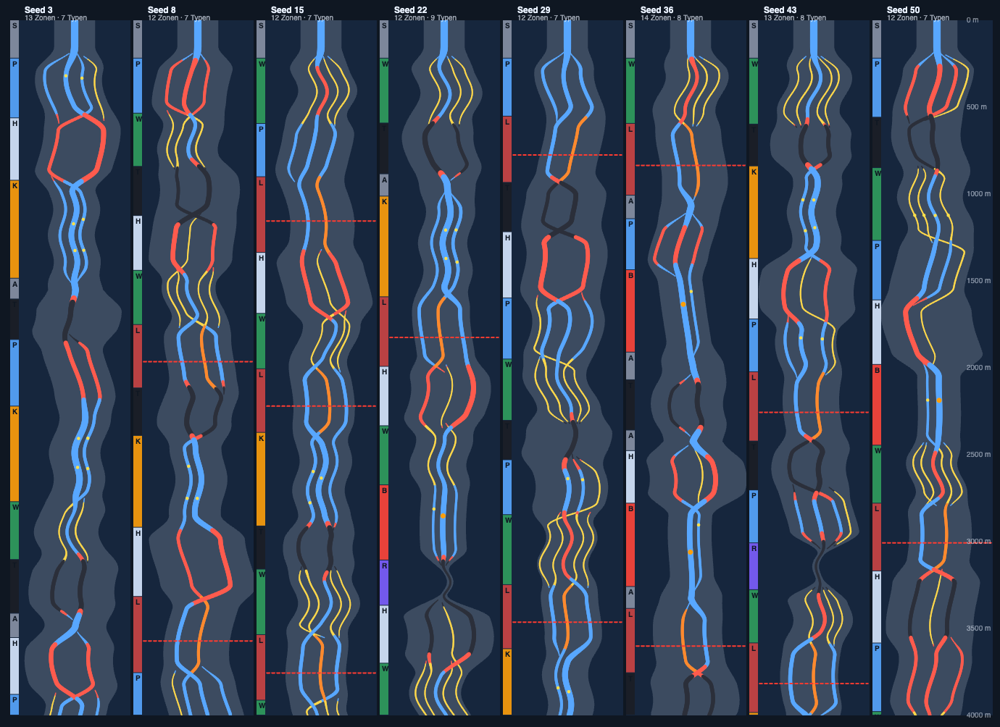
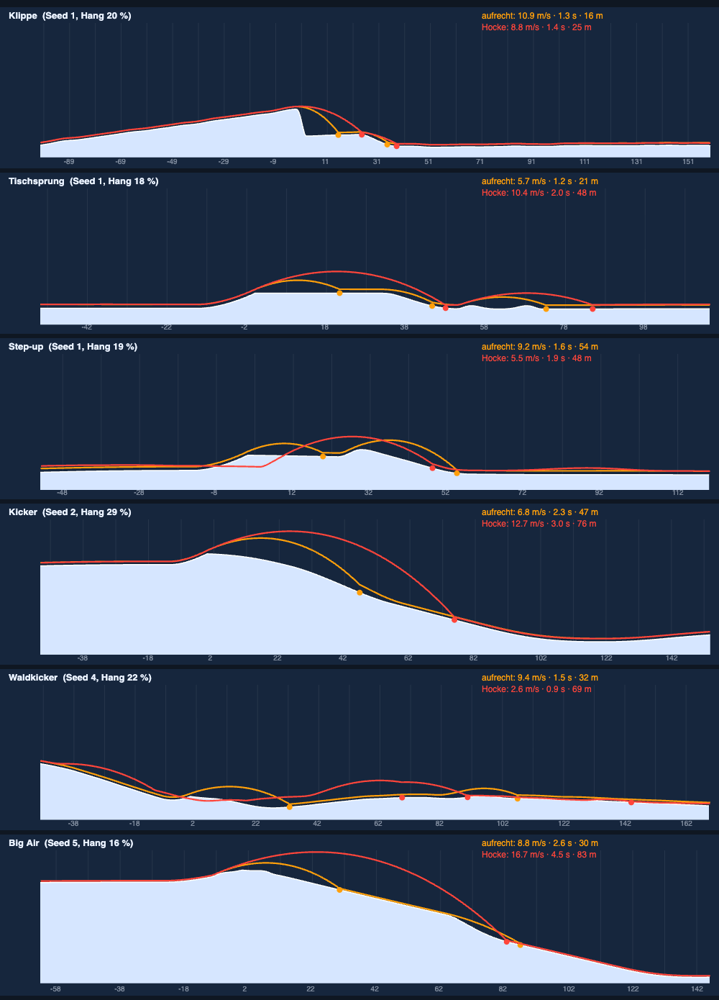
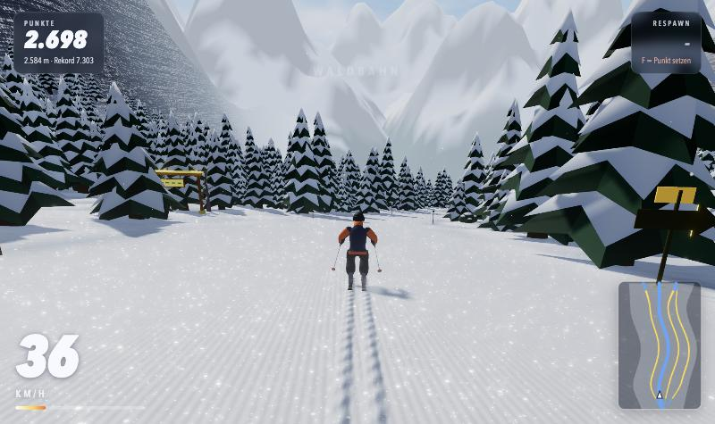
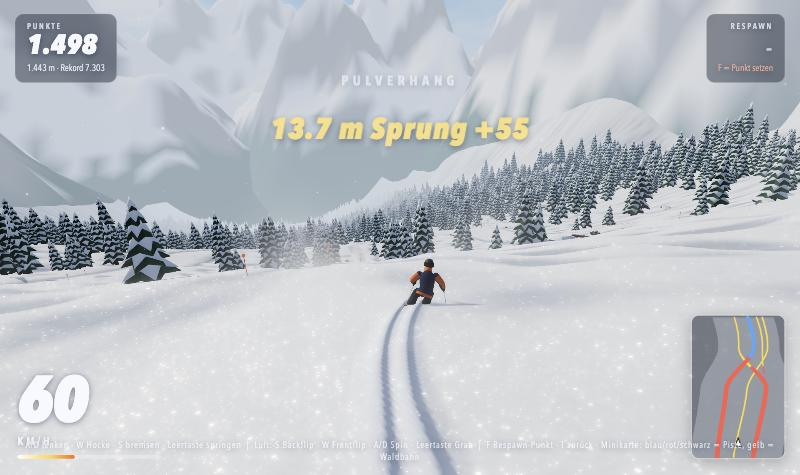
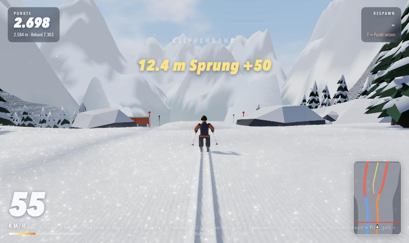

# Piste-Generator – Testbericht

Stand: 11. November 2026 (vierte Runde: Zäune am Hang, Stufen an Zonenwechseln, Abseits-Test, neue Felsen). Getestet auf einem Mac mit Apple M4 im Browser (Vite-Entwicklungsserver) und headless in Node.

## 1. Was gebaut wurde

| Baustein | Datei | Aufgabe |
|---|---|---|
| Routenplanung | `src/piste.js` (`pickType`, `makeZone`) | Zonen-Grammatik: Start, Panorama-Piste, Waldbahn, Pulverhang, Ski-Cross-Park, Big Air, Steilhang, Rinne, Klippenband, Auslauf. Keine Wiederholung hintereinander; nach zwei sanften Zonen erzwingt der Generator eine steile; nach harten Zonen folgt eine Verschnaufpause. |
| Mittellinie | `piste.js` (`hubX`) | Aus einem Kurswinkel integriert (Sweeper, Esses, enge Rinnen-Kurven), mit Rückstellkraft. Kurvenradius ≥ 42 m. |
| Spuren | `piste.js` (`props`, `linkLanes`) | **Bis zu fünf Spuren** pro Hang (A bis E): präpariert, Waldbahn, Rinne, Sprunglinie. Neue Spuren **wachsen aus einer Nachbarspur heraus**, endende laufen in sie hinein. Rinne und Auslauf führen alle Spuren wieder zusammen. |
| Höhenprofil | `piste.js` (`Hof`, `heightP`) | Gefälle je Zone, Steilstufen mit Absatz, Querneigung, Hügel. **Breite, flache Täler (bis ± 190 m)**, Talränder steigen nur sanft an. |
| Sprung-Geometrie | `src/jumps.js` | Absprung, Tisch, Landefläche und Klippen-Abbruch werden **aus der Flugbahn** berechnet (äquivalente Fallhöhe, Übergangsradius). |
| Features | `piste.js` | Kicker, Tisch, Step-up, Step-down, Spine, Big Air, Rollen, Steilkurven, Pulverkissen, Mogulfelder, Engstellen, Klippenband mit mehreren Rampen. |
| Ausstattung | `src/course.js` (`genChunk`) + `tools/blender_props.py` | 14 neue Blender-Modelle, platziert nach Zone, Abzweigung und Feature. |
| Validierung | `piste.js` + `tools/piste_validate.mjs` | Statische Prüfung beim Erzeugen und ein Bot mit der echten Spielphysik. |

## 2. Testmethode

1. **Statische Regeln:** Ein Sprung wird verworfen, wenn die berechnete Landung zu hart ist (über ca. 6,7 m/s bei Auslegungstempo). Spuren, die nicht ins Tal passen, entfallen. Kurven mit zu kleinem Radius werden entschärft.
2. **Bot-Fahrten (headless):** `node tools/piste_validate.mjs 20 3800` lässt einen Bot **20 Seeds × 3 Fahrweisen** je 3800 m fahren (aufrecht Spur A, Hocke Spur A, Hocke Spur B), mit der echten Physik (120 Hz).
3. **Sichtprüfung im Browser:** Routenkarten, Sprung-Seitenansichten mit echten Flugbahnen, Spielansichten.

## 3. Ergebnisse

### Bot-Fahrten (60 Läufe, 228 km, 781 Landungen; Stand vierte Runde)

| Kennzahl | Wert |
|---|---:|
| Läufe ohne Hängenbleiben | 60 von 60 |
| Stürze | **0** |
| Landungen mit Aufprall über 15 m/s | 22 (2,8 %) |
| Höchstes Tempo | 138 km/h |
| Ø Zeit für 3800 m | aufrecht 198 s, Hocke 159–167 s |

| Feature | Landungen | Ø Aufprall (m/s) | max. Aufprall | längste Flugzeit (s) | weitester Flug (m) |
|---|---:|---:|---:|---:|---:|
| Big Air | 37 | 10,3 | 18,9 | 4,54 | 92,4 |
| Kicker (Seitenlinie) | 95 | 6,8 | 15,2 | 3,02 | 77,5 |
| Kicker | 22 | 6,7 | 14,4 | 2,93 | 75,4 |
| Step-up | 9 | 7,4 | 11,9 | 2,07 | 48,6 |
| Tischsprung | 34 | 6,1 | 10,1 | 1,84 | 45,7 |
| Waldkicker | 4 | 8,3 | 13,3 | 1,76 | 47,7 |
| Klippe | 80 | 6,3 | 16,4 | 2,27 | 47,1 |
| Natürliches Gelände (Kanten, Kissen) | 500 | 5,8 | 22,1 | – | – |

**Wirkung der Glättung:** Ungewollte Mini-Flüge im natürlichen Gelände sanken von 3.158 (zweite Runde) auf 500 Landungen (−84 %) bei gleicher Strecke. Weiterhin **0 Stürze** und **0 Läufe mit Hängenbleiben**. Die harten Aufpralle im Gelände (bis 22,1 m/s, Absturzgrenze 23) stammen fast alle vom Ausgang der Rinne: Der Bot fliegt dort mit 100+ km/h in der engen, kurvigen Rinne aus der Spur an die Wand und landet hart. Das ist ein Fehler des Bots, kein Höhenfehler der Spur (siehe 4c).

Auslegungswert der Landeflächen: **4,2 m/s**. Das Spiel lässt erst ab **23 m/s** stürzen. Rohdaten: `docs/validation_results.json`.

Die Bot-Fahrten laufen ohne Bäume und Zäune (siehe Grenzen). Zum Vergleich: In der **ersten Runde** (schmaler Berg) gab es in 60 Läufen **einen** Sturz.

### Zonen-Mischung (12 Seeds, je 5000 m)

- Durchschnittliche Zonenlänge: **ca. 350 m** (vorher 450–650 m).
- Rund **26 %** der Strecke sind steil (≥ 33 %), rund **28 %** flach (< 22 %), der Rest mittel. Flache Anteile stecken vor allem im Ski-Cross-Park (bewusst 15–20 % Gefälle) und im Auslauf.
- Ø **2,2 bis 2,7 aktive Spuren** pro Zone.

### Routenkarten (Draufsicht, 0 bis 4000 m, ± 190 m breit, 8 Seeds)



Man sieht mehrere Pisten nebeneinander, Abzweigungen, Schleifen aus roten und schwarzen Spuren, die sich wieder treffen, gelbe Waldbahnen, orange Sprunglinien und Klippenbänder (rot gestrichelt). Der Berg ist so breit wie die graue Fläche, nicht mehr nur ein Streifen.

### Sprünge im Querschnitt (Gelände und echte Flugbahnen)



Alle sechs Beispiele ohne Sturz, Aufprall 2,6 bis 16,7 m/s (der höchste Wert ist das Big Air in Hocke, siehe Grenzen).

### Spielansichten

| | |
|---|---|
|  Abzweigung: Wegweiser rechts, Trail-Tor links |  Waldzone mit mehreren Bahnen |
|  Tiefschnee: Fahrer sinkt ein, tiefe Spur |  Klippenband mit Rampen links und rechts |
|  Hocke: Stöcke laufen am Körper vorbei |  Sturz: Schneewolke und sichtbare Figur |

Aus der ersten Runde: [Panorama](docs/img/game_panorama_cruise.jpg), [Rinne](docs/img/game_couloir.jpg), [Big Air](docs/img/game_bigair_backflip.jpg), [Grafik niedrig](docs/img/game_quality_low.jpg).

## 4. Änderungen dieser Runde und was dabei gefunden wurde

- **Stöcke durch den Körper:** In der Hocke lagen die Hände vor der Brustmitte, die Stöcke gingen nach hinten durch den Rumpf. Die Hände sitzen jetzt außen neben dem Oberkörper, die Stöcke zeigen nach hinten und leicht nach außen.
- **Sturz ohne Schnee:** Die Wolken wurden zu stark ausgedünnt, die Figur wirkte schwebend. Jetzt stieben Spritzer vom Boden bis Körperhöhe, dazu Wolken und eine Schneefahne. Der **Fahrer wird nach den Schneepartikeln gezeichnet** (Tiefentest bleibt), so verdeckt der Schnee ihn nie. Die Überschläge hüpfen niedriger.
- **Zu schmaler Berg:** Täler mit 115 bis 190 m halber Breite statt 50 bis 80 m; fünf Spuren; Talränder fast flach; der Weltrand steigt erst weit außen an. Wald wächst in Inseln und Lichtungen, nicht mehr als Wand.
- **Abzweigungen:** Neue Spuren wachsen aus einer Nachbarspur heraus (Übergangsfenster 140 m). Ein Wegweiser mit Pfeilfarbe (Schwierigkeit) steht am Beginn, Waldbahnen bekommen ein Trail-Tor.
- **Abwechslung:** neue Zone „Steilhang“, kürzere Zonen, Steilstufen mit Absatz, nach zwei sanften Zonen zwingend eine steile.
- **Tiefschnee:** Pulverfahne an den Kurven (stärker bei hoher Querbeschleunigung), tieferes Einsinken in Kurven, weiches Rauschen als Ton.
- **Fehler beim Testen:** Die Abzweigungs-Erkennung verglich zweimal dasselbe zwischengespeicherte Objekt (0 Abzweigungen gefunden), korrigiert. Die Klippenhöhe schwankte mit der Wandhöhe, wodurch am Ende des Bandes eine 2,7-m-Stufe entstand, korrigiert.

## 4b. Dritte Runde: Rückmeldung „Wälder, kleine Hügel, Tiefschnee, alles fahrbar“

- **Zäune in Wäldern und an Waldbahnen:** Holzzäune (Blender-Modell `SnowFence`) im Abstand von 4,2 m an beiden Rändern jeder Waldbahn und Lichtung, mit Kollisionskörper (`zaun`): man prallt ab und rutscht entlang, statt durchzufahren. Zäune fehlen bewusst an Abzweigungen und Einfahrten. Per Screenshot geprüft.
- **Kleine Hügel:** Rauschen, Kissen und Mogulfelder in der Höhe deutlich flacher, die Abhebe-Schwelle am Boden höher (`vn > 1.5 + 0.012·v`). Dadurch weniger ungewollte Flüge (siehe oben).
- **Landung ohne Tempo:** Hinter jedem Sprung liegt mehr Auslauf (Absprung-Reichweite + 10 m + 14 m) und der Abstand von Sprung zu Sprung wurde auf 8 bis 18 m (Sprungketten) bzw. 26 bis 44 m angepasst. Verbleibende Schwäche: In Sprungketten kommt man mit etwas weniger Tempo an.
- **Verzeihendere Kollisionen:** Zäune, weiche Hindernisse und Streifkontakte bremsen nur; ein Sturz folgt erst bei frontalem Aufprall mit mehr als 9,5 m/s Annäherung.
- **Echtes Einsinken im Tiefschnee:** Neue Pulverschicht (`src/powder.js`, 18 m × 18 m um den Fahrer, bis 30 cm dick, nur im Endlosmodus und ab Pulveranteil 0,18). Skier und Körper schneiden eine Rinne in die Schicht, daneben bleibt ein Schneewall; der Fahrer steht in der Spur, sein Körper wird nicht mehr in den Boden gezogen. Das Einsinken des Modells wurde dafür von 0,8 auf 0,12 reduziert. Eine anfangs sichtbare Patch-Kante in präpariertem Schnee wurde durch die höhere Schwelle behoben. Messung im Browser: ca. 0,4 ms pro Schritt inklusive Physik bei vollem Pulver (M4).

## 4c. Vierte Runde: Zäune am Hang, Bump an Zonenwechseln, Abseits der Piste, Felsen

- **Zäune:** Jedes Zaunfeld folgt jetzt dem Hang (Pfosten senkrecht, Bahn und Oberkante laufen parallel zum Boden; im Code eine Scherung der Instanzmatrix, `src/world.js`, Steigung aus der Geländehöhe an den Feldenden, `src/course.js`). Vorher standen sie waagerecht. Im Browser geprüft.
- **Bump an Zonenwechseln (Ursache gefunden):** `tools/terrain_scan.mjs` misst Gefälleänderungen entlang aller Spuren alle 0,5 m. Zwei harte Ursachen: (1) Die Waldbahn-Rinne (30 cm tief) schaltete beim Wechsel der Spurart schlagartig ein oder aus. (2) Die Querneigung wählte hart die „stärkste Spur“, die beim Spurwechsel sprang. Beides ist jetzt stetig (gewichteter Mittelwert, stetiger Waldbahn-Anteil). **Auffällige Knicke über 6 Seeds: 133 → 9** (Schwelle: Gefälleänderung über 0,16 auf 0,5 m).
- **Abseits der Piste:** `node tools/piste_validate.mjs 12 3800 off` fährt feste Linien abseits der Spuren und einen Quer-Slalom über das ganze Tal, ohne Bäume: **0 Stürze**. Dabei zeigte sich, dass man in tiefem Pulver auf sanften Hängen stehen blieb. Reibung im Pulver deshalb gesenkt (Gleitreibung 0,10 → 0,072, Zusatzbremse 0,5 + 0,04·v → 0,26 + 0,03·v), und der Boden hält Kanten besser fest (Abhebe-Schwelle steigt mit Pulver und Gelände neben der Piste).
- **Felsen:** Sechs neue Blender-Felsen (`tools/blender_rocks.py`): kantige Granitblöcke mit Schnittflächen, Schichtung, Flechten, Schnee nur auf flachen Flächen und Verschattung am Fuß; dazu hohe Platte, runder Findling und Blockgruppe. Je ca. 490 bis 730 Dreiecke (auf 38 % reduziert). Messung im Browser (Seed 15, Klippenzone, Chrome im Claude-Fenster): Felsen kosten zusammen etwa 0,5 Mio. von rund 7,1 Mio. Dreiecken pro Bild (inklusive Schattenpass). Die Felswände der Berge selbst nutzen weiter den Schnee-Shader mit Schichtung; dort habe ich nichts geändert.

## 4d. Fünfte Runde: Anlauf, Felsen-Kollision, Netzzaun, Berge

- **Anlauf vor Sprüngen:** 90 m vor jedem Absprung ist das Gelände glatt: kein Geländerauschen, keine Rollen, Kissen, Moguls oder Steilkurven, die Seitenform schwenkt nicht mit der Mittellinie mit. Gemessen: mittlere Abweichung von der Geraden über 80 m Anlauf von 0,25 m auf 0,09 m (46 Sprünge, 6 Seeds). Der Rest ist das sanfte Gefälle des Berges selbst; bei Sprungketten kann die Landung des Vorgängers im Anlauf liegen.
- **Felsen:** Sturz schon ab 2,2 m/s Aufprall (Bäume 5,5, sonst 7). Felsen am Klippenband haben jetzt auch Kollisionskörper, Radius 1,3 × Größe.
- **Zaun:** Orangefarbenes Fangnetz an dünnen Stangen statt Holzbrettern; jedes Feld leicht versetzt, schief, in Größe und Helligkeit unterschiedlich.
- **Zaun, Nachbesserung:** Jedes Feld wird jetzt exakt von Endpunkt zu Endpunkt gesetzt (Länge, Richtung, Hangneigung aus den Enden). Gemessen über 2.329 Felder: Median-Abstand der Enden 0,05 m (leichte Überlappung statt Lücke). Kollision: drei kleine Körper pro Feld statt eines 2-m-Kreises; kein Abstoßen mehr. Sturz, wenn man mit mehr als 2,2 m/s quer zur Zaunlinie hineinfährt; flaches Entlangstreifen bleibt ohne Sturz (headless getestet).
- **Strohballen entfernt**, an Steilkurven steht stattdessen ein kurzes Netz. **Waldbahn-Tor neu:** Rundholz-Pfosten, Querbalken mit Schnee, Holzschild mit Tannen-Symbol (vorher Schild mit Strich-Platzhaltern).
- **Berge im Hintergrund:** feinere Gitter, Grate, geschichteter Fels mit Schnee in Rinnen statt grauer Flächen. Nur per Screenshot beurteilt.

## 4e. Sechste Runde: Buckel, Erkennbarkeit, Abzweigungen, Engstellen

- **Buckel:** Wellenbahnen (Roller) jetzt 17 bis 21 m lang und höchstens 0,7 m hoch (vorher 9 bis 12 m und bis 1,3 m), Buckelfelder halb so hoch und gestreckter. Bot-Test: Landungen im natürlichen Gelände 500 → 359, 0 Stürze, 0 Hängenbleiben.
- **Pisten erkennen:** Präparierte Fläche etwas kühler und matter, am Rand ein weicher dunklerer Saum; Markierungsstangen alle 22 m statt 34 m.
- **Zufahrt zu Abzweigungen:** Neue Spuren sind nach einem Drittel des Übergangs voll breit (liegen dort noch auf der Elternpiste) und ziehen dann seitlich weg; vorher wuchsen sie als schmaler Streifen heraus. Endende Spuren bleiben bis kurz vor dem Zusammenfluss breit. An jeder Einfahrt stehen acht Paar farbige Leitstangen.
- **Engstellen:** Die Felsnasen in Rinnen bestehen jetzt aus zwei Reihen Felsbrocken auf einem flachen Sockel (vorher ein glatter Hügel mit zufälligen Steinen). Alle Felsen sitzen auf dem tiefsten Bodenpunkt unter ihrer Grundfläche und schweben nirgends. Im Browser angesehen.

## 4f. Mehr Abwechslung (Berg-Charakter und Zonen-Variationen)

- **Berg-Charakter pro Startwert:** eigene Gewichte für Zonentypen sowie Grundzüge (Talbreite, Steilheit, Wald, Pulver, Kurvigkeit, Häufigkeit von Geländeformen). Jeder Berg fühlt sich anders an.
- **Jede Zone wird abgewandelt:** Länge ×0,75–1,3, Kurvenstil (gerade, enge S-Kurven, weite Bögen), Spuren (Breite, Lage, zusätzliche oder wegfallende Spuren, Piste ↔ Waldbahn), dazu 0–2 Geländeformen: lange Wellen, Mulde (natürliche Halfpipe), Rücken in der Mitte, Kuppen, Baum-Inseln, Felsinseln, weit/eng. Alle Formen sind krümmungsbegrenzt und laufen an Zonengrenzen weich aus. Der Name der Zone zeigt die Abwandlung („Pulverhang – eng, mit Rücken“).
- **Sprünge geschützt:** Über Anlauf, Sprung und Landung gibt es keine Zusatzformen; Steilstufen, die in einen Sprungbereich fallen würden, entfallen vor dem Sprung-Entwurf. Mittlere Abweichung des Anlaufs von der Geraden: 0,076 m auf 80 m (78 Sprünge, 6 Seeds); es werden mehr Sprünge gebaut, weil weniger verworfen werden.
- **Rinne:** Kurvenradius jetzt ≥ ca. 130 m (vorher bis 76 m), weil man bei Höchsttempo sonst an die Wand getragen wurde.
- **Bot-Test danach:** 60 Läufe, 228 km, **0 Stürze**, 0 Hängenbleiben, 653 Landungen, 13 über 15 m/s (vorher 22–25), höchster Aufprall 21,2 m/s. Big Air höchstens 13,3 m/s (vorher 18,9).
- Die rot gestrichelte Linie auf der Minikarte ist ein **Klippenband**, keine Nahtstelle zwischen Abschnitten.

## 4g. Dritte Welt: Freestyle-Berg

- **Eigener Generator-Stil** (`pisteInit(seed, 'freestyle')`): Zonen „Sprunglinie“ (bis zu sechs große Tische, Kicker XL und Step-downs auf der Hauptspur, jeweils 110 bis 160 m Abstand zum Tempo-Aufbauen, Kicker auf den Seitenspuren), „Mega Air“ (ein Riesensprung nach etwa 60 % der Zone, Landung in steilen Hang, mit Rückfallgrößen bis Big Air), „Slopestyle“ (Tisch, Spine, Step-up, großer Tisch, Step-down), dazu Big Air, gelegentlich Klippen und kurze Ausläufe. Gleichmäßiges Gefälle, ruhige Kurven, keine Wellen oder Kuppen.
- **Große Sprünge auf Hocke ausgelegt** (Auslegungstempo näher an der Hocke), damit man bei Vollgas nicht über die Landung hinausfliegt. Step-up XL wurde nach dem Bot-Test entfernt (bis 24 m/s Aufprall).
- **Bot-Test** (`node tools/piste_validate.mjs 20 4000 freestyle`): 60 Läufe, 240 km, **0 Stürze**, 942 Landungen, 16 über 15 m/s, höchster Aufprall 20,4 m/s; Ergebnis in `docs/validation_freestyle.json`.
- **Grabs:** Leertaste Safety Grab, Pfeil links Mute Grab (linke Hand), Pfeil rechts Tail Grab (rechte Hand ans Skiende); mehrere Grabs in einem Sprung zählen einzeln. Am Handy seitlich wischen und halten.
- **Landung im Stand:** Wer langsamer als 3 m/s ist, landet quer ohne Sturz (die Drehung wird zur neuen Fahrtrichtung); bis 8 m/s wird die Grenze schrittweise strenger, darüber gilt wie bisher: quer = Sturz.

## 4h. Rails, Boxen, Gaps und Sprünge passend zum Tempo

- **Tempo-Modell** (`speedAfter` in `src/piste.js`, gleiche Reibung und Luftwiderstand wie die Spielphysik): In Sprunglinien wird für jeden Sprung berechnet, wie schnell man nach dem tatsächlichen Anlauf seit der letzten Landung ist (Landung kostet ca. 15 % Tempo). Der Sprung wird genau auf dieses Tempo ausgelegt; kurzer Anlauf ergibt einen kürzeren Sprung.
- **Gaps:** Statt eines Tisches liegt ein 2,2 bis 3 m tiefer Graben zwischen Absprung und Landung (rote Stangen an beiden Kanten). Ein Gap wird nur gebaut, wenn auch das untere Ende des erwarteten Tempobereichs sicher hinter dem Graben landet; sonst wird es ein normaler Tisch. Wer viel zu langsam ist, fällt hinein.
- **Rails und Boxen:** eigene Elemente mit Schneerampe zum Auffahren; man kann auch von oben aufspringen. Auf dem Element rutscht man mit eigener Physik (Hangabtrieb, geringe Reibung). Die Balance kippt von selbst weg und wird mit Lenken gehalten (Anzeige unten), auf Boxen gutmütiger. Sprung = abspringen; kippt die Balance, rutscht man seitlich ab (kein Sturz). Seitlich gegen ein Element fahren drückt einen weg. Rail = Boardslide (quer), Box = 50-50 (gerade); Punkte nach Länge, zählen für den Combo-Multiplikator.
- **Neue Zone „Rail-Park“** (Boxen, Rails, kleine Gaps im Wechsel, Seitenspuren mit Boxen/Rails); Sprunglinien haben Rails und Boxen auf den Seitenspuren, Slopestyle beginnt mit Box und Rail, im Freeride-Park gibt es echte Boxen/Rails statt Deko.
- **Bot-Test Freestyle** (60 Läufe, 240 km): **0 Stürze**, höchster Aufprall 16,5 m/s (vorher 20,4 – das Tempo-Modell passt die Sprünge besser an), 8 Landungen über 15 m/s, 64 Gap-Landungen, 89 Rail-/Box-Slides, alle sauber (der Bot hält die Balance mit Gegenlenken). Freeride unverändert 0 Stürze.

## 4i. Heli-Skiing (vierte Welt) und Rückwärts landen

- **Heli-Berg** (`pisteInit(seed, 'heli')`): Start auf einem schmalen Gipfel, danach Gletscher (weit, lange Wellen, Séracs aus Eisbrocken), steile Pulverflanken (Gefälle 0,50 bis 0,62, Pillow-Linien), Felsgärten (viele große Felsen), Riesenklippen (18 bis 30 m Abbruch mit Geröllhang zum Landen), Rinnen und Pulverhänge. Keine präparierten Pisten, keine Pistenausstattung, über der Baumgrenze kein Wald; weiter unten beginnt langsam der Wald.
- **Absprung:** Während des Countdowns schwebt ein Helikopter (Blender, `tools/blender_heli.py`) über dem Gipfel, der Fahrer steht auf der Kufe; bei „Spring!“ fällt er gut 4 m in den Tiefschnee, der Helikopter dreht ab und fliegt davon. Rotorgeräusch abhängig von der Entfernung.
- **Tiefschnee auf Niedrig:** Die Pulverschicht mit Spurrinne läuft jetzt auch auf „Niedrig“ (gröberes Raster), die Pulverfahne bleibt kräftig, der Schnee bekommt eine günstige Oberflächenstruktur.
- **Bot-Test Heli** (`node tools/piste_validate.mjs 20 4000 heli`): 60 Läufe, 240 km, **0 Stürze**, höchster Aufprall 15,8 m/s.
- **Rückwärts landen (Switch):** Drehungen werden auf halbe Umdrehungen gewertet. Eine 180 landet rückwärts (sauber, mit Punkten), eine weitere 180 wieder vorwärts. Rückwärts dreht der Fahrer Oberkörper und Kopf über die Schulter hangabwärts; die Ego-Sicht schaut ebenfalls nach vorn. Tricks aus dem Rückwärtsfahren heißen „Switch …“ und zählen 25 % mehr.
- **Balance-Leiste entfernt:** Die Balance auf Rails sieht man nur noch an der Körperneigung des Fahrers.

## 4j. Heli-Berg spannender: Drops, Spines, Eisbruch, Eishöhlen, Lawinen

Referenzen (Recherche): Alaska-Heli-Gebiete werden mit offenen Gletschern, steilen Rinnen, Türmen und den typischen **Spines** beschrieben (Pure Powder, Tordrillo Mountain Lodge); in Haines (Alaska) gibt es befahrbare **Eishöhlen**; Heli-Ski-Betreiber fliegen meist den **AS350 B3** mit großen Fenstern und **Skikorb außen** (Stellar Heliskiing, Heliksir).

- **Klippen-Drops:** Bänder mit 2 bis 3 Drops nebeneinander in verschiedenen Höhen (7 bis 11, 13 bis 19 und 20 bis 30 m), jeweils mit Absatz davor (Tempo kontrollierbar), Wand und Geröllhang zum Landen (aus der Flugbahn berechnet); daneben sanfte Umgehungen. Felsen rahmen die Kanten. Eigene Zone „Dropzone“ mit zwei Bändern, Pulverflanken haben oft ein Band.
- **Spines** (Zone „Spines“): scharfe Grate in Falllinie mit runden Rinnen dazwischen, Gefälle 0,55 bis 0,66.
- **Eisbruch:** steile Gletscherstufe mit Séracs und einer **Eishöhle**; auch auf Gletschern gibt es oft eine Höhle: ein 55 bis 100 m langer Tunnel aus Eis (innen tiefblau bis türkis, leicht leuchtend, außen dicke Eisschale mit Schneekappe), Wände mit Kollision.
- **Lawinen:** Auf steilen Pulverhängen (über ca. 29°) steigt das Risiko mit Steilheit und Tempo; harte Landungen aus über 1,4 s Flug können ein Brett lösen. Das Brett reißt oberhalb ab, die Front rollt hinab (auf steilem Gelände bis über 100 km/h) als riesige, quellende Staubwolke; Abrissknall, Grollen, Kamerawackeln und kurz eine Seitenkamera auf die Lawine. Erfasst = Sturz; entkommen = +1500 Punkte. Danach 22 s Ruhe.
- **Helikopter neu modelliert** (AS350-Stil): Rumpf mit großer Glaskanzel, Seitenfenster, Schiebetür, Triebwerkshaube, Heckausleger mit Höhenleitwerk und Endscheiben, gepfeiltes Seitenleitwerk, Kufen mit hochgebogenen Spitzen, Skikorb mit Skiern, Dreiblatt-Rotor mit gelben Spitzen; Lackierung mit scharfen Kanten (Farbe pro Fläche).
- **Bot-Test Heli** (60 Läufe, 300 km): **0 Stürze**, 56 Flüge über 2 s, höchster Aufprall 16,4 m/s. Freeride und Freestyle weiterhin 0 Stürze. (Der Bot löst keine Lawinen aus, sie sind nur im Spiel aktiv.)

## 5. Bekannte Grenzen (bitte ernst nehmen)

- **Kein Mensch hat die Strecken gespielt.** Der Bot fährt Spur und Tempo ideal. Wie sich die Abzweigungen, der Pulverschnee und die Rinne bei 100 km/h mit Tastatur anfühlen, ist nicht getestet.
- **Bäume und Felsen fehlen im Bot-Test.** Dort gibt es keine Kollisionen mit Bäumen, Zäunen, Kanonen oder Hütten. Wie gut Spuren davon freigehalten werden, habe ich nur optisch geprüft.
- **Big Air bei Höchsttempo:** In Hocke (ca. 25 m/s) landet es hart (bis 18,9 m/s Aufprall, Absturzgrenze 23).
- **Dekoration ist nur Dekoration:** Rails, Boxen und umgestürzte Bäume sind keine befahrbaren Features. Kollisionen haben nur Hütten, Kanonen, Wegweiser, Totholz-Bäume und Bäume; Strohballen federn ab.
- **Tiefschnee-Optik nur Screenshots:** Die Rinne und der Schneewall sind per Screenshot beurteilt, nicht im Fahrgefühl. Auf „Niedrig“ ist die Pulverschicht abgeschaltet (dort bleibt nur die flache Spur im Schnee); Leistung auf schwachen Geräten nicht gemessen.
- **Freeride „überall fahrbar“** heißt: Gelände ist glatter und verzeiht mehr, aber Felsbänder, Klippen und dichter Wald bleiben bewusst Hindernisse.
- **Rinne bei hohem Tempo:** Die enge, kurvige Rinne (Hub schwenkt bis 0,44 m pro Meter) wirft einen Bot mit 100+ km/h aus der Spur; auch ein Mensch fliegt dort bei hohem Tempo an die Wand. Das ist ein Hindernis, kein Bump.
- **Rest-Knicke:** 9 kleine Knicke (Gefälleänderung 0,17 bis 0,27 auf 0,5 m) bleiben, vor allem an Zonenenden; sie sind gering, aber nicht null.
- **Felsen nur von Nahem angesehen:** Ein Screenshot im Spiel, kein Vergleich auf schwachen Geräten.
- **Chunk-Aufbau:** Ein 100-m-Stück erzeugt Bäume, Felsen, Zäune und Dekoration in einem Schritt; gemessen ca. 117 ms, aber auf einem stark ausgelasteten Rechner (Last ~90). Ob das auf schwachen Geräten zu einem Ruckler führt, ist nicht geprüft.
- **Rails nur gerade:** keine Knick-Rails (Kinks), keine Wallrides oder Quarterpipes. Auf Rails gibt es keine eigenen Tricks (z. B. 270 auf die Rail); Drehungen davor und danach zählen normal.
- **Lawinen** sind ein vereinfachtes Modell (eine Front über eine Breite, keine echte Schneedecke); nur im Heli-Berg.
- **Eishöhlen** sind ein eigenes Netz über dem Gelände; mit der Kamera kann man bei engen Kurven die Wand streifen.
- **Hip Jumps** und eine echte Halfpipe fehlen (siehe `PISTE_REFERENCE_RESEARCH.md`).
- **Leistung auf schwachen Geräten ist nicht gemessen.** Auf dem M4 kostet ein Gelände-Stück (jetzt ca. 12.000 Punkte plus Bäume und Dekoration) rund 4 ms; die Stufen „Mittel“ und „Niedrig“ habe ich nur optisch geprüft. Die Dekoration (ca. 70 Teile pro 100 m) und bis zu 720 Bäume pro Stück laufen über denselben Regler wie die Bäume.
- Die Felswand-Textur wirkt aus der Nähe teilweise streifig.
- **Die Quellen zu Skispielen sind dünn** (siehe `PISTE_REFERENCE_RESEARCH.md`, Abschnitt 2b).

## 6. Nachprüfen

```bash
npm run dev                                # Spiel auf http://localhost:5183
node tools/piste_validate.mjs 20 3800      # Bot-Läufe, schreibt docs/validation_results.json
node tools/savepng.mjs                     # (optional) Empfänger für Bilder der Prüfseiten
# Prüfseiten im Browser: /tools/layouts.html und /tools/jumpview.html
```

Im Spiel lassen sich Seeds für Tests festlegen: `window.__game.game.forceSeed = 15; window.__game.setKind('endless', 15)`.
Blender-Modelle neu erzeugen: `tools/blender_build.py`, danach `blender_skier.py` und `blender_props.py` ausführen, dann `export(...)`.

## Heli-Berg neu (2026-11-16)

Der Heli-Modus ist kein Endlos-Generator mehr, sondern ein endlicher Berg vom Gipfel bis ins Tal (`src/heliberg.js`), jedes Mal aus einem Grund-Bauplan zufällig abgewandelt.

### Vorbilder und übernommene Prinzipien

| Vorbild | Übernommenes Prinzip |
|---|---|
| Haines, Alaska (Freeride World Tour, Haines Pro) | Gipfelflanke mit anhaltend rund 45 Grad, Spines und Felsbändern; Rinnen zwischen den Bändern als Durchschlupf |
| Chugach | Spines als scharfe Grate in Falllinie, dazwischen Rinnen |
| Tordrillo | Gletscherstufe im mittleren Berg (Eisbruch mit Séracs) |
| British Columbia (Heli-Skiing) | unten Bergwald mit Lichtungen und Pillow-Feld |
| Bec des Rosses (Verbier) | schmaler Gipfelgrat als Startplatz, links und rechts fällt es ab, Linie sucht man selbst |

### Aufbau

- Gipfel: Grat mit 43 bis 49 Grad Gefälle, Breite wächst nach unten; die Flanken links und rechts sind Absturzgelände (wer sie bis zum Rand abrutscht, stürzt).
- Gipfelflanke: zwei bis drei Felsbänder mit Klippen von 10 bis 42 m, Spines auf einer Seite.
- Mitte: Kessel, Gletscherstufen, Eisbruch, Pillow-Feld, einzelne Felsköpfe.
- Unten: Baumgrenze mit unruhigem Rand, Bergwald mit Lichtungen, Talboden mit Ziel und Hütten.
- Felswände: eigene Meshes vor jeder Klippenkante (`World.buildWalls`), geschichtetes Gestein, Pfeiler, Bänder mit Schnee, Wechte an der Oberkante.
- Fernsicht: grobes Mesh des ganzen Bergs und Tals; Nachbargipfel stehen fest um den Berg.

### Bot-Test `node tools/heli_validate.mjs 20`

| Prüfung | Ergebnis |
|---|---|
| Hauptlinie Gipfel bis Tal, 20 Berge, je drei Tempi | 60 von 60 ohne Sturz, Zeiten 97 bis 112 s |
| Klippensprünge (jede Klippe, vier Tempi, zwei Stellen) | 2264 Sprünge, 0 Stürze, höchster Aufprall 12,4 m/s (Sturzgrenze 23) |
| Freie Linien (seitlich versetzt, pendelnd), 80 Fahrten | 78 enden an Bäumen oder Felsen, weil der Bot nicht ausweicht; 2 bleiben im Flachen stecken |
| Andere Welten (`piste_validate.mjs` Freeride, Freestyle, abseits) | weiterhin 0 Stürze |

### Nicht geprüft

- Kein Mensch hat den neuen Berg gespielt.
- Lawinen-Auslösung im echten Spiel nur per Testbefehl ausgelöst und im Bild angesehen, nicht beim Fahren.
- Leistung auf schwachen Handys nicht gemessen (Fernsicht-Mesh und Felswände kommen dazu).

## Heli-Gebirge (2026-11-16, zweite Fassung)

Die erste Fassung war ein einzelner Hang mit vorgegebener Linie. Jetzt erzeugt `src/heliberg.js` ein ganzes Gebirge, `src/heliworld.js` stellt es dar.

### Was echte Berge ausmacht (angesehen: Matterhorn, Lauterbrunnental, Chugach) und wie es umgesetzt ist

| Beobachtung | Umsetzung |
|---|---|
| Horn-Gipfel: Grate laufen nach allen Seiten, dazwischen konkave Flanken | Kegel mit Graten je Winkel, Grate biegen und haben Schultern |
| Flanken sind von Rippen und Rinnen in Falllinie durchzogen | gestrecktes Grat-Rauschen in Polarkoordinaten um den Gipfel |
| Wasser formt verzweigte Rinnen und Schwemmkegel | Tropfen-Erosion (160 000 Tropfen), Hangrutschung bis rund 48 Grad |
| Ketten hängen zusammen, Täler dazwischen sind V-förmig | Ridged-Multifractal-Rauschen mit Verzerrung für die Umgebung |
| Haupttal als Trog: flacher Boden, Fluss, Dörfer, Wald an den Hangfüßen | U-Trog, Fluss als Band (teils zugefroren), fünf Dörfer, Waldgürtel |
| Wald endet unregelmäßig, Lawinenstriche bleiben frei | Baumgrenze mit Rauschen, keine Bäume in Mulden und auf Steilhängen |
| Fels zeigt sich in Rippen, Schnee hält in Rinnen | Fels-Maske im Shader entlang der Falllinie gestreift |
| Ferne Berge werden blasser und bläulich | exponentieller Dunst statt fester Sichtgrenze |
| Grate werfen Schatten auf die Flanken | Gelände-Schatten vorab berechnet (Strahlen zur Sonne), tiefere, seitliche Sonne |

### Spielbarkeit

- Senken werden mit Mindestgefälle aufgefüllt (Priority-Flood), im Talboden nur minimal; so bleibt man nicht stecken, ohne dass das Tal zur Rampe wird.
- Der Fluss trägt den Schutt ab: Ablagerungen der Erosion im Talboden werden zurückgenommen.
- Klippen werden quer zur örtlichen Falllinie gesetzt, die Bank oberhalb nach dem örtlichen Gefälle ausgelegt und jede Landung mit der Flugbahn geprüft.
- Endtempo im Tiefschnee rund 100 bis 120 km/h, Lawinen nur auf Hängen über etwa 31 Grad, seltener als vorher.
- Lawine folgt der örtlichen Falllinie (eigener Rahmen je Abriss).

### Bot-Test `node tools/heli_validate.mjs 8 ohne` (ohne Bäume und Felsen)

| Prüfung | Ergebnis |
|---|---|
| Fahrten vom Gipfel ins Tal (8 Berge, je 5 Linien entlang der Falllinie) | 40 von 40 im Tal, 0 Geländestürze, 0 steckengeblieben, 4 bis 7 Minuten |
| Klippensprünge (368 Klippen, je 4 Tempi an 2 Stellen) | 2944 Sprünge, 0 Stürze, höchster Aufprall 15,3 m/s (Grenze 23) |
| Erzeugungszeit je Berg | rund 1,4 bis 1,6 s |
| Mit Bäumen und Felsen (`node tools/heli_validate.mjs 4`) | alle 20 Fahrten enden an einem Baum oder Fels, der Bot weicht nicht aus |
| Andere Welten | weiterhin 0 Stürze |

### Nicht geprüft

- Kein Mensch hat das Gebirge gespielt; ob der Wald mit rund 6 bis 7 m Baumabstand angenehm fahrbar ist, ist offen.
- Bildrate nur auf diesem Rechner gemessen (60 Bilder/s), nicht auf Handys.

## Heli-Gebirge, dritte Fassung (2026-11-16, nachts)

Rückmeldung nach dem ersten Spieltest: Tiefschnee zu langsam, durch Felsen durchgeglitten, Tal erst spät sichtbar, Berg zu gleichförmig („Rillenpisten“), Hängen beim Moduswechsel, Rückwärts-Pizza falsch, Handy-Steuerung, Wunsch nach Snowboard.

| Punkt | Änderung |
|---|---|
| Tiefschnee | Pulver bremst im Heli-Modus kaum noch (wie leichter Powder); Abfahrt rund ein Drittel schneller |
| Felsen | Felsen kollidieren als Kreiskette über ihre ganze Länge und bis zu ihrer Oberkante; Felswände der Klippen haben Kollisionen am Wandfuß; jede Kachel entfernt nur ihre eigenen Kollisionen (vorher konnten Kollisionen beim Entladen der Nachbarkachel verschwinden) |
| Sichtbarkeit | Horizont-Ring bis rund 35 km um das Gebirge; Kacheln bauen sich schrittweise auf, bis dahin zeigt die Fernsicht |
| Abwechslung | Grundrillen deutlich schwächer, Erosion sanfter; neu: 9 Couloirs mit Felswänden, Klippenbänder (bis 80 Klippen), 38 Windlippen mit geprüfter Landung, Pillow-Felder, Spines-Zonen, Felsinseln |
| Hängen | Gebirge und Fernsicht entstehen im Web Worker, der nächste Berg wird vorab erzeugt; Menü bleibt bedienbar |
| Rückwärts bremsen | Pflug gespiegelt: rückwärts Enden zusammen, der Keil öffnet sich in Fahrtrichtung |
| Handy | keine automatische Nulllage mehr (geradeaus = Handy waagrecht); weniger Knöpfe mit eigenen Symbolen; Respawn-Punkt in einem Knopf (tippen zurück, halten setzen), im Heli-Modus ausgeblendet; Lenkung Neigen/Daumen unter Einstellungen |
| Snowboard | wählbar im Startmenü (Taste B): seitliche Haltung, Kurven über die Kante, Bremsen durch Querstellen, eine breite Spur, Tricks Indy, Melon, Tail Grab, Frontside und Backside, Fakie |

### Bot-Test `node tools/heli_validate.mjs 6 ohne`

| Prüfung | Ergebnis |
|---|---|
| Fahrten Gipfel bis Tal (6 Berge, je 5 Linien) | 30 von 30 im Tal, 0 Geländestürze, 0 steckengeblieben, 3 bis 6 Minuten |
| Klippensprünge | 3840, 0 Stürze, höchster Aufprall 15,6 m/s |
| Andere Welten | weiterhin 0 Stürze |

### Nicht geprüft

- Moduswechsel-Flüssigkeit und Handy-Knöpfe nur bei ausgeblendetem Browserfenster geprüft (Animationen liefen dort nicht); im sichtbaren Fenster nicht gemessen.
- Snowboard nur im Standbild angesehen, Tricks nicht von Hand gespielt; Bot-Test fährt nur Ski.
- Ob der Zustand „Tal am Anfang nicht sichtbar“ damit behoben ist, ist nicht sicher belegt: ich konnte den Fehler nicht nachstellen.

## Fernsicht repariert: Tal war durchsichtig (2026-11-17)

- Ursache: Die Dreiecke der Fernsicht waren falsch herum gewickelt. Von oben zeigten sie ihre Rückseite und wurden nicht gezeichnet; vom Tal aus sah man die abgewandten Hänge von innen. Darum war der Blick hinunter ins Tal leer, nur Bäume, Fluss und Straße schwebten. Gefunden, indem die Fernsicht testweise ausgeblendet wurde: das Bild blieb gleich.
- Waldgrenze rund 1100 bis 1300 m über dem Talboden (vorher 900, Wald erst ab 600). Wald steht auch an steilen Hängen, frei bleiben nur große Lawinenstriche: unterhalb der Waldgrenze 65 Prozent bewaldet statt 32.
- Talboden: unregelmäßige Flur mit einzelnen Hecken und Zäunen, geräumte Straße, 170 Heustadel, größere Dörfer, Ufergehölz und Feldgehölze, rund 75 000 Fichten in der Ferne.
- Fernsicht: Felsköpfe auch in mittelsteilen Flanken, Mulden-Schattierung, Windstrukturen; Waldboden im Nahbereich dunkler, damit der Übergang zur Fernsicht nicht als heller Kreis auffällt.
- Bot-Test ohne Hindernisse weiterhin alle Fahrten im Tal, Klippensprünge ohne Sturz.

## Großes Update (2026-11-17, abends): Snowboard, Renn-Disziplinen, glatter Freeride, Hütten, Heli-Wertung, Shop

Stand Cache `gipfelsturm-v26`, jeder Block einzeln gebaut, gepusht und mit grüner GitHub Action online.

### Snowboard im Pulver (v21)
- Fehler: Geradeaus schwebte das Brett über einer ausgeschnittenen Rinne (die breite Körperspur schnitt den ganzen Pulver weg), in der Variante davor lag es 5 bis 10 cm unter der Pulverschicht.
- Jetzt: Die Spur schneidet beim Snowboard nur so tief, wie die Kante eingreift; die Brett-Höhe folgt genau der übrig gebliebenen Schicht (gleiche Formel wie `powder.js` und der Schnee-Shader). Geradeaus liegt der Belag gut 1 cm im Pulver, auf der Kante gräbt sich das Brett in die Rinne. Auf präpariertem Schnee liegt das Brett obenauf (vorher 2 cm darunter).
- Geprüft per Standbild in Freeride (gerade und Kurve) und Heli.

### Rennen: vier Disziplinen (v22)
| Disziplin | Start | Länge | Höhenmeter | Tore | Torbreite | Abstand |
|---|---|---|---|---|---|---|
| Slalom | 1960 m | 440 m | 94 | 35 (Kippstangen, Vertikalen) | 5 m | 10,5 bis 12,5 m |
| Riesentorlauf | 1480 m | 920 m | 284 | 26 | 6,4 m | 28 bis 34 m |
| Super-G | 700 m | 1700 m | 491 | 29, 2 Sprünge | 8 m | 48 bis 62 m |
| Abfahrt | 0 m | 2400 m | 706 | 22, 3 Sprünge | 11 m | 90 bis 125 m |

- Bot-Test `node tools/race_validate.mjs` (neu): je Disziplin drei Fahrstile. Vorsichtig und mittel: alle Tore, 0 Stürze. Schnell: im Slalom werden bei 47 km/h Tore verpasst (gewollt: Tempo dosieren), sonst alle Tore. Riesentorlauf und Super-G waren zuerst zu eng gesteckt (Kurvenradius verlangte über 2 g bei 1,5 g Kantengriff) und wurden entsprechend ausgelegt.
- Eigene Bestzeit je Disziplin, Auswahl im Menü (Knöpfe, Pfeil hoch/runter, Tasten 1 bis 4).

### Freeride glatt (v23)
- Neuer Flächenscan `node tools/terrain_scan2.mjs [seeds] [m] [stil]`: Krümmung in alle Richtungen im ganzen Tal, eingeteilt in Kreuzung, Pistenrand, Spur, frei.
- Gefunden und behoben: (1) Features wurden nur aus der eigenen Zone gerechnet und an Zonengrenzen abgeschnitten (Stufen bis 0,75 m); (2) überlappende Sprung-Anläufe sprangen zwischen zwei Bezugslinien (0,85 m Stufe); (3) Zonen kürzer als 160 m wurden zweimal überblendet (Spuren sprangen 14 m); (4) Querneigung wurde am Pistenrand auf 3,7 m ausgeglichen (jetzt 14 m), Rauigkeit auf 8 m; (5) im Anlauf wurden Koordinaten statt Höhenwerte gemischt (Böschungen).
- Ergebnis Flächenscan Freeride 6 Berge x 3 km: **425 auffällige Stellen vorher, 0 danach** (Kreuzung 27 auf 0, Pistenrand 249 auf 0); mit den neuen Sprüngen 4 Stellen an den Flanken großer Sprungtische (gewollt). Spur-Scan `terrain_scan.mjs`: 29 Knicke auf 1.
- Keine Felsbrocken, Büsche, Totholz und Kanonen direkt an der Strecke (Abstand 10 bis 18 m), Freeride ohne Buckelpisten und Felsengstellen. Sprünge in vier Größen, rund 15 je 4 km (vorher 9, fast nur kleine), Höhen 1,6 bis 7,1 m.
- Bergdörfer aus Blender (`tools/blender_village.py`: Bauernhaus mit Balkon, Holzhaus, Kapelle mit Zwiebelturm, Heustadel), etwa eines je 2,4 km, mindestens 26 m neben den Spuren, jedes Haus auf einer ebenen Terrasse.

### Freestyle (v24)
- Hüttendach als Schanze: bergseitige Dachhälfte unter dem Schnee, der First ist die Kante (Abflugwinkel = Dachneigung 20,6 Grad), dahinter ein Step-down-Tisch. Nur wo das Anlauftempo passt (Rail-Park, Slopestyle).
- Hüttensprung: Hütte in einer 10 m langen Lücke eines großen Tisches; die langsamste Flugbahn bleibt mindestens 0,9 m über dem First.
- Im Spiel mit Kollision gefahren: über das Dach 20 bis 27 m weit, über die Hütte 21 bis 23 m, kein Sturz.
- Rails und Boxen 2,1-mal so lang (bis 30 m), eigenes Modell (Rohr auf Stützen, Box mit Seitenwänden), ebenes Schneebett darunter. 30-m-Rail und 25-m-Box im Spiel ganz durchgefahren.

### Heli-Skiing (v25)
- Absprungpunkte wählbar: Gipfel, Westgrat, Ostgrat, Couloir, über dem höchsten Klippenband; Schwierigkeit 1 bis 5; jeder Punkt wird mit einer fein gemittelten Falllinie bis ins Tal geprüft (Grate sind instabil, ein Punkt führte zuerst auf die Rückseite).
- Wertung wie bei der Freeride World Tour: Linie, Flüssigkeit, Kontrolle, Sprünge, Gesamt 0 bis 100; Flow-Kette (saubere Drops, Sprünge, Tricks, Couloir), die durch Anhalten oder langes Bremsen reißt; Hinweise auf Klippen, Couloirs und Windlippen voraus.
- Bot-Test `node tools/heli_validate.mjs 6 ohne`: **72 von 72 Fahrten im Tal** (30 vom Gipfel, 42 von den neuen Absprungpunkten), 0 Geländestürze, 0 steckengeblieben, 3840 Klippensprünge ohne Sturz, höchster Aufprall 15,5 m/s.

### Shop (v26)
- Punkte aus Läufen (Rennen nach Toren und Bestzeit, Freeride und Freestyle ein Zehntel der gesicherten Punkte, Heli nach Wertung), Startguthaben 300.
- 8 Ski (Taillierung, Rocker, Vorspannung, Stahlkanten, Belag, Bindung mit Stopper, Grafik), 6 Snowboards (Twin, Directional, Swallowtail, mit Bindungen), 7 Outfits, davon 4 mit Kopfteil (Weihnachtsmann mit Mütze und Bart, Schneemann, Retro, Gipfelkönig).
- Kauf, Anlegen und Abbuchen per Klick getestet; Ski, Brett und Kopfteile im Standbild angesehen.
- Nebenbei behoben: Das Liftseil der Rennpiste hing bei 2300 m bis 7,8 m im Schnee.

### Andere Welten
- `piste_validate.mjs` Freeride, Freestyle und abseits: jeweils 0 Stürze. Abseits bleiben wie vorher 12 freie Linien bei ±85 m stecken (vor und nach diesem Update gleich).

### Nicht geprüft
- Kein Mensch hat die neuen Teile gespielt (Slalom-Gefühl, Hüttendach, lange Rails mit Tastatur, Heli-Wertung über eine ganze Abfahrt).
- Der Browser in der App war ausgeblendet: Bilder per Canvas-Export, Animationen und Moduswechsel per Testaufruf statt per Klick geprüft. Shop-Fenster nur als Inhalt geprüft, nicht im Bild.
- Leistung auf Handys mit den Dörfern (Bauernhaus rund 12.700 Punkte) und der größeren Modelldatei (2,1 MB statt 1,2 MB) nicht gemessen.
- Die Heli-Wertung ist selbst gewichtet und nicht mit echten Contest-Noten abgeglichen.

## Rückmeldung nach dem Spieltest (2026-11-17, v27)

| Punkt | Befund | Änderung | Prüfung |
|---|---|---|---|
| „Dinger am Berg, man stürzt darauf“ (Heli) | Das sind die Klippen-Bänke (erhöhte Bank mit Felswand davor). An ihren **Seiten** standen unsichtbare Fels-Kreise; wer die steile Seite hinauffuhr, stürzte. Dazu Felsblöcke genau in der Umfahrung | Kreise nur noch an der Stirnseite (ohne Ecken, nur wo die Wand mindestens 4 m hoch ist), keine Blöcke neben dem Wandfuß | Seitliche Anfahrten (1920 Fahrten, 3 Berge, mit Hindernissen): Stürze 1446 auf 287, davon 109 Bäume, der Rest frontal gegen den Wandfuß. `heli_validate.mjs 4 ohne`: 46 von 46 im Tal |
| Freeride zu viele Sprünge | | Keine gebauten Sprünge mehr in Piste, Waldbahn, Pulverhang, Steilhang, Auslauf; kein Ski-Cross-Park im Freeride; Big Air bleibt selten (etwa einer je 6 km) | Zählung 8 Berge x 4 km: 5 Big Airs |
| Freestyle abwechslungsreicher | | Sprunglinie mischt Kicker, Tisch, Großer Tisch, Riesen-Tisch, Kicker XL, Step-up, Step-down, Step-down XL, nie zweimal dieselbe Art hintereinander | `piste_validate.mjs freestyle`: 0 Stürze |
| Hütten nicht in Sprüngen, sondern eigene Hindernisse | | Hütten aus den Park-Sprüngen entfernt. Neu: Holzhackerhütten abseits der Pisten im Freeride (eine je etwa 1,4 km, nur auf Hängen ab 30 Prozent), bergseitig eingeschneit bis zur Traufe; das Dach ist eine eigene Fahrfläche der Physik (`course.js` addDeck), der First die Absprungkante. Neues Blender-Modell `WoodHut` (Blockhütte, Trockenmauer, Holzstoß, Hackstock mit Axt) | Node-Test 22 Hütten x 7 Tempi x 3 Linien: 0 Stürze an der Hütte, höchster Aufprall 16 m/s; Stürze nur jenseits des 75 m freien Auslaufs (Wald, der Testfahrer lenkt nicht) |
| Gekaufte Outfits wählen, cool aussehen | Das Fenster „Outfit“ kannte nur Farben | Gekaufte Outfits dort als Knöpfe; jedes Outfit mit Ausrüstung (Weihnachtsmann: Gürtel mit Goldschnalle und Knöpfe; Rennanzug: Startnummer vorn und hinten; Bergführer: Rucksack mit Schaufel; Schneemann: Schal, Kohleknöpfe; Gipfelkönig: Medaille; Retro: Bauchtasche) | Kauf, Auswahl im Fenster und Anlegen per Klick getestet, Standbilder vorn und hinten |
| Snowboard lehnt unrealistisch zur Seite | Der ganze Körper kippte starr mit dem Brett | Brett geht weiter auf die Kante als der Körper (Körper etwa 55 Prozent), Knie und Hüfte beugen sich in der Kurve (Angulation) | Standbilder Fersen- und Zehenkante auf der Rennpiste |

### Nicht geprüft
- Kein Mensch hat die Holzhackerhütten, die neue Snowboard-Haltung und die geänderten Klippen gespielt.
- Die Holzhackerhütten-Physik (Dach als Fahrfläche) nur mit geradem Testfahrer; schräges Anfahren der Dachkante von der Seite nicht systematisch geprüft.
- Modelldatei jetzt 2,26 MB.

## Zweite Rückmeldung nach dem Spieltest (v28, 2026-11-18)

| Rückmeldung | Ursache | Änderung | Prüfung |
|---|---|---|---|
| Freeride: wieder dicke Hügel mitten in der Piste | Steilstufen (`addPitches`) bildeten Kuppen; vorher lagen sie unter den 150 m langen Sprung-Anläufen, die das Gelände glätteten. Dazu Zonen-Wellen bis 2 m, der Mittelrücken und Pulverkissen auf den Spuren, Steilkurven bis 2,3 m | Steilstufen mit Übergang 40 m und kleinerem Gefälle-Sprung, Wellen auf den Spuren um 60 % flacher, Rücken und Kuppen auf den Spuren fast weg (weiche Vereinigung aller Spurmasken, kein Knick an Kreuzungen), Kissen nur neben den Spuren, Steilkurven 1,0 bis 1,5 m, Roller 0,35 bis 0,55 m | Hügel über 1,2 m (20-m-Sehne, 8 Berge): 132 auf 51, Rest Klippen und Big Air. `terrain_scan2`: 4 auffällige Stellen, alle über 120 m neben der Piste (vorher 2) |
| Zu viele Pistenstangen | alle 22 m ein Paar je Spur, 8 Paare an jeder Abzweigung | alle 50 m, an Abzweigungen 3 Paare | Standbild |
| Dörfer und Hütten zu selten | Dorf-Wahrscheinlichkeit 0,42 mit 3 Zonen Abstand, Hütten 0,55 | 0,75 und 2 Zonen Abstand, Hütten 0,85 (zwei mit 45 %), etwas weitere Gefälle | Dörfer 0,36 auf 0,75 pro km (Abstand im Mittel 855 m), Hütten 0,81 auf 1,39 pro km |
| Heli: Boden zu uneben | feines Rauschen 0,9 m auf 19 m und 0,3 m auf 6,5 m | 0,45 m auf 24 m und 0,08 m auf 7 m | `heli_validate.mjs 6 ohne`: 75 von 76 im Tal, 0 Geländestürze; eine langsame Bot-Linie bleibt in einer engen Rinne stecken (der Bot lenkt dort in die Wand, die Rinne fällt weiter ab) |
| Lenkung am Fahrer schlecht sichtbar | Neigung nur aus der Querbeschleunigung, die im Pulver klein ist | Antizipation: Neigung folgt schon der Lenkeingabe (Heli stärker), Einfedern beim Kurvenwechsel, Oberkörper dreht mit | Standbild: Neigung 0,92 bei voller Lenkung |
| Coole Spezialtricks mit eigener Kamera | neu | Tasten 1 bis 5: Cork 720 (Kreisfahrt), Rodeo 540 (Profil), Superman bzw. Method Air (Heldenkamera von vorne), Iron Cross bzw. Stalefish (Froschperspektive), Bullet Time Doppel-Backflip (ganze Kreisfahrt); Zeitlupe 0,4 bis 0,6; Start nur bei genug Flugzeit; Handy: Stern-Knopf in der Luft | alle fünf mit Ski und zwei mit Snowboard sauber gelandet, Kamerabilder geprüft |

Weitere Bots: `piste_validate.mjs` Freeride 30 von 30 ohne Sturz; Freestyle, abseits und `race_validate.mjs` mit genau denselben Ergebnissen wie v27 (ein bekannter Freestyle-Sturz bei Seed 57, 20 freie Linien bei ±85 m stecken, ein knappes Tor im Super-G Stil 2).

## Wunschliste nach dem Spieltest (v29, 2026-11-18)

### Bodentricks (neu)

| Taste | Trick | Wertung |
|---|---|---|
| Q / E halten | Butter-Drehung links oder rechts auf dem Schnee (180, 360, 540 ...), beim Loslassen dreht der Fahrer zur nächsten halben Drehung aus; ungerade halbe Drehungen fahren rückwärts weiter | 170 x Drehungen^1,35, Nose-Butter +25 %, aus der Rückwärtsfahrt +20 % |
| X halten | Tail-Press (Manual auf den Skienden), Snowboard: Tail Press | ab 0,6 s, 60 + 150 je Sekunde |
| G halten | Nose-Press, mit Q/E: Nose-Butter | wie Tail-Press, +20 % |
| Leertaste aus dem Press | Ollie (Enden) oder Nollie (Spitzen), springt 1,3 m/s höher | +140, zählt mit Lufttricks als Kombination |

- Darstellung: der ganze Körper kippt um das Ski-Ende bzw. die Spitze (Kontaktpunkt bleibt auf dem Schnee), auch mitten in der Drehung; Snowboard ebenso.
- Physik: im Press greift die Kante 22 % weniger, quer stehende Ski bremsen in der Drehung (Freestyle-Ski weniger).
- Wertung über dasselbe Risiko-Konto wie die Lufttricks (`addPending`, Kombi-Multiplikator), im Heli-Modus in die Trick-Wertung und Flow-Kette.
- Handy: neuer Dreh-Knopf am Boden an der Stelle des Stern-Knopfs (Richtung nach der Lenkung), hoch wischen und halten = Nose-Press, runter = Tail-Press.
- Im Spiel geprüft (Canvas-Export, Browser ausgeblendet): Butter 360, Butter 180 (danach rückwärts), Tail- und Nose-Manual, Ollie aus dem Press mit 1,1 s Luft, Snowboard Nose-Butter Frontside 180 und Tail Press, Dreh-Knopf in der Handy-Ansicht.

### Ski- und Brett-Eigenschaften (neu)

Jedes Teil hat fünf Werte von 1 bis 10 (Tempo, Wendigkeit, Pulver, Tricks, Kantengriff), im Shop als Balken mit Vergleich zum angelegten Teil (+/−). Wert 5 ist neutral: der Allround-Ski und das Classic-Brett fahren genau wie vorher, deshalb sind alle Bots unverändert.

Messung `node tools/gear_stats.mjs` (echte Spielphysik):

| Teil | Werte T/W/P/Tr/K | Endtempo Hocke | Kurvenradius bei 54 km/h | Pulver-Bremswirkung Freeride | Tempoverlust Butter 1 s |
|---|---|---|---|---|---|
| Allround / Classic | 5/5/5/5/5 | 123 km/h | 16,3 m | 2,87 m/s² | 2,2 km/h |
| Slalom-Racer | 5/9/2/3/8 | 123 km/h | 12,9 m | 3,33 m/s² | 2,5 km/h |
| Riesentorlauf GS | 8/4/3/2/8 | 127 km/h | 15,3 m | 2,97 m/s² | 2,7 km/h |
| Powder 118 | 5/5/10/6/3 | 123 km/h | 17,7 m | 2,52 m/s² | 2,1 km/h |
| Park Twin (Ski und Brett) | 4/7/4/10/4 | 121 km/h | 15,5 m | 3,05 m/s² | 1,7 km/h |
| Gipfel Gold | 8/7/7/8/7 | 127 km/h | 13,8 m | 2,53 m/s² | 1,9 km/h |

Freestyle-Teile (Tricks 10): Luft-Drehungen 18 % schneller, Butter-Drehungen 42 % schneller, alle Trickpunkte (Luft, Rails, Boden) x 1,3. Im Spiel: mit dem Park Twin dreht der Butter 360 in 0,9 s statt 1,2 s.

### Heli-Berg

| Wunsch | Ursache | Änderung | Messung |
|---|---|---|---|
| An den riesigen Sprüngen am Rand durchglitchen | Die Seiten der Klippen-Bänke waren senkrechte Schneewände ohne Fels (Felswand nur bis 76 m hinter der Kante). Die Physik ließ den Fahrer an jeder Wand hinauffahren (Geschwindigkeit in die Wand wurde nach oben umgelenkt), mitten durch den Fels | Physik: steiler als 60 Grad ist eine Wand; hineinfahren heißt abprallen und an ihr entlanggleiten (Ski drehen mit), an einer Wand gewinnt man keine Höhe; frontal über 43 km/h gegen eine hohe Wand Sturz. Felswand an den Bank-Seiten so weit bergauf, wie die Bank über 2 m hoch ist. Windlippen mit flacheren Seiten | `node tools/heli_edges.mjs 3` (12.300 seitliche und schräge Anfahrten an Bänke und Windlippen): Wandfahrten 5100 (bis 16 m hoch) auf 0 |
| Gelände zu uneben | Erosionsrillen und feine Rippen: quer zur Falllinie im Mittel 1,7 m Buckel auf 20 m | Vier Glättungsdurchgänge nach der Erosion (Wellen unter etwa 40 m), feine Rippen und Rauschen kleiner; Couloirs, Klippen und Geländeformen bleiben. Interpolation schwingt nicht mehr über die Eckwerte (Mulden im Rinnenboden) | `node tools/heli_rough.mjs 4`: Buckel quer Median 1,72 auf 0,35 m, Falllinie 0,70 auf 0,11 m; über 1 m quer 77 % auf 10 % |
| Ganz unten im Tal alles weiß | Talboden und unterste 70 m waldfrei | Talboden mit Waldflecken und Wiesen, Fluss, Straße und Dörfer frei; geht zum Hang in den Bergwald über | Talboden 0 % auf rund 44 % bewaldet |
| Nicht überall Bäume | unten geschlossener Wald | Almen (einige hundert Meter) und Lichtungen, auch in der Fernsicht | rund 15 % der Waldzone offen |
| Lenkung greift bei Tempo am Querhang nicht | Der ganze Kantengriff ging auf den Querhang-Abtrieb, dazu hob man auf dem welligen Hang dauernd ab (20 bis 26 % der Zeit in der Luft, keine Lenkung) | Kante hält im Heli zusätzlich den Querhang-Abtrieb, mehr Griff im Heli-Pulver; dazu das glattere Gelände | `node tools/heli_steer.mjs 3` (120 Steilhänge 29 bis 44 Grad, 2 s voll gegen den Hang): bei 101 km/h quer Drehung im Mittel 16 bis 21 auf 47 bis 49 Grad, schlechteste 10 % von −3 bis 4 auf 40 Grad; Luftanteil 26 % auf 4 % |

- Absprungpunkte: auf einem Grat wird auch 30 m links und rechts geprüft, ob die Falllinie ins Tal führt (ein Bot rollte vom Westgrat auf die Rückseite); mehr Kandidaten, weiterhin 5 Punkte je Berg.
- Nach dem Einschneiden der Couloirs volles Mindestgefälle (vorher 0,9-fach): im Rinnen-Auslauf rollte man im Pulver aus.

### Lawinen-Kamera

- Statt seitlich zu schwenken geht die Kamera weit zurück und hoch und schaut voraus den Hang hinab (Blickrichtung bleibt die Fahrtrichtung), mindestens 3,4 s und solange die Lawine nah ist, weich ein- und ausgeblendet.
- In dieser Zeit lassen Felsen und Felswände nicht stürzen: man gleitet seitlich am Felsen vorbei (Test: frontal mit 72 km/h auf einen Felsen, vorher Sturz, jetzt vorbei mit rund drei Vierteln des Tempos). Bäume werfen weiterhin ab.
- Standbild: Fahrer, Schollen und der Hang bis ins Tal im Bild.

### Bots vorher und nachher

| Prüfung | v28 | v29 |
|---|---|---|
| `piste_validate.mjs 10 3200` (Freeride, Freestyle, abseits) | 0 Stürze; Freestyle 1 Sturz Seed 57; abseits 20 Linien bei ±85 m stecken | genau gleich (Ausgaben identisch) |
| `race_validate.mjs` | 1 knappes Tor Super-G Stil 2, Slalom schnell verpasst 4 Tore | genau gleich |
| `terrain_scan2.mjs` | 4 Stellen, alle über 120 m neben der Piste | genau gleich |
| `heli_validate.mjs 6 ohne` | 75 von 76 im Tal, 1 Linie steckt in einer Rinne | 75 von 78 im Tal, 0 Geländestürze, 3840 Klippensprünge ohne Sturz (höchster Aufprall 13,3 m/s); 1 Linie (Dauer-Lenkung nach rechts) steckt, 2 Bot-Fahrten prallen mit rund 100 km/h frontal gegen eine Felswand und stürzen (vorher wären sie an der Wand hinaufgeglitten; der Bot weicht nicht aus) |

### Nicht geprüft

- Kein Mensch hat die Bodentricks, die Ski-Werte, die neue Heli-Lenkung und die Wände gespielt. Ob Q/E/X/G gut erreichbar sind und sich der Butter gut anfühlt, ist offen.
- Handy-Knopf und Wischen für den Press nur in der Handy-Ansicht des Browsers geprüft, nicht auf einem echten Telefon.
- Die Heli-Wand-Regel kann an engen Couloir-Wänden bei Vollgas frontal stürzen lassen; ob das fair wirkt, muss ein Spieltest zeigen.
- In `heli_edges.mjs` gerät der Fahrer in 3 von 12.300 Fahrten kurz mehr als 0,3 m unter die Oberfläche (nicht weiter untersucht).

## Rückmeldung zu den Bodentricks (v30, 2026-11-18)

| Rückmeldung | Änderung | Prüfung |
|---|---|---|
| „Was ist das auf dem Rücken?“ | Der Rucksack des Outfits „Bergführer“ war eine dicke schwarze Kiste mit Abstand zum Rücken. Neu: flacher, abgerundeter Lawinen-Rucksack direkt am Rücken, orangener Deckel, Schaufelblatt außen, Träger über die Schultern | Standbilder von der Seite, von hinten und von vorn |
| Neue Tricks sehen schlecht aus, man schwebt, zu leicht | Butter-Drehungen, Nose-Press und Tail-Press entfernt. Statt den ganzen Körper starr um das Ski-Ende zu kippen, eigene Haltung: Ski drehen um ihr Ende (Spitzen hoch), Gesäß zurück und tief, Oberkörper aufrecht, Arme nach vorn | Standbild seitlich am Heli-Steilhang |
| Nur Zurücklehnen, nur im Tiefschnee, schwer, mit Q und E balancieren | Tiefschnee-Manual: Q startet ihn (nur im Pulver und ab rund 30 km/h, sonst Hinweis), danach Q zurück, E (oder W) nach vorn. Die Balance kippt von selbst weg, schneller bei Tempo und auf welligem Boden; Freestyle-Teile sind ruhiger. Zu weit hinten heißt Sturz („Nach hinten gekippt!“), nach vorne tauchen die Spitzen ein und der Manual wird gewertet (ab 1 s, 90 + 210 · s^1,25). Leertaste aus dem Manual: Ollie. Balken mit Marke und Sekunden unter dem Fahrer. Handy: Zurücklehnen-Knopf, Hocke-Knopf lehnt nach vorn | Simulierter Spieler im Heli-Pulver bei 104 bis 128 km/h: ohne Ausgleich Sturz nach 0,5 s; mit 0,12 s Reaktionszeit 2 bis 5 s gehalten, mit 0,25 s rund 1 s oder Sturz. Auf der Piste kommt der Hinweis „nur im Tiefschnee“ |
| Kurz weiß nach einem Trick | nicht nachgestellt: Bildhelligkeit Bild für Bild nach Backflips, allen fünf Spezialtricks, in der Ego-Sicht und mit Lawine gemessen, kein Aufblitzen | offen, braucht Angabe, wann genau |

Bots: Freeride, Freestyle und Rennen unverändert (Ausgaben identisch), Heli-Lenkung unverändert.

## Rückmeldung v30 (v31, 2026-11-18, abends)

| Rückmeldung | Änderung | Prüfung |
|---|---|---|
| Vor- und Zurücklehnen wieder weg | Tiefschnee-Manual, Balance-Anzeige, Zurücklehnen-Knopf und Tasten Q/E komplett entfernt | Freeride, Freestyle, Rennen: Bot-Ausgaben identisch zu v28 |
| Heli: Wald viel zu dicht, man kommt nicht durch | Bäume in Gruppen mit Gassen, etwa ein Viertel der Dichte; Kollision auf Stamm und dichte untere Äste verkleinert (Radius 0,38 · Größe + 0,1 statt 0,5 · Größe + 0,15) | `tools/heli_trees.mjs 3`: Bäume je Hektar im Wald Median 197 auf 50; freie Fahrt geradeaus Median 14 auf 90 m; 100 m ohne Baum 5 % auf 46 %. Neuer Testfahrer, der ausweicht (`tools/heli_forest_bot.mjs 3`, 400 m durch bewaldete Hänge): bis 58 km/h 16 auf 65 von 75 ohne Sturz, bis 80 km/h 11 auf 52 von 75 |
| Man bekommt zu schnell Geld | Freeride/Freestyle ein Vierzigstel statt ein Zehntel der gesicherten Punkte; Heli 2,5 je Wertungspunkt + 20 (vorher 8 + 50, also bis 270 statt 850); Rennen etwa ein Drittel von vorher | Rechnung |
| Outfits nicht fein, Krone verbessern, Gold-Ski echt golden | Metallteile spiegeln jetzt eine kleine Umgebung (nur diese Materialien, die Szene bleibt gleich). Krone neu: Goldreif mit Rändern, acht Zacken mit Perlen, Edelsteine, roter Samt, gekreuzte Bügel mit Reichsapfel und Kreuz. Gold-Ski und Gold-Brett aus Metall statt gelber Farbe. Weihnachtsmütze als gebogene Stoffspitze, Bart mit Schnurrbart; Zylinder aus Seidenfilz mit gewölbter Krempe; Stirnband mit Streifen; Medaille mit Rand und Stern; Gürtelschnalle und Schaufel aus Metall | Standbilder von vorne und seitlich |
| Mehr Tricks auf anderen Zahlen, cool und real | 6 Misty 720 (Brett: Frontside Misty 540), 7 Flatspin 540, 8 Double Cork 1080 (viel Luft nötig), 9 Daffy (Brett: Frontside 360 Indy); eigene Kamera und Zeitlupe wie 1 bis 5, Handy-Stern wählt sie mit | alle acht (Ski und Brett) im Spiel gesprungen und sauber gelandet, Standbilder mitten im Trick |

## Unterstützen-Knopf (v32, 2026-11-18)

- Neuer Knopf „Unterstützen“ im Menü mit kurzem Fenster (gratis, ohne Werbung, Spende freiwillig, man bekommt nichts im Spiel) und ein dezenter Hinweis auf dem Zielbildschirm. Der Link öffnet in einem neuen Fenster (`noopener noreferrer`).
- Der Spendenlink steht an einer Stelle: `DONATE_URL` in `src/donate.js`. Solange er leer ist, ist alles ausgeblendet; nur echte https-Links werden gezeigt. Der Anbieter wird aus dem Link erkannt (Ko-fi, PayPal, Buy Me a Coffee, Patreon, GitHub Sponsors).
- Geprüft im Browser: leer = ausgeblendet, `javascript:`-Link abgelehnt, mit Test-Link Knopf, Fenster und Zielhinweis sichtbar; Menüleiste passt auch in der Handy-Ansicht.
- Offen: Noahs echter Link fehlt noch, deshalb ist der Knopf online noch nicht zu sehen. Vor dem Freischalten ein Impressum auf der Seite ergänzen (siehe Vault-Notiz zum Geldverdienen).

## Sturz beim Sprung über die Klippen-Bänke (v33, 2026-11-18)

- Rückmeldung: Wer gerade über die riesigen Sprünge im Heli-Berg fährt, stürzt an der weißen Fläche.
- Ursache: Vor jeder Felswand standen unsichtbare Kollisionskreise (bis 4 m vor der Kante, Oberkante 1,5 m unter der Bank). Sie sollten verhindern, dass man von unten in den Fels fährt, fingen aber auch jeden ab, der von der Bank über die Kante sprang und im Flug unter ihre Oberkante fiel. Die Physik-Tests liefen bisher ohne die Kollisionen der Kacheln und sahen das nicht.
- Änderung: Die Kreise sind jetzt eine Felswand mit Richtung (Typ `felswand`, Normale nach außen): Sie halten nur auf, wer auf die Wand zufährt; wer von ihr wegfliegt, wird nicht mehr abgefangen.
- Neuer Test `node tools/heli_jumps.mjs 3 mit`: gerade und 17 Grad schräg über alle Windlippen und Klippen-Bänke, Mitte und Rand, 36 bis 151 km/h, mit allen Kollisionen der Kacheln. Klippen-Bänke: Felsstürze 4811 von 14.400 auf 59; die restlichen 59 liegen 90 bis 105 m unterhalb an anderen Felsen (der Testfahrer weicht nicht aus). Dazu Baumstürze weiter unten aus demselben Grund. Windlippen: 0 Felsstürze am Sprung. Ohne Kacheln (`node tools/heli_jumps.mjs 3`): wie vorher fast keine Stürze.

## 3D-Shop (v34, 2026-11-18)

- Wunsch: Ein Shop wie ein echter Laden bzw. wie in anderen Spielen, in dem man Ski und Outfits wirklich sieht und auswählt.
- Umsetzung (`src/shop3d.js`): Der Knopf „Shop“ öffnet einen eigenen kleinen 3D-Laden statt des Fensters mit Karten. Holzwand mit Schild, Wandregal mit allen Ski (als Paar) bzw. allen Snowboards, der gewählte Ski hängt leuchtend markiert vorne; davor ein Drehständer mit dem gewählten Ski oder Brett in Großformat und ein Podest mit einer Puppe, die das Gewählte anprobiert (Ski, Brett oder Outfit mit Kopfteil und Ausrüstung), ohne dass man es kaufen muss. Ziehen dreht die Puppe, Mausrad zoomt, sonst dreht sie sich langsam.
- Oberfläche: oben Guthaben und Schließen, links Reiter (Ski, Snowboards, Outfits) und Liste mit Farbmustern und Preis bzw. „Gekauft“/„Angelegt“, rechts Name, Beschreibung, Werte-Balken mit Vergleich zum angelegten Teil und der Knopf Kaufen bzw. Anlegen. Wer ein Brett anlegt, fährt danach Snowboard, wer einen Ski anlegt, Ski. Tastatur: Pfeile hoch/runter wählen, links/rechts Reiter, Enter kaufen oder anlegen, Esc zurück. Am Handy quer mit schmaleren Leisten.
- Eigene Szene und Kamera, gerendert nur solange der Shop offen ist; das Spiel darunter bleibt unverändert.
- Geprüft im Browser: Öffnen, Reiter, Auswahl mit Anprobieren, Kaufen mit Testpunkten, Anlegen eines Bretts (Ausrüstung wechselt auf Snowboard), Esc zurück ins Menü, Handy-Ansicht quer; Standbilder aller Reiter. Testpunkte und Testkäufe danach gelöscht.

## Breite Klippen, Felsen in den Windlippen, Joystick (v35, 2026-11-19)

| Rückmeldung | Änderung |
|---|---|
| „Warum ist um die Sprünge im Heli ein weißes, blockartiges Ding?“ | Das war die angehobene Bank, mit der Klippen ins Höhenfeld gebaut wurden: 18 bis 60 m schmal, mit steilen weißen Seitenwänden. Neu sind Klippen breite Felsbänder: die Wand wird zu den Enden niedriger und verschwindet im Hang, es gibt keine Seitenwände mehr. Oberhalb wird nur ein knappes Drittel der Höhe angehoben, der Rest unterhalb abgesenkt (dort bleibt der Hang so steil wie vorher, die Landung ist steil). Die Felswand wird in Abschnitten von rund 40 m je Kachel gebaut, damit sie auch bei 380 m Breite überall steht |
| „Mit Klippen meinte ich wirklich breite, sehr hohe Klippen“ | 30 Felsbänder je Berg, 100 bis 380 m breit, 16 bis 57 m hoch (Median rund 34 m), gewellte Kante, wechselnde Wandhöhe. Damit Drops aus über 50 m landbar sind, fängt tiefer Heli-Pulver Landungen stärker ab (55 statt 42 Prozent), wie beim Big-Mountain-Fahren; jede Klippe wird mit der Flugbahn bei 14 bis 108 km/h geprüft |
| „Normale Jumps mit Steinen darin“ | Windlippen etwas größer (2 bis 4,2 m hoch); unter der Absprungkante steht eine Felsstufe, über die der Schnee geweht ist, an den Seiten liegen Blöcke im Schnee. Die Felsen unter der Kante haben keine eigene Kollision (die Absprungfläche ist schon fest), die seitlichen schon |
| Handy: Joystick | Unter Einstellungen „Lenkung“ jetzt Neigen, Daumen oder Joystick. Der Joystick setzt links unten dort auf, wo der Daumen landet: seitlich lenkt (in der Luft drehen), nach unten Hocke (Luft: Frontflip), nach oben bremsen (Luft: Backflip), beliebig kombiniert, z. B. links unten = Hocke und links. Die Knöpfe Hocke und Bremse sind in diesem Modus ausgeblendet |

Dazu: Am Ende eines Couloirs stieg der Rinnenboden an (die Tiefe nahm schneller ab, als das Gelände fiel); jetzt fällt der Boden überall und die Rinne läuft aus. Der Heli-Bot dreht sich im Stand zur örtlichen Falllinie wie ein Spieler (die Kante hält einen sonst quer am Steilhang).

### Prüfung

| Test | Ergebnis |
|---|---|
| `heli_validate.mjs 6 ohne` | 76 von 78 Fahrten im Tal, 0 Geländestürze; 1440 Sprünge über die neuen Felsbänder (180 Klippen) ohne Sturz, höchster Aufprall 15,2 m/s (Grenze 23); eine Bot-Linie mit dauerndem Rechtsdrall bleibt stecken |
| `heli_jumps.mjs 3` (ohne Kacheln) | Felsbänder: 1 Sturz in 5400 Fahrten (frontal gegen eine Wand); Windlippen: 36 Wandstürze in 9120 Fahrten (schnell und schräg gegen die steilere Stirn der größeren Windlippen) |
| `heli_jumps.mjs 3 mit` | Felsstürze an den Windlippen 97 von 9120 (vorher 11), fast alle schräge Anfahrten am Rand vorbei an die neuen, sichtbaren Seitenblöcken; Felsbänder 46 Felsstürze weiter unten an anderen Felsen |
| Lenkung, Wald, Kanten | wie v34 (Querhang 101 km/h im Mittel 47 bis 49 Grad; Wald bis 58 km/h 67 von 75; 0 Wandfahrten) |
| Freeride, Freestyle, Rennen | Ausgaben identisch zu v28 |
| Im Spiel | Standbilder eines 320 m breiten, 55 m hohen Felsbands von unten, von der Seite und von oben; Windlippe mit Felsstufe von vorne, seitlich und aus der Anfahrt; Joystick in der Handy-Ansicht: links unten = Hocke und links, rechts = lenken ohne Hocke, oben = bremsen, Loslassen = neutral |

### Nicht geprüft
- Kein Mensch hat die neuen Klippen und den Joystick gespielt. Ob Drops aus 50 m sich gut anfühlen und der Joystick auf einem echten Telefon angenehm liegt, ist offen.
- Die Felsen unter den Windlippen wirken im Schatten fast schwarz.
- Aus der Ferne (außerhalb der geladenen Kacheln) sind die Felsbänder nicht zu sehen; sie erscheinen erst beim Näherkommen.

## Lawinen-Sicht: Fels und Kamera (v36, 2026-11-19)

- Rückmeldung: Auf der Flucht vor der Lawine an einen Stein gefahren, wurde man einfach seitlich vorbeigeschoben, und die Kamera war sehr weit vom Snowboarder weg.
- Fels: Statt den Fahrer seitlich am Felsen vorbeizuschieben (Richtung und Ski wurden umgelenkt) springt er jetzt beim Anstoßen über den Felsen: kurzer Ruck mit Wackeln und Schneeburst, etwa ein Fünftel Tempo weg, die Fahrtrichtung bleibt; bis zur Landung zählt dieser Felsen nicht mehr. Weiterhin kein Sturz in der Lawinen-Sicht.
- Test (frontal und versetzt mit 72 km/h auf einen 2,5 m hohen Felsen, 2 s): kein Sturz, ein Anstoß, danach 58 bis 59 km/h statt 76 km/h ohne Felsen, seitliche Abweichung 1,5 m wie ohne Felsen (vorher bis 8 m weggeschoben).
- Kamera: in der Lawinen-Sicht nur noch etwa 2,4 m weiter zurück und 1,5 m höher als sonst (vorher 9 m und 6 m), Blick 10 m statt 24 m voraus, kaum weiterer Bildwinkel; sie greift nur noch, solange die Lawine wirklich nah ist, und mindestens 2,5 s nach dem Abriss.
- Freeride-Bot unverändert, Heli-Sprungtest unverändert.

## Spezialtricks echter, zehnter Trick (v37, 2026-11-19)

- Rückmeldung (Freund von Noah): Die Tricks 1 bis 5 sehen nicht echt aus.
- Ursache: Der Körper drehte starr erst um die Hochachse und kippte dabei nach vorn, ohne Grab und ohne kompakte Haltung. Echte Corks, Rodeos und Mistys drehen um eine schräge Achse, der Kopf geht seitlich bzw. rückwärts über die Schulter nach unten, die Hand hält den Ski.
- Neu: Drehung um eine schräge Achse (am Anfang und Ende senkrecht, in der Mitte bis 58 bis 72 Grad gekippt), Grab in der Mitte der Drehung (Mute, Safety, Tail; Brett Indy, Melon, Tail), kompakte Haltung während der Überschläge.

| Taste | Ski | Snowboard |
|---|---|---|
| 1 | Cork 720 Mute | Backside Cork 720 Indy |
| 2 | Rodeo 540 Tail | Backside Rodeo 540 Melon |
| 3 | Japan Air (statt Superman: Ski hinter dem Körper hochgezogen, Spitzen nach unten) | Method Air |
| 4 | Iron Cross mit Tail Grab | Stalefish |
| 5 | Doppel-Backflip, eng gehockt mit Safety Grab (Bullet-Time-Kamera) | dasselbe |
| 6 | Misty 720 Mute | Frontside Misty 540 Indy |
| 7 | Flatspin 540 Safety | Backside Flatspin 540 |
| 8 | Double Cork 1080 Safety | Double Cork 1080 Indy |
| 9 | Daffy | Frontside 360 Indy |
| 0 | Triple Cork 1440 Mute (neu, braucht rund 1,6 s Luft) | Triple Cork 1440 Indy |

- Der Handy-Stern wählt weiterhin einen passenden Trick (jetzt auch den Triple Cork).
- Geprüft im Spiel: alle zehn mit Ski und Brett aus großer Höhe gesprungen und sauber gelandet; Standbilder von der Seite bei 30 und 55 Prozent jeder Drehung.

## Rails und Boxen ohne Abfallen (v38, 2026-11-19)

- Rückmeldung: Auf Rails und Boxen im Freestyle fällt man herunter, auch wenn man sich dreht; ein Überbleibsel der alten Balance-Logik.
- Ursache: Die Balance kippte von selbst weg und A/D schob sie weiter, ab 100 Prozent rutschte man seitlich ab. Zusätzlich zählte die Rail für die Trick-Logik als „in der Luft“, A/D drehte den Körper auf der Rail mit.
- Änderung: Keine Balance mehr, von der man abfällt. Man rutscht bis zum Ende, bis man mit der Leertaste abspringt oder stehen bleibt. A/D lehnt nur noch leicht zur Seite (sichtbar), der Körper dreht sich auf der Rail nicht mehr. Hilfetexte angepasst.
- Neuer Test `node tools/rail_test.mjs 5` (65 Rails und Boxen auf 5 Bergen, je ohne Eingabe, mit wild wechselndem A/D und mit dauerndem A): vorher 154 von 195 Fahrten abgerutscht, jetzt 0, alle 195 bis zum Ende. Im Spiel zwei Boxen und zwei Rails mit gehaltenem A bis zum Ende gefahren, Körper nicht gedreht, kein Sturz.
- Nebenbei: Metertexte im Spiel (Rail, Sprungweite, Zielstatistik) mit Komma statt Punkt.
- Freeride- und Freestyle-Bot unverändert.

## Grafikstufe Ultra (v39, 2026-11-19)

- Wunsch von Noah: eine Stufe für starke PCs, die wirklich realistisch aussieht, mit flatterndem Gewand. Die Stufen Hoch, Mittel, Niedrig und Auto bleiben unverändert; Ultra wird nur von Hand unter Einstellungen gewählt (am Handy ausgeblendet), die Automatik schaltet nie auf Ultra.
- Ultra wird nie still heruntergeschaltet. Die dynamische Auflösung darf bis 1,25 Pixel pro CSS-Pixel sinken; bleibt die Bildrate dann 5 s unter 28, kommt einmal pro Lauf der Hinweis, dass Hoch flüssiger läuft.

| Baustein | Umsetzung |
|---|---|
| Flatternde Kleidung | Verformung im Vertex-Shader nach dem Skinning (`src/skier.js`): Ärmel, Saum und Rücken der Jacke, Hosenbeine über den Schuhen; Wellen laufen mit dem Fahrtwind über den Stoff, die angeströmte Seite liegt flach an, die windabgewandte flattert. Weihnachtsmütze (Spitze und Bommel schwingen und wehen nach hinten), Bart, Schal-Ende des Schneemann-Outfits. Stärke wächst mit dem Tempo, Zeitlupe gilt mit |
| Umgebungsverdeckung | GTAO in halber Auflösung im Umkreis von 70 m um die Kamera; liest die Tiefe aus dem normalen Bilddurchgang (kein zweites Zeichnen der Szene) und wird im Ultra-Durchgang eingemischt |
| Bewegungsunschärfe | aus der Kamerabewegung zwischen zwei Bildern, ab etwa 30 km/h zunehmend, nur für Dinge ab 5 m Abstand (der Fahrer bleibt scharf), aus bei Schnitten |
| Tiefenunschärfe | in den Spezialtrick-Kameras: Fokus auf dem Fahrer, Hintergrund weich; scharfer Vordergrund verschmiert nicht |
| Schatten | Schattenkarte 8192 statt 4096, Bereich ±140 m statt ±95 m (trotzdem feiner) |
| Schnee | Windgangeln (Sastrugi) im unberührten Pulver, feine Körnung ganz nah |
| Sichtweite | Freeride und Freestyle 1300 m statt 1000 m, Heli-Kacheln im Umkreis 330 m statt 280 m, Pulverschicht feiner (0,4 m) |
| Schneestaub | 1,6-mal so viel Gischt und Pulverfahne mit etwas kleineren Teilchen (Ringspeicher 16000 statt 9000), doppelt so viele Eiskristalle in der Luft |

Baumdichte bleibt wie auf Hoch: mehr Bäume hätten eine andere, schwerere Strecke erzeugt.

### Prüfung

Gemessen auf diesem Rechner (Apple M4, Fenster 1600 mal 900 bei doppelter Pixeldichte, also 3200 mal 1800 Bildpunkte, ausgeblendeter Browserbereich, Spielschritt plus Zeichnen mit erzwungenem Warten auf die Grafik, 40 Bilder nach 7 s Fahrt mit Hocke):

| Welt | Hoch vorher (v38) | Hoch nachher | Ultra |
|---|---|---|---|
| Rennen | 36 ms | 37 bis 38 ms | 49 ms |
| Freeride | 41 ms | 39 bis 40 ms | 53 ms |
| Freestyle | 40 ms | 37 bis 40 ms | 52 ms |
| Heli | nicht gemessen | 39 ms | 53 ms |

- Ultra kostet hier rund 35 Prozent mehr Bildzeit als Hoch (Umgebungsverdeckung etwa 8 ms, Unschärfe-Durchgang etwa 4 ms, größere Schatten und Sichtweite etwa 5 ms). Der erste Entwurf lag bei 64 ms: GTAO zeichnete die Szene ein zweites Mal und mischte mit zwei Vollbild-Durchgängen in das kantengeglättete Zwischenbild; beides entfällt jetzt.
- Hoch vorher und nachher: Standbilder derselben Fahrt (Freestyle, Seed 4242) gleich, Bildzeit im Rauschen gleich, auch nachdem im selben Tab vorher Ultra lief (Umschalten stellt Materialien, Zwischenbilder und Partikelspeicher zurück).
- Standbilder Ultra gegen Hoch in allen vier Welten aus derselben Fahrt; Nahaufnahme von der Seite mit Weihnachtsmütze und Schal in drei Bildern im Abstand von 0,04 s (Ärmelkontur, Schattierung und Bommel bewegen sich); Spezialtrick 1 mit Tiefenunschärfe; GTAO-Ausgabe einzeln geprüft (Astunterseiten, Stammfüße, Kontakt unter dem Fahrer).
- Ultra bleibt nach Neuladen gewählt, keine Fehler in der Konsole.

### Nicht geprüft
- Bildrate im sichtbaren Fenster und auf anderen Grafikkarten; der Hinweis bei niedriger Bildrate wurde nicht ausgelöst (läuft nur bei echten Animationsbildern).
- Die Jacke hat nur rund 500 Eckpunkte, das Flattern ist deshalb eher ein Wellen der Ärmel und des Saums als feiner Faltenwurf. Schatten und Umgebungsverdeckung flattern nicht mit.
- Kein Mensch hat Ultra gespielt; ob die Bewegungsunschärfe bei hohem Tempo angenehm oder zu stark wirkt, ist offen.

## Stufe Sparsam und Zurückspulen (v40, 2026-11-20)

### Sparsam für sehr schwache Laptops
- Neue Stufe „Sparsam“ unter Einstellungen und als letzte Stufe der Automatik. Auto geht von Niedrig nur dann auf Sparsam, wenn die Bildrate 6 s lang unter 26 bleibt (Handy unter 22) und die Auflösung schon an ihrer Untergrenze ist. Von Hoch über Mittel auf Niedrig gilt die bisherige Regel.
- Nicht verpixelt: die Auflösung fällt nie unter die echte Bildschirmauflösung (1 Pixel pro CSS-Pixel, am Handy wie bisher mindestens 2), mit Kantenglättung. Gespart wird an der Überabtastung (Niedrig rendert auf Retina-Bildschirmen 1,4-fach), Sichtweite 600 statt 760 m, Bäume 35 statt 50 Prozent, keine Pulverschicht um den Fahrer, 40 Prozent weniger Schneestaub, gröberes Gelände-Raster (2,8 statt 2,5 m), Heli-Kacheln 170 statt 200 m und Fernsicht wie Niedrig.
- Gemessen (M4, Fenster 1600 mal 900, doppelte Pixeldichte): Freeride Niedrig 11,9 ms, Sparsam 5,0 ms; Heli 7,8 gegen 5,4 ms; Rennen 7,3 gegen 6,7 ms. Auf Bildschirmen mit einfacher Pixeldichte fällt der Gewinn kleiner aus, weil Niedrig dort schon mit 1,0 rendert.

### Zurückspulen
- Taste Q halten (Handy: Knopf mit Doppelpfeil rechts oben, halten), in Rennen, Freeride und Freestyle, nicht im Heli (dort ist Knopf ausgeblendet und Taste ohne Wirkung).
- 30-mal pro Sekunde Spielzeit wird der Zustand gemerkt (Physik, Tricks, Haltung, Punkte, Tore, Spezialtrick), bis 8 s zurück. Die Fahrt läuft doppelt so schnell rückwärts, das Bild wird entsättigt und kühl, oben steht „Zurückspulen“ mit einem Balken für den restlichen Vorrat. Beim Loslassen geht es von dort weiter.
- Fair bleiben: Die Rennzeit läuft nicht zurück (wer zurückspult, verliert die Zeit), verpasste Tore werden zurückgenommen. In den Endlos-Welten kommen Punkte und Meter auf den Stand von damals, der Combo-Multiplikator fällt auf 1. Ein Sturz lässt sich zurückspulen (Ski wieder an den Füßen). Neustart, Respawn-Punkt und Zurücksetzen leeren den Vorrat.
- Geprüft: Freeride 1 s gehalten = 2 s zurück (23,6 m bergauf), danach normale Weiterfahrt; Sturz erzwungen und zurückgespult, Ski wieder angelegt; Rennen: verpasstes Tor zurückgenommen, Zeit lief weiter; Heli: keine Wirkung; Handy-Ansicht: Knopf spult zurück, im Heli ausgeblendet.

### Nicht geprüft
- Kein schwacher Laptop zur Hand; ob Sparsam dort flüssig läuft und die Automatik wirklich erst dann umschaltet, ist nicht am echten Gerät geprüft.
- Schneestaub und Spuren im Schnee laufen beim Zurückspulen nicht mit zurück (die Spur der verworfenen Fahrt bleibt sichtbar).

## Tutorial, feste Grafikwahl, Handy-Knöpfe, kein Gewandflattern (v41, 2026-11-20)

- **Tutorial:** Beim allerersten Druck auf Start kommt statt des gewählten Modus eine geführte Fahrt im Freeride (eigener ruhiger Berg). Sieben Schritte, jeder zählt erst, wenn man ihn wirklich macht: Lenken links und rechts, Hocke, Bremsen, Springen, Trick in der Luft (Drehung oder Flip angefangen), Zurückspulen, Respawn-Punkt setzen und dorthin zurück. Karte oben in der Mitte mit Schritt, Text (Tastatur oder Handy), Fortschrittsbalken und „Überspringen“; nach jedem Schritt kurz „Gut gemacht“. Am Ende „Geschafft“, nach 8 s oder „Zum Menü“ zurück ins Menü. Danach (auch nach Überspringen oder Esc) kommt es nur noch über Einstellungen > Tutorial > Starten. Im Tutorial werden keine Bestwerte und keine Shop-Punkte gespeichert.
- **Feste Grafikwahl:** Wer eine Stufe von Hand wählt, behält sie genau so, auch wenn es ruckelt: keine dynamische Auflösung mehr, keine Herabstufung. Bei Ultra kommt bei dauerhaft unter 28 Bildern nur einmal ein Hinweis. Nur „Auto“ passt Auflösung und Stufe an. Am Handy bleiben wie bisher MSAA und Leuchten aus (Absturzschutz unter iOS).
- **Ultra:** Das flatternde Gewand ist wieder entfernt (Shader-Code gelöscht). Ultra behält Umgebungsverdeckung, Bewegungs- und Tiefenunschärfe, feinere Schatten, Windgangeln, Sichtweite und Schneestaub.
- **Handy-Knöpfe:** Auf quer gehaltenen Telefonen mit wenig Höhe (seit v39 bei 360 Pixel Höhe) überlappten Menü- und Kamera-Knopf mit Hocke und Stern, Bremse und Minikarte mit der Tempoanzeige; mit dem Zurückspul-Knopf rutschte der Respawn-Knopf in den Sprung-Knopf. Jetzt: kleine Knöpfe als 2 mal 2 Raster links neben der großen Knopfsäule, Säule enger, Tempoanzeige rechts neben der Bremse. Die Tutorial-Karte sitzt dort in der Lücke zwischen linker Anzeige und Knopfraster, kleiner gesetzt; der Vollbild-Knopf macht während des Tutorials Platz (Taste V geht weiter).

### Prüfung
- Tutorial am Laptop mit simulierten Tasten komplett durchgespielt (alle sieben Schritte, Abschluss, zurück ins Menü, gemerkt); zweiter Start geht direkt in den gewählten Modus; Start über Einstellungen; Überspringen.
- Handy (Touch-Emulation): Texte in Handy-Fassung, Überspringen antippbar, Zurückspul-Knopf spult, im Heli ausgeblendet.
- Überlappungsprüfung aller Knöpfe und Anzeigen (Begrenzungsrechtecke) während Tutorial am Boden und in der Luft sowie im normalen Lauf: 1280 mal 720, 740 mal 360, 667 mal 375 und iPhone hochkant (gedrehte Darstellung): keine Überlappung.
- Feste Grafikwahl mit simulierten Bildraten: Ultra von Hand bei 10 Bildern/s bleibt Ultra mit voller Auflösung (Hinweis erscheint), Niedrig von Hand bei 8 Bildern/s bleibt Niedrig mit 1,4; Auto bei 20 Bildern/s geht Hoch, Mittel, Niedrig, Sparsam; Auto bei 30 Bildern/s hält bei Niedrig.

## Ultra wirklich verfeinert (v42, 2026-11-20)

Rückmeldung von Noah: Statt Gimmicks wie dem Gewandflattern soll Ultra die Grafik „komplett verrückt verfeinern“. Alles nur auf Ultra; Hoch, Mittel, Niedrig und Sparsam bleiben unverändert.

| Baustein | Umsetzung |
|---|---|
| Fichten | Neue, fein modellierte Fichten (`src/ultratrees.js`, rund 5000 Dreiecke statt 500 bis 700): Stamm, 16 bis 18 Astquirle aus einzelnen hängenden Zweigfächern mit Grat und gezackten Rändern, Schneepolster nur auf der Astmitte, grüne Ränder, dunkle Unterseite; Farben und Maße wie die Vorlage, also gleiche Kollisionen. Ein erster Entwurf aus gestapelten Schürzen sah wie graublaue Lampenschirme aus und wurde verworfen |
| Detailstufen | Jede Baumgruppe hat ein zweites Instanz-Modell; Bäume im Umkreis von 110 m um die Kamera stehen in der feinen Fassung, der Rest im einfachen Modell. Neu verteilt wird nach 5 m Kamerafahrt. Ohne das waren es über 10.000 feine Bäume und 173 Millionen Dreiecke je Bild (138 ms) |
| Himmelslicht | Die Himmelskuppel (ohne Sonne und Sonnenhof, die sind schon direktes Licht) wird vorgefiltert und beleuchtet alle Oberflächen; Halbkugel-Licht halbiert. Schatten werden bläulich, glatte Flächen spiegeln den Himmel. Rauer Schnee spiegelt kaum (Spiegelanteil 22 Prozent), gepresste Spuren etwas dunkler, sonst leuchteten sie weiß auf |
| Tonkurve | Neutrale Kurve statt ACES: weißer Schnee, natürliches Grün, mehr Kontrast in den Bergen. AgX getestet und verworfen (flau, grau) |
| Berge im Hintergrund | Relief je Bildpunkt als Höhenfeld in der Beleuchtung (Grate, Rinnen, Felsköpfe in vier Stufen, in der Ferne ausgeblendet), an steilen Stellen kommt Fels unter dem Schnee hervor |
| Heli-Fernsicht | Dasselbe Relief in die echte Beleuchtung der Fernsicht, an steilen Flanken kräftiger |
| Himmel | Haufenwolken aus zwei Ebenen mit Eigenschatten aus der Dichte Richtung Sonne, Silberrand im Gegenlicht, feine Schleier, Dunst über dem Horizont; tieferes Blau |
| Lichtstrahlen | Aus der Tiefe: vom Bildpunkt Richtung Sonne gezählt, wie viel freier Himmel dazwischen liegt; Grate, Bäume und Fahrer werfen Schattenbahnen in den warmen Dunst. Nur in der Luft (nahe Flächen bekommen fast nichts), nur wenn die Sonne vor der Kamera steht |

### Prüfung
- Bildzeit (M4, 3200 mal 1800 Bildpunkte, ausgeblendetes Fenster, 30 Bilder): Rennen Hoch 36, Ultra 57 ms; Freeride 41 / 57; Freestyle 40 / 60; Heli 41 / 60. Einzelkosten auf Ultra: Nachbearbeitung (Verdeckung, Unschärfe, Lichtstrahlen) rund 15 ms, feine Bäume, Himmelslicht und Bergrelief je rund 1 ms.
- Hoch gegen v41: deterministisches Vergleichsbild (Schneestaub ausgeblendet, feste Kamera) in Rennen, Freeride, Freestyle; Unterschiede nur an den fahrenden Sesselliften und den ziehenden Wolken (zeitabhängig), auch nach vorherigem Ultra im selben Tab.
- Umschalten Hoch, Ultra, Hoch, Ultra, Niedrig, Ultra, Mittel: Himmelslicht, Halbkugel-Licht, Tonkurve, Schatten, Baumgruppen und Shader-Schalter jedes Mal korrekt gesetzt und zurückgesetzt.
- Alle fünf Stufen in allen vier Welten gestartet und gefahren, Spezialtrick mit Tiefenunschärfe, Zurückspulen, Menü und Ego-Sicht auf Ultra: keine Fehler in der Konsole.
- Standbilder: Fichten von nah und fern, Spielansicht, Blick zur Sonne mit Lichtstrahlen, Berge mit und ohne Relief, Heli-Fernsicht, Himmel mit und gegen die Sonne.

### Nicht geprüft
- Bildrate im sichtbaren Fenster und auf anderen Grafikkarten.
- Die feinen Fichten wechseln an der 110-m-Grenze sichtbar von der feinen in die einfache Fassung (kein Überblenden).
- Kein Mensch hat Ultra gespielt.

## Zurückspulen ohne Punkte-Rückgabe, weniger Münzen, Ultra-Berge fest (v43, 2026-11-20)

| Rückmeldung | Änderung |
|---|---|
| „Warum bekommt man seine Punkte wieder, wenn man nach einem Sturz zurückspult?“ | Beim Zurückspulen gehen Punkte, Vormerkung, Combo und Trickzahl nur noch nach unten, nie nach oben. Was ein Sturz gekostet hat, bleibt weg; Punkte aus dem zurückgespulten Stück gibt es nicht doppelt. Sturz, Haltung und Ski werden weiterhin zurückgesetzt |
| „Für 100.000 Punkte ca. 40 Münzen“ | Freeride und Freestyle: Shop-Münzen = Punkte geteilt durch 2500 (vorher durch 40, also 2500 Münzen für 100.000 Punkte). Rennen und Heli unverändert |
| „Bei Ultra sehen die Berge hinten komisch aus … sollten sich nicht bewegen“ | Ursache: Die Berg-Kulisse wandert in Freeride und Freestyle mit dem Fahrer mit, das Relief hing an der Weltposition und rutschte über die Hänge. Jetzt liegt es in den Koordinaten der Berge selbst (Gipfel-Geometrien dafür in einen gemeinsamen Raum verschoben, gleiche Lage). Neues Relief nach echten Alpenwänden: Rippen und Rinnen die Wände hinab (senkrecht gestrecktes Rauschen), breite, unregelmäßige, leicht geneigte Felsbänder, Schnee in den Rinnen, schneefreie Rippenkämme, kräftigere Felswände. Zwei Zwischenstände verworfen: Ausrichtung an der Flächennormale ergab Holz- und Marmormaserung, schmale Felsbänder wirkten wie Höhenlinien |

### Prüfung
- Sturz mit 58.000 Punkten, dann 1,6 s zurückgespult: Punkte bleiben 0, Sturz und lose Ski aufgehoben. Ohne Sturz 62.000 Punkte, 0,8 s zurück: 50.000 (Stand von damals).
- Münzen: 100.000 Punkte = 40, 37.400 Punkte = 14.
- Berge: Kamera fest zur mitwandernden Berg-Gruppe, 82 m Fahrt dazwischen: Bild der Berge praktisch gleich (mittlere Abweichung 0,9 von 255, nur ziehende Wolken). Standbilder Spielansicht Freeride und Rennen, Bergansicht.
- Alle fünf Stufen in allen vier Welten ohne Fehler; Hoch sieht aus wie vorher.

## Münzen in Rennen und Heli angeglichen (v44, 2026-11-20)

- Auf Noahs Wunsch an Freeride und Freestyle angeglichen (40 Münzen je 100.000 Punkte). Annahme: ein guter Freeride-Lauf bringt rund 100.000 Punkte in etwa 5 Minuten, also rund 8 Münzen je Minute.
- Rennen: sauberer Lauf Slalom 6, Riesentorlauf 8, Super-G 10, Abfahrt 13 Münzen (je nach Länge), verpasste Tore zählen doppelt dagegen, neue Bestzeit +2. Vorher 50 bis über 200 je Lauf.
- Heli: Gesamtwertung mal 0,4 plus 2, also 2 bis 42 je Abfahrt (vorher 20 bis 270).
- Geprüft im Spiel (Zielauswertung mit gesetzten Toren): Slalom sauber mit Bestzeit 8, drei Tore verpasst 4; Riesentorlauf 10 / 5; Super-G 12 / 7; Abfahrt 15 / 7; Heli mit Wertung 51,4 ergibt 23.
- Nicht geprüft: wie viele Punkte ein Mensch im Freeride wirklich pro Minute holt. Die Annahme von 8 Münzen je Minute lässt sich an den drei Stellen in `src/main.js` (payEndless, Rennen, Heli in finishRun) leicht nachstellen.

## Schwarzer Fleck, Grafiklöcher, alle Bäume fein, Ski mit eigenem Trick, Legenden-Ski (v45, 2026-11-21)

| Rückmeldung | Ursache und Änderung |
|---|---|
| Schwarzer Fleck am Boden vor dem Fahrer (Ultra) | Die Umgebungsverdeckung (GTAO) rechnete unter dem Fahrer einen dunklen, verrauschten Kontaktschatten. Sie wird jetzt in einem Umkreis von 1,4 bis 2,8 m um den Fahrer ausgeblendet (Weltposition aus der Tiefe), der echte Schatten bleibt. Geprüft im Stand, beim Bremsen und auf dem Board |
| Seitlich am Berg kein Schnee, man sieht durch (Heli) | Strahlprüfung: Die feinen Kacheln endeten am Rand des Schnittkreises, die grobe Fernsicht war im selben Kreis weggeschnitten; schräg von der Seite traf der Blick in die Lücke. Jetzt: feine Kacheln 60 m über den Kreis hinaus, Fernsicht von beiden Seiten gezeichnet, im Kreis 100 m abgesenkt statt nur weggeschnitten, Tiefenversatz gegen Flimmern. Lochsuche mit magentafarbenem Hintergrund (Himmel und Nebel aus): 0 Löcher in 432 Blickrichtungen auf 6 Bergen und allen Stufen |
| S in der Luft macht Pizza, damit gehen nur Backflips mit Pizza | Pizza (Schneepflug) nur noch am Boden, nicht beim Grinden und nicht im Sturz; in der Luft löst sie sich schnell auf, nach der Landung kommt sie mit S sofort wieder. Grabs mit gehaltenem S geprüft |
| Bei Ultra sind nur nahe Bäume fein | Drei Feinheitsstufen statt Fein und Einfach: bis 110 m die feine Fichte (rund 6.400 Dreiecke), bis 380 m eine mittlere mit gleich vielen Astquirlen (rund 2.100), dahinter eine Fern-Fichte aus sternförmigen Astschürzen (rund 480). Alle drei mit innerem Nadelkern: ohne ihn sah man in der Mitte den Stamm zwischen den Quirlen (Pagodenform) und am Kamm schwebende Spitzen. Keine einfache Vorlagen-Fichte mehr auf Ultra |
| Mehr Ski, gute Ski mit eigenem Trick, immer dieselbe Taste | Taste E (Handy: Sternknopf am Boden) führt den Trick des angelegten Ski aus. Nur am Boden, nur mit Ski, nicht mit anderen Tasten nachzumachen. Die Bewegung ist auf allen Grafikstufen gleich (reine Haltung und Ski-Biegung im Shader) |
| Ein Ski mit allem auf Maximum, extrem teuer, nur nach extrem guten Zeiten | „Gipfelsturm Legende“: alle Werte 10, 15.000 Punkte, im Shop gesperrt, bis in allen vier Rennen die Bestzeit unter der Grenze liegt (Slalom 43,0 s, Riesentorlauf 56,0 s, Super-G 77,0 s, Abfahrt 88,0 s; der Testfahrer schafft 43,8 / 56,8 / 78,4 / 89,7). Der Shop zeigt die Bedingungen mit den eigenen Bestzeiten; der Legenden-Trick wählt je nach Lage Slash, Eurocarve oder Butter-Kombi und zählt 1,5-fach |

### Ski und Tricks

| Ski | Trick | Bewegung | Punkte |
|---|---|---|---|
| Park (Freestyle) | Nose Butter 360 | Ski biegt sich auf der Schaufel, Enden heben ab, volle Drehung auf der Schaufel, bleibt am Boden | 600 |
| Gold | Nose-Tail-Butter 360 | Halbe Drehung auf der Schaufel, halbe auf dem Ende | 900 |
| Powder | Powder Slash | Querstellen mit Schneewand, bremst kräftig, ab 5 m/s | 400 |
| Carbon | Eurocarve | Tiefe Schräglage, Hand zieht durch den Schnee, ab 9 m/s | 700 |
| Telemark Nordic (neu) | Telemark-Schwung | Ausfallschritt mit gehobener Ferse | 450 |
| Big Mountain 108 (neu) | Sprungschwung | Kurzer Hüpfer mit Querdrehung, kurzes Bremsen | 500 |
| Weltcup Speed (neu) | ohne | reiner Renn-Ski | |
| Gipfelsturm Legende (neu) | Legenden-Trick | siehe oben | 1,5-fach |

Neu außerdem: Boards „Backcountry Split“ und „Park Pro“, Outfits Freerider, Weltcup-Rennanzug, Alpin Klassik und Polarnacht (mit Bommelmützen).

### Prüfung
- Jeder Trick bis zum Ende gefahren, Punkte gutgeschrieben (Park 780, Gold 1062, Powder 424, Carbon 700, Telemark 477, Big Mountain 530, Legende 1365, mit Combo-Faktor). Ski ohne Trick zeigt einen Hinweis, Board und Luft tun nichts. Haltungen von der Seite und von hinten als Standbild angesehen.
- Shop mit leerem Spielstand: Legende in der Liste „Gesperrt“, Kaufknopf gesperrt, Kauf verweigert; mit allen vier Zeiten freigeschaltet, Kauf zieht 15.000 ab; mit nur drei Zeiten wieder gesperrt.
- Handy-Ansicht: Sternknopf wird am Boden mit Trick-Ski aktiv und startet den Nose Butter.
- Alle fünf Stufen in allen vier Welten ohne Konsolenfehler. Bildzeit (2560 mal 1440 Bildpunkte, ausgeblendetes Fenster, 30 Bilder) Freeride: Ultra 46 bis 50, Hoch 31, Mittel 18, Niedrig 7, Sparsam 5 ms; Rennen Ultra 43, Hoch 27; Heli Ultra 47, Hoch 32. Hoch ist gleich wie in v44.

### Nicht geprüft
- Kein Mensch hat die Tricks gespielt; ob sich E im Fahrfluss gut anfühlt, ist offen.
- Ob die Legenden-Zeiten für Menschen erreichbar sind (sie liegen knapp unter dem Testfahrer).
- Bildrate im sichtbaren Fenster und auf anderen Grafikkarten; Ultra kostet durch die feinen Bäume in der Ferne mehr als in v44.

## Nur noch Nose Butter und Powder Slash, Ski nie im Schnee, Spiel-HUD statt Web-Karten (v46, 2026-11-22)

| Rückmeldung | Ursache und Änderung |
|---|---|
| Die Tricks bringen nichts, nur Powder Slash und bei Freestyle-Ski der Nose Butter | Eurocarve, Telemark-Schwung, Sprungschwung und Nose-Tail-Butter entfernt. Park Twin: Nose Butter 360, Powder 118: Powder Slash, Legende: im Pulver der Slash, sonst der Nose Butter (1,5-fache Punkte). Gipfel Gold, Carbon, Big Mountain und der frühere Telemark-Ski (jetzt „Nordic Classic“) haben keinen eigenen Trick mehr |
| Teile des Ski verschwinden im Schnee | Drei Ursachen: Beim Butter kippte der ganze Körper um die Hüfte nach vorn und drückte die Schaufeln bis 12 cm in den Schnee; die Biegung war nur eine Näherung, die bei stärkerem Winkel einsank; beim Slash kippte der ganze Körper zur Seite, der äußere Ski tauchte 7 cm ein. Dazu kantete der Pflug die Ski nach innen ein, ohne sie anzuheben. Jetzt: keine Körperkippung mehr beim Butter, exakte Biegung (siehe unten), Slash über die normale Kurvenlage, jeder Ski wird um halbe Breite mal Kantenwinkel angehoben (auch beim Pflug) |
| Nose Butter zu wenig gebogen, unschön, zu schnell | Wie bei echten Fahrern (Gewicht aus der Hüfte nach vorn, Enden lösen sich, Drehung auf den Schaufeln): Der Ski bleibt unter dem Schuh gerade, biegt sich davor auf einem Kreisbogen bis zum Auflagepunkt am Rocker-Beginn und liegt dort flach auf; die Enden stehen gut 23 Grad hoch. Jeder Punkt wird im Shader entlang des Bogens umgelegt (keine Dehnung, keine Näherung), der Fuß wird genau so weit gekippt und angehoben, dass die Schaufel auf dem Schnee liegt. Hüfte nach vorn über die Schuhspitzen, Arme seitlich vorn. Dauer 3,1 s statt 1,6 s: erst Druck aufbauen, dann eine ruhige ganze Drehung mit weichem Anfang und Ende, zum Schluss wieder flach. Feiner Schneestaub an den Schaufeln |
| Beim Nose Butter leicht heranzoomen | Kamera rückt langsam um 45 % heran, geht tiefer, schwenkt 1,5 m zur Seite und schaut näher auf den Fahrer, Blickwinkel 8 Grad enger; weich ein- und ausgeblendet |
| Spiel auf Vibecode-Optik prüfen | Menü, Shop, Zielbildschirm und 3D-Welt wirken stimmig. Auffällig waren das Fahr-HUD und die Knöpfe: eine lange Tastatur-Textzeile über der Tempoanzeige (bei 1024 px zweizeilig, überlappend), abgerundete Glas-Karten, Zeichen wie ✓, ↺, ⚑ und orange Leuchtschatten. Jetzt: Anzeigetafeln wie in TV-Sportgrafiken (dunkle schräg abgeschnittene Platte, orange Kante zur Bildschirmseite, Beschriftung in Akzentfarbe), Tastenkappen-Leiste mit nur den nötigen Tasten zwischen Tempoanzeige und Minikarte (unter 980 px ausgeblendet, nach 10 s weg, im Heli ohne Spezialtricks und Zurückspulen), Respawn-Tafel mit „Offen“ bzw. „Gesetzt“ und Tasten als Kappen, schräger Tempobalken, Minikarte mit Akzentkante, Ecken überall auf 4 px, Knöpfe mit hartem Schlagschatten statt Leuchten |

Tests (versteckter Browser, Bild für Bild):
- Bodenprüfung: tiefster Punkt beider Ski über dem Gelände, mit derselben Biegung wie im Shader. Auf der Piste: Nose Butter (Park Twin, Legende) und Powder Slash jedes Bild 0 bis 1 cm über dem Schnee; Ausgangslage vor dem Trick −0,2 cm (Rundung der Geländekurve). Normales Fahren, Kurven und Pizza: −0,3 bis 0,7 cm. Im Heli-Pulver liegen die Ski wie bisher rund 5 cm in der Pulverschicht, beim Trick nicht tiefer.
- Kein Ruck: der Drehpunkt wandert höchstens 5,6 cm pro Bild (gleichmäßige Kreisbahn um die Schaufeln), die Drehung höchstens 5,3 Grad pro Bild.
- Bewegung hängt nur an der Zeit; nur die Menge Schneestaub folgt der Grafikstufe.
- Alle fünf Stufen in allen vier Welten mit laufendem Nose Butter: keine Fehler, Bildzeiten wie v45.
- Handy quer: keine Überlappungen im HUD, Text der Tafeln hält Abstand zur Kamera-Aussparung.

Nicht geprüft: wie sich der Nose Butter in einem sichtbaren Fenster bei echter Bildrate anfühlt, und ob die Zoomstärke gefällt.

## Nose Butter natürlicher: weiche Biegung, unruhige Drehung, echte Spuren (v47, 2026-11-22)

| Rückmeldung | Ursache und Änderung |
|---|---|
| Die Ski biegen sich künstlich, zu weit vom Boden | Die Biegung war ein gleichmäßiger Kreisbogen mit Knick am Anfang und Ende, die Enden standen gut 23 Grad hoch. Jetzt biegt sich der Ski wie ein echter: unter der Bindung steif, im Vorderteil am stärksten, zur Schaufel hin wieder gerade (Krümmung mit sin² über die Biegestrecke, ohne Knick). Kippwinkel 11 bis 12 Grad statt 23, die Enden stehen gut 20 cm statt fast einen halben Meter über dem Schnee. Die Schaufel liegt weiterhin exakt flach auf |
| Er dreht sich in einem perfekten Kreis, ein echter Butter ist zittrig und immer anders | Pro Versuch ausgewürfelt: Dauer (plus oder minus 12 %), Stärke des Drucks, wie schnell er auf die Schaufeln geht, Rhythmus der Drehung. Während des Tricks: der Druck pumpt (die Enden wippen), die Drehung stockt und zieht wieder an, feines Zittern um die Hochachse, der Drehpunkt rutscht ein paar Zentimeter über den Schnee, der Körper wackelt seitlich und in der Hocke. Am Ende stellt er sich wieder über die Ski. Höchstens 6 bis 7 Grad Drehung pro Bild (kein Ruck), Dauer bei fünf Versuchen 2,9 bis 3,4 s |
| Wie würden die Spuren aussehen? | Bisher wurde bei jedem Bild ein Abdruck über die ganze Skilänge in Fahrtrichtung gestempelt, auch wenn die Ski quer standen oder die Enden in der Luft waren. Jetzt tastet das Spiel bei Ski-Tricks die Unterseite jedes Ski ab (mit Rocker und Biegung) und stempelt nur das Stück, das wirklich aufliegt, in der echten Lage des Ski. Beim Butter: die zwei Linien werden kürzer, wenn sich die Enden heben, dann wischen nur noch die Schaufeln einen flachen, gekratzten Streifen in den Schnee (keine Rille, rutschend mit Schmierspur), danach setzt die Doppelspur wieder ein. Beim Slash: breiter Rutschfleck der quer stehenden Ski |

Tests: Bodenprüfung Bild für Bild, fünf Butter und ein Slash, kein Ski-Teil unter dem Schnee (tiefster Wert gleich der Ausgangslage, −0,2 cm Geländerundung). Draufsicht auf die Spur geprüft. Alle Stufen in Rennen, Freeride und Heli mit laufendem Butter ohne Fehler, Bildzeiten wie v46.

Nicht geprüft: das Gefühl bei echter Bildrate im sichtbaren Fenster.

## Nose Butter aus dem Schwung: Ausholen, 180er, dann auf die Schaufeln (v48, 2026-11-22)

| Rückmeldung | Änderung |
|---|---|
| Unrealistisch, dass er ohne Schwung auf einmal auf den Schaufeln dreht | Neuer Ablauf wie bei echten Fahrern (Tricks entstehen aus Bewegung und Timing, wie es auch das physikbasierte Skispiel Jibbers beschreibt): Ausholen (Oberkörper gegen die Drehung, kurz einfedern), ein 180er auf flachen Ski mit vorausziehendem Oberkörper und Querrutschen, aus diesem Schwung weit nach vorn auf die Schaufeln, die zweite halbe Drehung läuft auf den Spitzen, dann wieder flach auf beide Ski. Gesamt 360 Grad, er fährt danach wieder vorwärts |
| Nose Butter nach dem 180er etwas schneller | Zweite halbe Drehung in rund 0,7 s (vorher eine ganze Drehung in 3,1 s); ganzer Trick 2,1 bis 2,5 s je nach Versuch. Beim Umsetzen aufs Vorderteil stockt die Drehung kurz |
| Viel mehr nach vorne lehnen, eher niedrig, nicht weit vom Boden | Hüfte 30 cm statt 20 cm nach vorn, Brust deutlich tiefer über den Knien, Hocke 0,5 statt 0,16, Hände tief vorn; Kippwinkel der Ski 9 bis 12 Grad (vorher bis 12), Füße nur noch wenig angehoben |
| Ungleichmäßig leicht nach oben und unten | Unruhiges Auf und Ab der Hüfte (zwei überlagerte Rauschwellen, bis gut 5 cm), dazu pumpender Druck auf den Schaufeln, Hocke schwankt, leichtes seitliches Wackeln |
| Drehpunkt | Beim 180er dreht er um die Körpermitte, auf den Schaufeln um die Spitzen. Der Körper schwenkt dabei um die Spitzen; diese Verschiebung (gut 1,9 m Bogen) läuft direkt in die Fahrt ein statt nachträglich zurückzuspringen |

Tests: fünf Butter Bild für Bild ohne Ski-Teil im Schnee (tiefster Wert gleich der Ausgangslage, −0,3 cm Geländerundung), höchstens 8 Grad Drehung pro Bild auf den Schaufeln, Verschiebung um die Spitzen höchstens 8,7 cm pro Bild (gleichmäßige Kreisbahn, kein Sprung). Spur von oben: Doppellinie, Rutschfleck des 180ers, Schaufelstreifen, wieder Doppellinie. Alle Stufen in Rennen, Freeride und Heli ohne Fehler.

## Nose Butter federnd, Ski eng zusammen (v49, 2026-11-22)

| Rückmeldung | Änderung |
|---|---|
| Ski beim Nose Butter enger zusammen, wie in echt | Auf den Schaufeln halbiert sich der Abstand der Ski (Knie fast aneinander), beim 180er davor schon etwas enger |
| Drehung zu steif, wie ein perfekter Kreis, er müsste voll bouncen | Federn: auf den Schaufeln drückt er rhythmisch in die Ski und springt aus der Biegung wieder hoch, 3 bis 4,5 Stöße pro Sekunde, jeder Stoß unterschiedlich stark. Beim Hochfedern ist er leicht, die Drehung schießt weiter, die Ski entspannen sich; beim Eindrücken bremst die Drehung, die Ski biegen sich am stärksten, er geht tief (Hüfte bis gut 5 cm auf und ab). Die Drehung läuft damit in Stößen (gemessen: 9 Grad pro Bild, dann fast Stillstand, dann wieder 7 bis 12 Grad) statt gleichmäßig. Der Drehpunkt rückt beim Hochfedern zur Körpermitte und beim Eindrücken ganz nach vorn: der Körper zieht keinen Kreis mehr, sondern einen unruhigen Bogen. Auch der 180er davor federt leicht |

Tests: fünf Butter mit Park Twin und einer mit der Legende Bild für Bild ohne Ski-Teil im Schnee (tiefster Wert gleich der Ausgangslage). Powder Slash unverändert sauber. Alle Stufen in Rennen, Freeride und Heli ohne Fehler.

## Nose Butter: langsames, ungleichmäßiges Auf und Ab statt Flattern (v50, 2026-11-22)

| Rückmeldung | Änderung |
|---|---|
| Das Ruckeln ist zu gleichmäßig und schnell, wie ein Flattern; lieber in der Höhe variieren | Federn jetzt gut 1 bis 2 Mal pro Sekunde statt 3 bis 4,5; der Takt schwankt (Phase mit langsamem Rauschen verschoben), jeder Stoß unterschiedlich hoch. Das Auf und Ab der Hüfte ist größer (bis gut 7 cm statt 5), das schnelle Zittern um die Hochachse und in der Höhe ist fast ganz weg. Die Drehung wird vom Federn nur noch etwa halb so stark beschleunigt und gebremst |

Tests: vier Butter Bild für Bild ohne Ski-Teil im Schnee; gemessene Drehung pro Bild steigt und fällt in zwei bis drei langsamen Wellen statt in schnellen Stößen. Slash unverändert sauber.

## Powder Slash mit echter Pulverfahne, Nose Butter spürt das Gelände (v51, 2026-11-22)

| Rückmeldung | Änderung |
|---|---|
| Powder Slash realistischer, echter Powder, der wegspritzt, und zwar viel | Die Kanten werfen den Schnee entlang beider Ski nach außen und mit dem Schwung nach vorn, in drei Teilen wie bei echten Pulver-Slashes: schwere Brocken fliegen in hohem Bogen weit (wenig Luftwiderstand, starke Schwerkraft), eine Pulverwand spritzt steil hoch, feiner Staub bleibt als große Wolke hängen. Menge hängt an der Pulvertiefe: im Tiefschnee rund 100 Teilchen pro Bild (Hoch), auf der Piste nur Schneesplitter. Teilchen haben dafür jetzt einen eigenen Luftwiderstand. Die quer stehenden Ski hinterlassen eine breite, gewischte Rinne statt eines Leitermusters aus Einzelabdrücken (gilt auch für den 180er vor dem Butter) |
| Nose Butter zu einfach, bei echten Fahrern sieht man jede Unebenheit im Trick | Das Spiel misst die Schneehöhe unter den Schaufeln gegenüber der Ebene unter den Füßen, dazu kleine Buckel der Schneedecke (nur nach oben, nie in den Schnee). Buckel heben die Ski an, die Knie fangen gut die Hälfte ab, die Hüfte geht mit; in Mulden drückt er die Schaufeln stärker hinunter. Steigt der Schnee unter den Spitzen schnell an, haken die Schaufeln: die Drehung stockt kurz und holt danach auf, die Knie federn ein, Oberkörper und Arme machen einen Ausgleichsschlag. Dazu nach echten Tipps (Fahrerforen, Freeskier): Blick über die Schulter in Drehrichtung, Arme zur Schaufel und ständig balancierend, am Ende ein kleiner Hopser aus den Schaufeln, die Enden klatschen mit etwas Schneestaub auf, die Knie fangen die Landung ab |

Tests: Butter auf vier verschiedenen Pistenstellen und im Heli-Pulver Bild für Bild ohne Ski-Teil im Schnee (tiefster Wert gleich der Ausgangslage), Buckel unter den Schaufeln gemessen −1 bis +2 cm. Slash im Heli-Tiefschnee: große Fahne und Wolke im Bild, gewischte Rinne. Leistung: Slash im Tiefschnee kostet keine messbare Bildzeit (Hoch 80 ms ohne, 72 ms mit; Ultra 99 / 95 ms, beides bei 2560 mal 1600 im ausgeblendeten Fenster, also Rauschen). Alle Stufen in Rennen, Freeride und Heli ohne Fehler.

## Shop-Münzen 2,5-fach: rund 20 je Minute (v52, 2026-11-22)

Rückmeldung: Das Geld ist jetzt sehr wenig, gemessen an den Preisen (Legende 15.000); nicht extrem viel mehr, aber etwas mehr.

Rechnung mit v44 (rund 8 Münzen je Minute guten Fahrens): ein Ski für 1.000 brauchte gut 2 Stunden, Gipfel Gold (2.500) gut 5 Stunden, die Legende 31 Stunden, alles im Shop (rund 49.700) gut 100 Stunden. Neu 2,5-fach, rund 20 je Minute, in allen Modi gleich:

| Modus | v44 | v52 |
|---|---|---|
| Freeride und Freestyle | 40 je 100.000 Punkte | 100 je 100.000 Punkte |
| Rennen sauber (Slalom / Riesentorlauf / Super-G / Abfahrt) | 6 / 8 / 10 / 13 | 15 / 20 / 26 / 32 |
| Neue Bestzeit im Rennen | +2 | +5 |
| Heli je Abfahrt (Wertung 0 bis 100) | 2 bis 42 | 5 bis 105 |

Damit: Ski für 1.000 rund 50 Minuten, Gipfel Gold gut 2 Stunden, Legende gut 12 Stunden (dazu die Zeitsperre), alles im Shop gut 40 Stunden. Verpasste Tore zählen weiter doppelt dagegen. Geprüft im Spiel: Super-G sauber +26, drei Tore verpasst +18, Freeride mit 100.000 Punkten +100.

## Drehen auf Rails und Boxen, Rail-Kamera, kein Festkleben an Boxen, Geist der Bestzeit (v53, 2026-11-22)

| Rückmeldung | Ursache und Änderung |
|---|---|
| Seitlich an Boxen sinkt man ein und kann sich nicht bewegen | Nachgestellt: langsam schräg gegen die Box-Seite blieb man mit Tempo 0 stehen. Die Spitzen zeigten in die Box (sichtbar in der Box), die Kante hielt die Fahrt in Skirichtung, die Wand schob zurück. Jetzt werden die Ski an der Wand entlang gedreht (nur wenn sie zur Wand zeigen, weglenken bleibt frei), knapp die Hälfte des Tempos in die Wand wird Tempo entlang der Wand, Abstand zur Wand 6 cm größer. Geprüft: von 2 km/h-Schrägfahrt auf 6,5 m/s entlang der Box, kein Stehenbleiben |
| Auf Rails und Boxen drehen | A/D kräftig halten dreht auf Rail und Box (rund 290 Grad pro Sekunde), beim Loslassen rastet der Fahrer in der nächsten Viertelstellung ein: 50-50, Railslide (Board: Boardslide), Switch 50-50. Jede neue Stellung ist ein Swap mit Anzeige; am Ende zählen Swaps extra (Rail 110, Box 80 Punkte je Swap) und eine volle Drehung auf dem Element (360: 300, 720: 700). Nach dem Absprung dreht der Körper in der Luft zurück. Leichtes Lenken lehnt nur wie bisher |
| Rails und Boxen cooler, mit Zoom | Eigene Kamera beim Grinden: rückt 40 % heran, geht tief und 2,4 m seitlich (Ski und Rail im Profil), Bildwinkel 9 Grad enger, weich ein und aus |
| Geist der Bestzeit in Rennen, auf schwachen Laptops automatisch aus | Neue Datei `src/ghost.js`: die Fahrt wird in den vier Rennen 15-mal pro Sekunde aufgezeichnet (Lage, Drehung, Haltung) und bei neuer Bestzeit gespeichert (rund 1,7 KB je Sekunde, eine Abfahrt rund 150 KB, pro Disziplin eine). Beim nächsten Lauf fährt ein blauer, durchscheinender Fahrer die Bestfahrt nach, in der Ausrüstung von damals; im Zeitfeld steht der Abstand („Geist +1,78 s“). Einstellungen > Geist der Bestzeit: Auto (an auf Ultra, Hoch, Mittel; aus auf Niedrig und Sparsam), An, Aus. Ein Material, kein Schatten |

Tests: Box-Seite in vier Anfahrten (schräg, langsam, drückend links und rechts), Rail mit Drehung (Swap-Ereignis bei 90 Grad, Kamera im Bild), Geist: Aufzeichnung gespeichert (12 s = 20 KB), zweiter Lauf mit Abstandsanzeige und sichtbarem Geist, Auto zeigt ihn auf Ultra/Hoch/Mittel und nicht auf Niedrig/Sparsam, Bildzeit Hoch mit und ohne Geist im Rauschen (27 / 26 bis 31 ms). Alle Stufen und Welten ohne Fehler.

Nicht geprüft: Drehen auf der Rail mit dem Handy (Neigen über 55 % Ausschlag dreht), wie sich die Swaps anfühlen.

## Rennserie mit zehn Rennen, Geist bleibt sichtbar (v54, 2026-11-23)

| Rückmeldung | Ursache und Änderung |
|---|---|
| Geist nur direkt danach sichtbar, nach Neustart weg | Der Geist war gespeichert, aber ausgeblendet: Auto zeigte ihn nur auf Ultra, Hoch und Mittel. Grafik Auto merkt sich am Rechner die zuletzt gewählte Stufe; ging die Automatik während des Spielens auf Niedrig, startete die nächste Sitzung auf Niedrig und der Geist blieb aus. Jetzt blendet Auto ihn nur auf Sparsam aus (er kostet keine messbare Bildzeit), und ist er ausgeblendet, sagt das Spiel es beim Start. Geprüft: nach Neuladen auf Niedrig und Hoch sichtbar. Gespeichert bleibt er wie bisher dauerhaft im Browser, je Disziplin und je Serienrennen eine Bestfahrt |
| Keine Bestenliste, dafür 10 Rennen, die richtig gut aussehen, in eigenem Feld | Neuer Modus „Rennserie“ im Menü (02 von 05) mit eigener Auswahl als zehn Startnummern-Karten, Medaille je Rennen sichtbar. Jedes Rennen hat eine eigene Strecke (Kurven, Breite, Steilheit, Sprünge, Wald, Felsen) und eine eigene Stimmung; Bestzeit, Geist und Medaillen je Rennen; erste Bronze, Silber, Gold je Rennen einmalig 30 / 60 / 100 Münzen |

Die zehn Rennen (`src/cup.js`):

| Nr. | Rennen | Disziplin, Länge | Stimmung | Besonderheit |
|---|---|---|---|---|
| 01 | Flutlicht-Slalom | Slalom, 520 m | Nacht, Sternenhimmel | Flutlichtmasten, Lichtinseln auf der Piste |
| 02 | Morgenrot | Riesentorlauf, 980 m | Sonnenaufgang, Gegenlicht | rosa Schnee, lange Schatten |
| 03 | Nebelwand | Super-G, 1,5 km | dichter Nebel, Sicht unter 200 m | Tore tauchen spät auf |
| 04 | Schneesturm | Abfahrt, 2,1 km | dichter Schneefall mit Wind | zwei Sprünge im Grau |
| 05 | Gletscher | Abfahrt, 2,4 km | tiefblauer Himmel | keine Bäume, Felsen, breite Piste, drei weite Sprünge |
| 06 | Waldkorridor | Riesentorlauf, 1,05 km | Nachmittag | schmale Piste durch dichten Wald |
| 07 | Abendrot | Super-G, 1,75 km | Sonnenuntergang | rosa Schnee, violette Schatten |
| 08 | Kamelbuckel | Abfahrt, 2,2 km | sonnig | drei Doppelsprünge kurz hintereinander |
| 09 | Steilhang | Slalom, 540 m | klarer Morgen | steilster Hang der Serie |
| 10 | Fackellauf | Riesentorlauf, 950 m | Vollmondnacht, leichter Schneefall | Fackeln säumen die Strecke, flackerndes Licht |

Technik: Rennpiste als Variante (`course.js`: Mittellinie, Breite, Steilheit, Steilstufen; die Standardpiste bleibt genau gleich, gleiche Tore, gleiche Bot-Zeiten). Stimmungen (`world.setMood`): Himmelsfarben, Sonne oder Mond, Halbkugel-Licht, Nebel, Belichtung, Sterne, Wolkenfarbe, Färbung der fernen Berge (im Nebel und Sturm ausgeblendet). Nachtlicht: Masten bzw. Fackeln als Instanzen, Lichtinseln im Schnee-Shader (24 nächste Lampen), zwei Punktlichter an den nächsten Lampen für Fahrer und Tore. Schneefall als eigene Teilchen um die Kamera, Menge nach Grafikstufe. Medaillenzeiten aus dem Renn-Bot (`tools/cup_validate.mjs`, alle zehn Rennen fehlerfrei fahrbar): Gold = schnellster fehlerfreier Bot plus 2 %, Silber plus 10 %, Bronze plus 22 %.

Tests: alle zehn Rennen geladen und mit Autopilot durch die Tore gefahren, Bilder je Rennen geprüft (Flutlicht zuerst überstrahlt, Gletscher mit hellem Schleier, Sturm zu schwach, Flocken vor der Linse zu groß: alles nachgestellt). Zielbildschirm mit Medaille und Ziel für die nächste, Geist je Serienrennen gespeichert und nach Neuladen sichtbar. Nach einem Nachtrennen sind Rennen, Freeride, Freestyle und Heli wieder Tag. Bildzeit Nachtrennen wie Standardrennen (Hoch 35 bis 41 ms gegen 39, Niedrig 8,4 bis 9,1 gegen 8,6, Sparsam 6,9 bis 7,4 gegen 5,8). Keine Fehler.

Nicht geprüft: wie die Medaillenzeiten sich für Menschen anfühlen (Gold ist knapp über dem schnellen Bot).

## Medaillen und Legenden-Zeiten enger, Heli-Wechsel im Menü lädt zuverlässig (v55, 2026-11-23)

| Rückmeldung | Ursache und Änderung |
|---|---|
| Zeiten viel zu leicht, außer Slalom | Die Medaillen beruhten auf einem Bot, der sich auf ein Höchsttempo herunterbremst (Riesentorlauf 14 bis 18 m/s, Super-G 22 bis 30, Abfahrt 28 bis 34): ein Mensch in der Hocke ist dort viel schneller. Neues Werkzeug `tools/cup_fast.mjs` sucht je Rennen das höchste Tempolimit, bei dem der Bot noch alle Tore trifft (Hocke in allen Disziplinen, mehrere Vorausschau-Weiten). Medaillen jetzt eng wie im Weltcup: Abfahrt und Super-G Gold 3 % unter diesem Bot, Silber gleichauf, Bronze 4 % darüber; Riesentorlauf Gold 2 % darunter, Silber 2 %, Bronze 7 % darüber. Slalom unverändert. Legenden-Ski auf Gold-Niveau: Riesentorlauf 48,2 s (vorher 56,0), Super-G 73,6 (77,0), Abfahrt 85,5 (88,0), Slalom 43,0 wie bisher |
| Beim Umschalten auf Heli sieht man teils nur den Timer und noch den alten Hintergrund | Drei Ursachen: Der Heli-Berg entsteht im Hintergrund (1,5 s und mehr), solange stand das alte Bild unverändert da; danach wurden die Geländekacheln nur Stück für Stück geladen und schon umgeblendet; und Start während des Ladens startete noch die alte Welt (mit Heli-Anzeige). Jetzt: altes Bild abgedunkelt und unscharf mit „Heli-Berg wird erzeugt“ (erst nach 250 ms, schnelle Wechsel ohne Zwischenschritt), alle Kacheln am Absprungpunkt werden vor dem Umblenden gebaut, umgeblendet wird nach zwei gezeichneten Bildern, und Start während des Ladens wartet und läuft danach von selbst los. Gilt für alle Modi und für Disziplin-, Rennen- und Absprungwechsel |

Medaillenzeiten neu (Gold / Silber / Bronze, Sekunden): Morgenrot 53,2 / 55,4 / 58,1; Nebelwand 61,7 / 63,6 / 66,1; Schneesturm 77,3 / 79,7 / 82,9; Gletscher 87,6 / 90,3 / 93,9; Waldkorridor 56,4 / 58,6 / 61,5; Abendrot 76,7 / 79,1 / 82,3; Kamelbuckel 79,0 / 81,4 / 84,7; Fackellauf 49,6 / 51,6 / 54,1; Slalom-Rennen unverändert.

Tests: Heli-Wechsel gemessen (Ladeanzeige während der Erzeugung, beim Umblenden alle 38 Kacheln da, voller Radius 280 m), Start während des Ladens startet danach im Heli, alle fünf Modi im Menü durchgeklickt und gestartet, keine Fehler.

Nicht geprüft: ob Gold in Abfahrt und Super-G für einen Menschen schaffbar ist (3 % unter dem schnellsten Bot); Werte in `src/cup.js` leicht anpassbar.

## Kein Ton im Hintergrund (v56, 2026-11-23)

Rückmeldung: Das Spiel rauscht dauerhaft, auch wenn man nicht spielt (Safari ließ sich nicht schließen). Jetzt hält das Spiel die ganze Tonausgabe an (AudioContext suspend), sobald der Tab versteckt ist, das Fenster minimiert ist oder ein anderes Fenster vorne liegt, auch beim Verlassen der Seite; beim Zurückkehren läuft der Ton weiter. Geprüft: Ton läuft, nach Fensterwechsel angehalten, ein erneuter Start im Hintergrund weckt ihn nicht.
